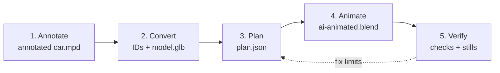
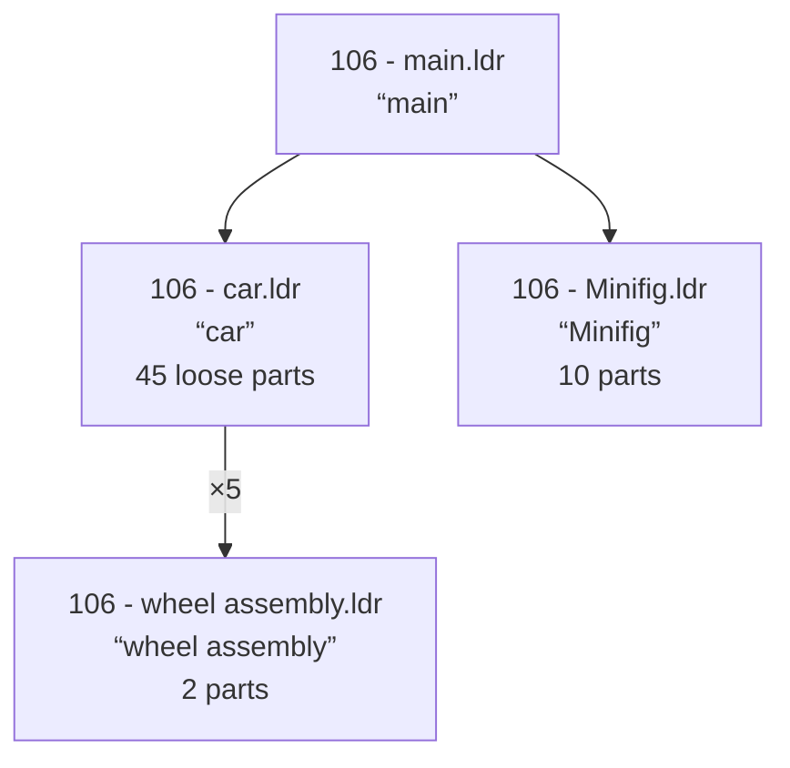
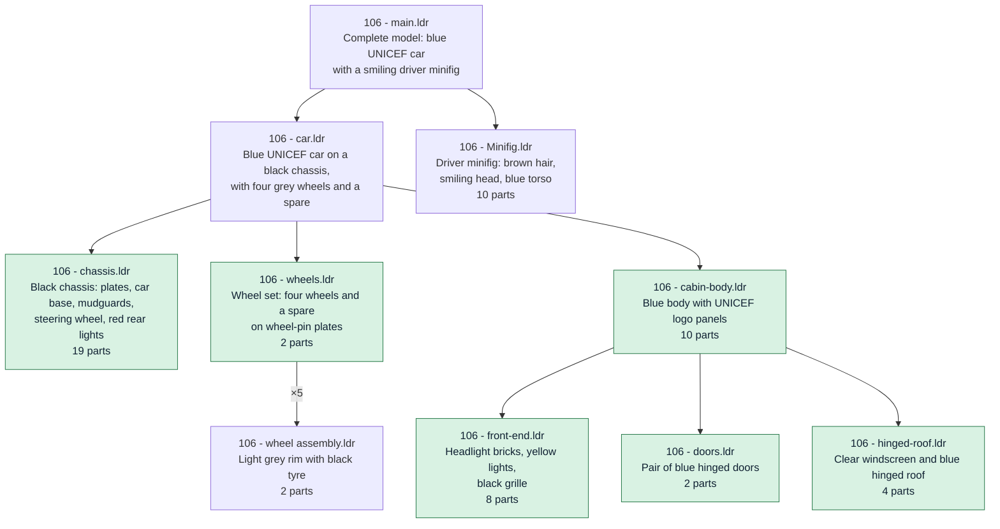
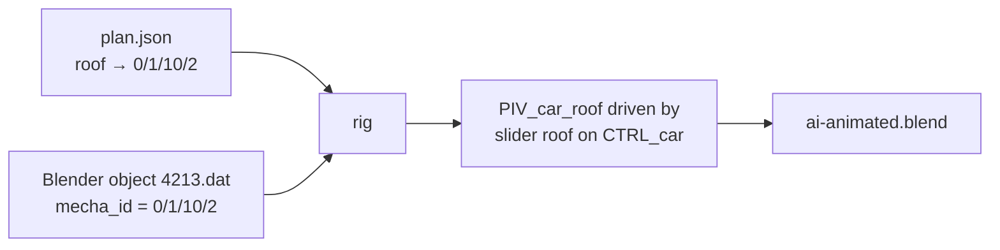

# Reverse engineering a LEGO model into a Blender animation

Agents can reverse engineer an LDraw `.mpd` file, which is only a list of parts, to find the
mechanisms in the model and animate them in Blender. This document describes how to work with
an agent through that process, and what it does under the hood.



| Step | You | The agent | Output |
|---|---|---|---|
| 1. Annotate | Pick an annotated model, or accept the cost of annotating yours | Names and groups the parts | Annotated `car.mpd` |
| 2. Convert | Nothing | Gives every piece an ID, converts to 3D | `plan.json` (draft), `model.glb` |
| 3. Plan | Choose what to animate and deliver | Works out what moves and how | `plan.json` (ready) |
| 4. Animate | Nothing | Builds the rig in Blender | `ai-animated.blend` |
| 5. Verify | Review the result, give feedback | Scans for collisions, renders stills, fixes | Final `.blend` + notes |

## Before you start

- **Setup.** Run `./setup-macos.sh` (or `setup-linux.sh`, `setup-win-wsl.sh`) once. It installs
  Blender, the LDraw parts library and the tools the agent uses. See [docs/setup.md](docs/setup.md).
- **An agent.** Open an LLM coding agent, such as Claude Code or Codex, in this repository. It
  picks up its instructions from [AGENTS.md](AGENTS.md) and [instructions.md](instructions.md).
- **A request.** Name the model, what should move and what you want back:

  > Animate `car.mpd`: open the roof and the doors. Deliver a `.blend` file.

**The example.** We'll use this model, a small car, to illustrate every step of the process:
`car.mpd`, LEGO set 106, a blue UNICEF car with a minifig beside it. It has 65 parts, and its
roof and doors open.


---

## Step 1: Annotate

**You.** You have two options:

- **A) Give the agent an annotated model.** The repository ships 1,821 annotated models in
  `data/models-annotated/`. To pick one, run `python3 model-selector/serve.py`. It opens a
  browser table of every model with its description, a **View 3D** button to inspect it, and
  **Copy path** to put its path (such as `data/models-annotated/106-1.mpd`) on your clipboard.
  Paste the path into your request. The agent uses the model as it is and skips to Step 2.
  See [model-selector/README.md](model-selector/README.md).
- **B) Give the agent an unannotated model**, any `.ldr` or `.mpd` file. The agent annotates it
  first. Before it starts, it tells you the model's size and a token estimate, and asks you to
  confirm. A 65-part car costs little; a model with thousands of parts can cost a lot. If you
  decline, the agent stops: it doesn't animate unannotated models.

The rest of this step describes option B.

**The agent** turns the flat list of parts into a tree of named, described assemblies:

1. Every part gets its name and colour from a parts database: `0 // Plate  2 x 10 (black)`.
2. The agent infers the missing submodels from those names and their order.
3. The file is rewritten as a main model with a tree of submodels, each with a one-line
   description.

**Why.** An LDraw file says *where* parts are, not *what* they form. Named submodels such as
`doors` or `hinged-roof` show the agent where to look for mechanisms in Step 3.

**Under the hood.** `ldraw-annotator prep` adds the part names, with no LLM involved.
`ldraw-annotator prompt` gives the agent its grouping rules. `ldraw-annotator check` verifies
that every part, colour and position survived, and the agent fixes the file until it passes.
Your original file is never changed; the agent works on a copy.

### Before and after

The car below was annotated with
[ldraw-annotator-nova](https://github.com/anteloc/ldraw-annotator-nova).

**Before.** Four submodels with names but no real descriptions. Everything that makes the car
(chassis, body, doors, roof, lights) is one flat list of 45 parts in `car.ldr`.



**After.** The same 45 parts are grouped into the assemblies a builder would name. Every
submodel says what it is. The new submodels are highlighted.



Inside each submodel, every part gets a comment naming it and its colour:

```
Before                                   After
0 FILE 106 - car.ldr                     0 FILE 106 - chassis.ldr
0 car                                    0 Black car chassis: long plates and car base with mudguards, …
0 Name: 106 - car.ldr                    0 Name: 106 - chassis.ldr
…                                        …
1 0 0 0 0 1 0 0 0 1 0 0 0 1 3832.dat     0 // Plate  2 x 10 (black)
                                         1 0 0 0 0 1 0 0 0 1 0 0 0 1 3832.dat
```

---

## Step 2: Convert

**You.** Nothing to do.

**The agent** gives every piece an ID, lists how the pieces connect, and converts the model to
`model.glb`, a glTF 3D file that Blender imports, with each piece's ID and description inside.

**Why.** Blender can't read `.mpd` files. From here on, the plan and Blender must refer to
exactly the same pieces, and the ID is how they do it.

**Under the hood.** One command, `ldraw-mecha prepare`. It writes a draft `plan.json` (every
piece with its ID and position, plus candidate connections and mechanisms, but no motion yet)
and `model.glb`.

### IDs

An ID is a piece's path through the model's tree. Each number is the index of a part or
submodel line inside its parent, counting from 0:

```
0            106 - car.ldr            line 0 of the main model
0/1          106 - cabin-body.ldr     line 1 of car.ldr
0/1/10       106 - hinged-roof.ldr    line 10 of cabin-body.ldr
0/1/10/2     4213.dat                 line 2 of hinged-roof.ldr: the roof
```

Part numbers can't do this job. The car has five identical tyres (`4084.dat`), and each one is
a separate piece that turns on its own: `0/2/0/1` (the spare), `0/2/3/1`, `0/2/4/1`… IDs are
valid for one version of the file; if the file changes, the agent prepares it again.

### IDs in Blender

The converter (`mpd2glb`) keeps the model's tree: one glTF node per part and submodel. It
writes each node's metadata into glTF `extras`, which Blender imports as **Custom
Properties**. The roof's, under **Object Properties → Custom Properties**:

```
fileName       4213.dat
description    Hinge Car Roof  4 x  4
colorCode      1
mecha_id       0/1/10/2
mecha_section  106 - main.ldr
mecha_source   b247a29a…   (SHA-256 of car.mpd)
```

Any Blender object can be traced back to the exact source line, by you and by the agent's
scripts.

### Connection evidence

`prepare` also lists which pieces touch, hinge, share an axle or mesh as gears. For the roof
it finds the hinge between the roof holder `0/1/10/1` and the roof `0/1/10/2`:

```json
"c_5f04a4e8697090b8": {
  "a": "0/1/10/1", "b": "0/1/10/2", "kind": "revolute", "status": "candidate",
  "measurements": { "first_kind": "hinge", "position": [0, -92, 36], "axis": [1, 0, 0] }
}
```

This is evidence, not a decision: a contact may be rigid or may move. Step 3 decides.

---

## Step 3: Plan

**You.** The agent lists the mechanisms it found and asks what you want. Typical questions:

- Which mechanisms to animate? (For the car: roof, doors, wheels.)
- One animation of the whole model, or each mechanism on its own?
- What to deliver: a `.blend` file, stills, a video?
- For big models: hide the bodywork? Leave out hoses and cables?

Answer them; the rest of the work follows from your answers. For examples, see the questions
asked in [42083](samples/42083-mechanisms.md), [42110](samples/42110.md) and
[minifigs](samples/minifigs.md).

**The agent** decides, for each mechanism, which pieces move, around which point and axis, how
far, and what drives them, and records it in `plan.json`.

This is where the reverse engineering happens. Nothing in `car.mpd` says the roof opens: the
agent infers it from a roof, a roof holder and the hinge between them.

**Why.** Motion must be measured, not guessed. A wrong axis or gear ratio looks broken. The plan
keeps every decision with its evidence, and it can be checked without Blender.

For the roof, the agent takes the hinge position and axis from the evidence, picks the axis
sign that lifts the roof (LDraw's up is −Y), and writes:

```json
"controls": { "roof": { "min": 0, "max": 1.309, "unit": "radian", "description": "Open the roof" } },
"bodies":   { "roof": { "instances": ["0/1/10/2"], "kind": "revolute",
                        "origin": [0, -92, 36], "axis": [-1, 0, 0], "signal": "roof" } }
```

In words: the control `roof` turns the piece `0/1/10/2` from 0 to 75° (1.309 rad) around the
hinge. Positions are in LDraw units (LDU; 1 stud = 20). Hinges, sliders, gear trains,
connecting rods and springs all use this format; see [docs/motion-plan.md](docs/motion-plan.md).

**Under the hood.** The agent edits `plan.json` through a small Python API, then runs
`ldraw-mecha check`, which validates the plan and sweeps every control through its range
without Blender.

### How agents work out a plan

Strategies used across the [samples](GALLERY.md):

1. **Read the tree and descriptions.** Submodels named `doors`, `hinged-roof` or `wheels` are
   the first candidates.
2. **Read the connection evidence.** Hinges, shared axles and gear meshes give positions and
   axes. Scans can miss things: in [42110](samples/42110.md), some gears were hidden from the
   first scan.
3. **Ask you for the scope**, as above.
4. **Work on a copy when the source falls short.** Extract one mechanism, split parts stored as
   one piece, add missing parts. Your original is never changed.
   ([42043 crane](samples/42043-crane.md), [3625](samples/3625.md),
   [42083](samples/42083-mechanisms.md))
5. **Compare with a reference.** Use a hand-made rig or an official set with the same parts.
   ([42000](samples/42000.md), [movables](samples/movables.md), [plants](samples/plants.md))
6. **Do the maths.** Gear ratios, rod lengths, every gear combination.
   ([42000](samples/42000.md), [42110](samples/42110.md))

### Look inside: x-ray boards

Mechanisms are usually hidden behind bodywork. Before building anything, the agent renders an
x-ray board of each moving body: the body in colour, everything else ghosted. It checks every
board for four things:

1. Exactly the right pieces are coloured.
2. The axis runs through the hinge, axle or pin.
3. Positive angles turn the right way.
4. The limit poses stay clear of grey neighbours.

The car's roof (image by [ldraw-xray](https://github.com/anteloc/ldraw-xray), which has more
examples):


*Coloured: the moving piece. Ghosted: the rest of the car. Green rod: the hinge axis (drawn
in, not a LEGO part). Panels 3 to 5: the roof at 0°, 40° and 75°.*

---

## Step 4: Animate

**You.** Nothing to do.

**The agent** builds the plan in Blender, adding a pivot per moving body, a slider per control
and a demonstration animation, and saves `ai-animated.blend`.

**Why.** The result is a standard `.blend` file. It plays in plain Blender with no add-on, no
Python auto-run and no agent.



**Under the hood.** `ldraw-mecha rig` runs Blender in the background and:

1. Imports `model.glb` and finds each object by its `mecha_id`.
2. Checks it's the right model: the `mecha_source` hash matches the plan, and every object is
   still at its source position.
3. Adds a pivot per body at the plan's origin and axis, parents the body's objects to it, and
   drives the pivot from a custom property on one control object, `CTRL_car`.
4. Keys the controls into a demonstration animation.
5. Compares every moving object against the plan, then saves.
6. Opens the saved file in a fresh Blender and compares again.

---

## Step 5: Verify

**The agent** scans the motion for collisions, renders stills and looks at them, and fixes
what it finds. A rig can match the plan exactly and still be wrong, for example a door that
swings through the bodywork.

- **Collisions.** What the scan finds goes **back to Step 3**. At 90° the car's doors and roof
  hit other parts, so the agent set their limit to 75°. ([106](samples/106.md),
  [hot rod mecha](samples/hot-rod-mecha.md))
- **Stills.** These catch what numbers miss: a window opening away from the viewer, a staff
  swinging into a leg. ([movables](samples/movables.md), [minifigs](samples/minifigs.md))

**You.** Open the `.blend`, select `CTRL_car`, and drag its sliders under **Object Properties →
Custom Properties**, or press play. Tell the agent what's wrong or missing. In the
[hot rod mecha](samples/hot-rod-mecha.md) sample, the user pointed out that "the engine on the
robot's chest … should be animated, too", and the agent added it.

**What you get back:** clickable links to the `.blend` file, the x-ray boards, the stills, the
plan, the check reports, and the agent's notes on what it decided, what it left out and the
known limits. In VS Code, clicking a link also selects the file in the Explorer. The agent
then offers to open the `.blend` in Blender for you; say yes, and Blender opens with the
animated model, ready to play.

**Limits.** The collision scan checks sampled poses, not the continuous motion. Parts are rigid,
with no friction, play or forces. Passing checks don't prove the model is physically buildable
or working.

---

## Learn more

- [GALLERY.md](GALLERY.md): ten models done this way, each with the request, what happened and
  every output file.
- [docs/how-it-works.md](docs/how-it-works.md): the design behind each step.
- [docs/motion-plan.md](docs/motion-plan.md): the plan format: joints, gears, rods, equations.
- [docs/validation.md](docs/validation.md): what each check proves, and what it doesn't.
