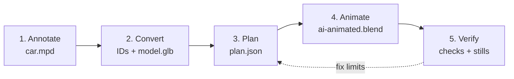
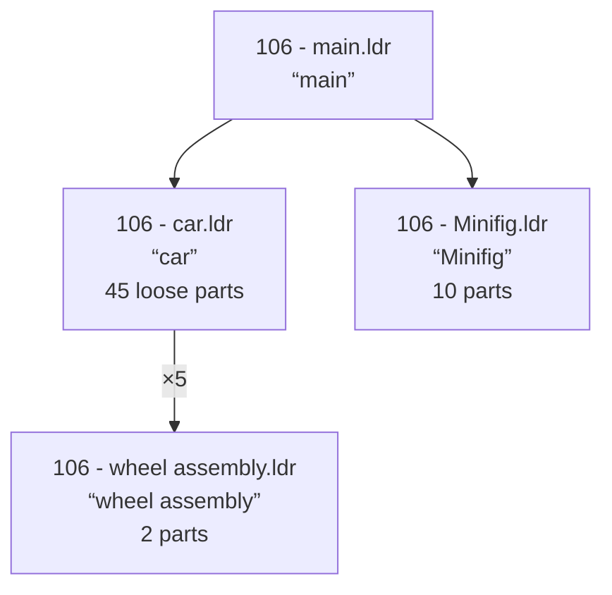
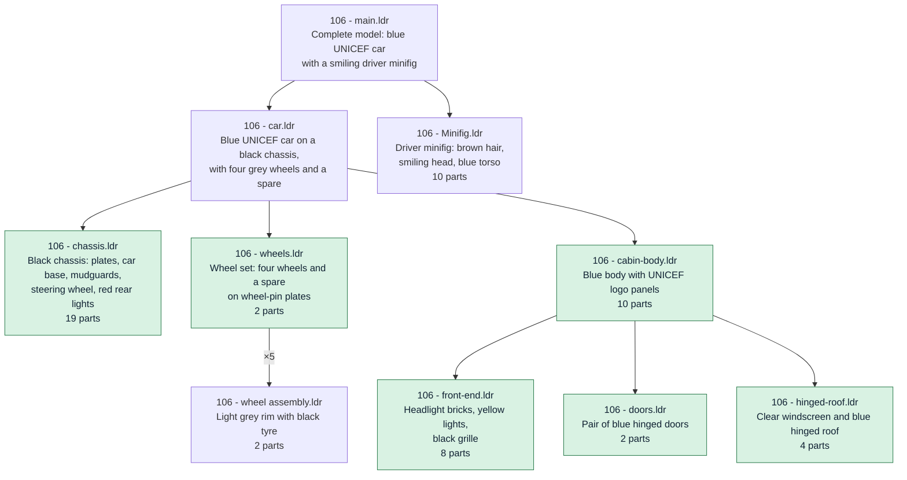
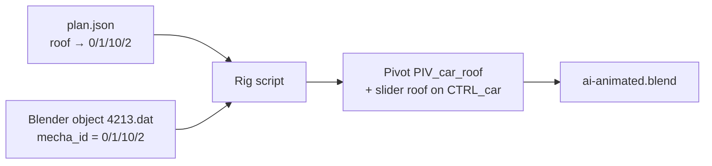

# From LEGO model to Blender animation

This page walks through the whole process, from a plain LEGO model file to an animated
Blender file, in five steps. Each step says **what** it does and **why** it's needed.



**The example.** Every step uses the same small model: LEGO set 106, a blue UNICEF car
with a minifig standing beside it. Its file is `car.mpd`, an [LDraw](https://www.ldraw.org/)
model: a text file that lists every LEGO part, its colour and its position.


---

## Step 1: Annotate

**What.** Annotation turns a bare list of parts into a model a person (or an agent) can read:

1. Every part gets its name and colour from a parts database, such as `Plate 2 x 10 (black)`.
2. Agents look at those names and their order to find the assemblies the model is made of:
   chassis, doors, roof, wheels…
3. The file is rewritten as a main model with a tree of named, described submodels.

Nothing is lost: every part, colour and position is still there.

**Why.** An LDraw file says *where* parts are, not *what* they form. Once each assembly is
a named, described submodel, other agents (such as Claude Sonnet 5.5) can spot the ones that
are mechanisms, like `doors` or `hinged-roof`, and work out how they move.

### Before and after

**Before.** Four submodels with names but no real descriptions. Everything that makes the car
(chassis, body, doors, roof, lights) is one flat list of 45 parts in `car.ldr`.



**After.** The same 45 parts are grouped into the assemblies a builder would name. Every
submodel says what it is. The new submodels are highlighted.



Inside each submodel, every part gets a comment naming it and its colour:

```
Before                                   After
0 FILE 106 - car.ldr                     0 FILE 106 - chassis.ldr
0 car                                    0 Black car chassis: long plates and car base with mudguards, …
0 Name: 106 - car.ldr                    0 Name: 106 - chassis.ldr
…                                        …
1 0 0 0 0 1 0 0 0 1 0 0 0 1 3832.dat     0 // Plate  2 x 10 (black)
                                         1 0 0 0 0 1 0 0 0 1 0 0 0 1 3832.dat
```

These results were produced with
[ldraw-annotator-nova](https://github.com/anteloc/ldraw-annotator-nova).

---

## Step 2: Convert

**What.** The toolkit gives every piece in `car.mpd` an ID. It then converts the model into
`model.glb`, a standard 3D file that Blender can open, with each piece's ID and description
stored inside.

**Why.** Blender doesn't read `.mpd` files. And from here on, the plan and Blender must talk
about *exactly the same pieces*. The ID is the name they share.

### IDs: one name per physical piece

An ID is the piece's path through the model's tree. Each number is the position of a part or
submodel line inside its parent, counting from 0:

```
0            106 - car.ldr            1st line of the main model
0/1          106 - cabin-body.ldr     2nd line of car.ldr
0/1/10       106 - hinged-roof.ldr    11th line of cabin-body.ldr
0/1/10/2     4213.dat                 3rd line of hinged-roof.ldr: the roof
```

**Why IDs?** Part numbers aren't enough. The car has five identical tyres, all `4084.dat`, but
each is a separate piece that may turn on its own. Their IDs tell them apart: `0/2/0/1` (the
spare), `0/2/3/1`, `0/2/4/1`… IDs are fixed for a given version of the file, so every tool
points at exactly the same piece.

### IDs in the 3D model

The converter (`mpd2glb`) keeps the model's tree: one 3D object per part and submodel. Into each
object it writes extra data: the part's description from the database, and its ID. When Blender
imports the file, that extra data becomes the object's **Custom Properties**. Here is what the
roof shows in **Object Properties → Custom Properties**:

```
fileName       4213.dat
description    Hinge Car Roof  4 x  4
colorCode      1
mecha_id       0/1/10/2
mecha_section  106 - main.ldr
mecha_source   b247a29a…   (fingerprint of car.mpd)
```

The objects in Blender mirror the `.mpd` file. Any object can be traced back to the exact
source part, by people and by scripts.

While converting, the toolkit also lists which parts touch, hinge, share an axle or mesh as
gears. That list is the starting point for the next step.

---

## Step 3: Plan

**What.** An agent studies the model and decides, for each mechanism, which parts move, around
which point and axis, how far, and what drives them. It writes those decisions, by ID, into a
motion plan: `plan.json`.

**Why.** Motion must be measured, not guessed. A door opened around the wrong axis, or a gear
turning at the wrong speed, looks broken. The plan records every decision with its evidence,
so it can be checked before anything reaches Blender.

For the car's roof, the plan says:

```json
"controls": {
  "roof": { "min": 0, "max": 1.309, "unit": "radian", "description": "Open the roof" }
},
"bodies": {
  "roof": {
    "instances": ["0/1/10/2"],
    "kind": "revolute",
    "origin": [0, -92, 36],
    "axis": [-1, 0, 0],
    "signal": "roof"
  }
}
```

In words: the control `roof` (0 to 75°) turns piece `0/1/10/2` around the hinge axis.
Positions are in LDraw units (1 stud = 20).

### How agents work out the plan

Across the [samples](GALLERY.md), agents use the same handful of strategies:

1. **Read the tree and the descriptions.** Submodels named `doors`, `hinged-roof` or
   `wheels` are the first candidates.
2. **Read the connection data.** For the car, it shows the hinge between the roof and its
   holder. ([42110](samples/42110.md): gears hidden from the first scan.)
3. **Ask the user for the scope.** Which mechanisms to animate, and what to deliver:
   a file, stills or a video. ([42083](samples/42083-mechanisms.md), [42110](samples/42110.md))
4. **Work on a copy when the source isn't enough.** Take one mechanism out of a big model,
   split parts stored as one piece, or add parts missing from the file. The original is never
   changed. ([42043 crane](samples/42043-crane.md), [3625](samples/3625.md),
   [42083](samples/42083-mechanisms.md))
5. **Compare with a reference.** Use a hand-made rig or an official LEGO set that uses the same
   parts. ([42000](samples/42000.md), [movables](samples/movables.md), [plants](samples/plants.md))
6. **Do the maths.** Gear ratios, connecting-rod lengths, every gear combination.
   ([42000](samples/42000.md), [42110](samples/42110.md))

### And above all: look inside

The strongest check is visual. Mechanisms are usually hidden inside the model, behind
bodywork. An **x-ray view** ghosts everything else, so the agent can **see inside** the model:
which parts move, where the axis runs, and how the parts look at each test angle.


*The car's roof. The moving part is in colour and the rest of the car is ghosted. The green
rod is the hinge axis, drawn in for the check (it isn't a LEGO part). Panels 3 to 5 show the
roof at 0°, 40° and 75°.*

The x-ray tool, with more examples, is [ldraw-xray](https://github.com/anteloc/ldraw-xray).

### What the planning leaves behind

| File | What it is | Why it's kept |
|---|---|---|
| `plan.json` | The motion plan: moving parts, axes, limits, controls | Everything after is built from it |
| `preparation.json` | The toolkit's first look: parts, connections, warnings | Starting point for the plan |
| Connection data (`evidence/`, `*-contact.json`) | Which parts touch, hinge or mesh | Where the axes come from |
| `xray/<joint>/mosaic.png` | X-ray boards, one per joint | Visual proof of each axis |
| `kinematics.json` | Gear and linkage maths | Proof that ratios and lengths hold |
| Extracted source + `idmap.json` | A mechanism taken out as its own model, mapped back to the original | When only part of a model is animated |
| `check.json` | Automatic checks of the plan | Shows the plan is complete and consistent |
| `REPORT.md`, `README.md`, `CATALOG.md` | The agent's own notes | Explains choices and limits to people |

Not every model needs all of them: the car needed only the plan and its roof-hinge
connection data.

---

## Step 4: Animate

**What.** A script applies the plan in Blender: each moving group of parts gets a pivot, each
control gets a slider, and the sliders are keyed into an animation saved as
`ai-animated.blend`.

**Why.** Blender is where you see and use the result. The rig plays back in plain Blender: no
add-on, and no agent needed.



The script reads the plan, then:

1. finds each Blender object by its `mecha_id`;
2. checks it's the right model: same file fingerprint, and every part still in its original place;
3. adds a pivot at each joint, parents the moving parts to it, and drives the pivot from a slider
   on one control object (`CTRL_car`);
4. keys the sliders into an animation and saves `ai-animated.blend`.

To move the car yourself, open the `.blend`, select `CTRL_car` and drag its sliders under
**Object Properties → Custom Properties**.

---

## Step 5: Verify

**What.** The finished file is checked against the plan, scanned for collisions and looked at.

**Why.** A rig can follow the plan exactly and still look wrong: a door can swing through the
bodywork, or a camera can cut off a raised crane. Each check catches a different kind of
mistake.

- **Reopen.** The saved file is opened in a fresh Blender and checked against the plan
  again, so it works on its own.
- **Collisions.** The motion is sampled and scanned for parts passing through each other.
  What it finds goes **back to the plan**: the car's doors and roof hit other parts at 90°,
  so their limit became 75°. ([106](samples/106.md), [hot rod mecha](samples/hot-rod-mecha.md))
- **Stills.** A few poses are rendered and looked at, like the image at the top of this page.
  They catch what numbers miss: a window opening away from the viewer, a staff swinging into
  a leg. ([movables](samples/movables.md), [minifigs](samples/minifigs.md))

These checks sample the motion; they don't prove it is physically possible. Each sample's
summary lists its known limits.

---

## Learn more

- [How it works](docs/how-it-works.md): the same process, in more depth.
- [Workflow](docs/workflow.md): the commands behind each step.
- [Samples gallery](GALLERY.md): ten models animated this way, with videos.
