# How ldraw-mecha works

**In one sentence:** ldraw-mecha takes a digital LEGO model, turns it into a
Blender puppet whose moving parts follow real mechanical rules, and then
checks that the puppet moves exactly as those rules say.

This guide explains the idea first, then each step, then how the code is
organised. It assumes no previous knowledge of LDraw, Blender rigging or the
codebase. Words in *italics* are listed in the [glossary](#8-glossary).

**Contents**

1. [The big picture](#1-the-big-picture)
2. [The one idea to remember: strings and a puppet](#2-the-one-idea-to-remember-strings-and-a-puppet)
3. [Step by step](#3-step-by-step)
4. [Try it: the 106 car in six commands](#4-try-it-the-106-car-in-six-commands)
5. [Map of the code](#5-map-of-the-code)
6. [Class diagrams](#6-class-diagrams)
7. [What it does not promise](#7-what-it-does-not-promise)
8. [Glossary](#8-glossary)

---

## 1. The big picture

You start with an *LDraw* file: a plain-text list of LEGO parts with their
positions, the digital version of a building-instructions booklet. You end
with a Blender file in which you can drag a slider and watch a door swing,
a gearbox turn or a piston pump.

The journey has three phases:

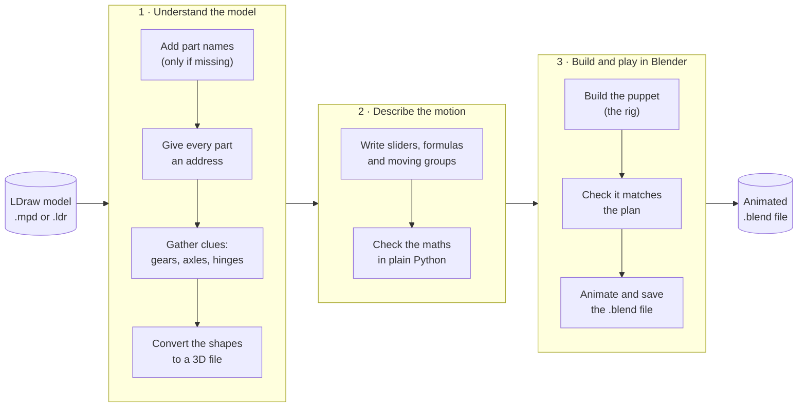

The same eight steps, each with an everyday comparison:

| # | Step | Think of it as… | Where it happens |
| --- | --- | --- | --- |
| 1 | Add part names | Labelling every bag in a LEGO set | `annotate`, `annotate-semantics` |
| 2 | Give every part an address | Seat numbers in a stadium | [source.py](../ldraw_mechanisms/source.py), run by `prepare` |
| 3 | Gather clues | A detective collecting evidence, but not judging | `prepare` ([analysis.py](../ldraw_mechanisms/analysis.py), [geometry.py](../ldraw_mechanisms/geometry.py)) |
| 4 | Convert to 3D | Exporting a drawing to a 3D model file | `prepare` or `convert` ([glb.py](../ldraw_mechanisms/glb.py)) |
| 5 | Write the plan | Writing a recipe | edit `plan.json`, or `plan --recipe` |
| 6 | Check the plan | A spell-checker plus a calculator | `validate`, `evaluate`, `sweep`, `audit` |
| 7 | Build the puppet | Tying strings to a marionette | `rig` ([blender.py](../ldraw_mechanisms/blender.py)) |
| 8 | Check and animate | A test drive, then filming it | `rig --animate`, animation scripts |

Everything about the motion lives in **one file, `plan.json`**. Every later
step reads that file, so there is only one place to edit and one place to look.

---

## 2. The one idea to remember: strings and a puppet

A finished rig works like a marionette:

- you pull a few **strings** (the *controls*, sliders in Blender);
- the strings run over **pulleys** that turn one movement into another (the
  *signals*, small formulas);
- the pulleys move **wooden limbs** (the *bodies*, groups of parts that move
  together);
- the limbs carry the **LEGO parts**.

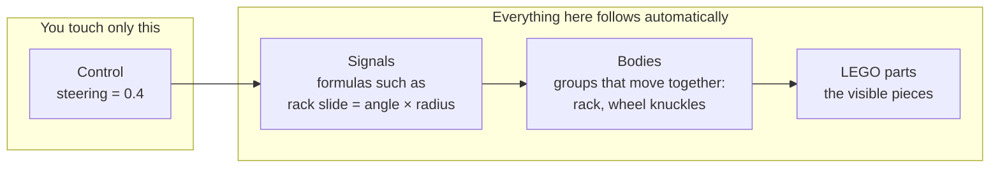

So **an animation is only keyframes on the controls.** Turn the steering slider
and the gears, rack and front wheels all follow, because formulas connect them.

The same formulas run in two places: in plain Python (to check the maths) and
inside Blender (to move the model). Because both calculate independently,
either one can check the other at any moment.

---

## 3. Step by step

### 3.1 Add part names (only for files that lack them)

Raw LDraw files list parts by number. This line places part `3022` at
position (0, 80, 8):

```plaintext
1 0 80 8 0 1 0 0 0 1 0 0 0 1 3022.dat
```

`annotate` writes a copy with a readable comment above each part:

```plaintext
0 // Plate  2 x  2 (black)
1 0 80 8 0 1 0 0 0 1 0 0 0 1 3022.dat
```

Next, the agent (a person or an AI) writes one descriptive line for the model
and each sub-assembly, applied with `annotate-semantics`. Finally the agent
checks that sensible groups exist, for example "wheel assembly" or "cab",
and adds missing ones. Every physical part must survive this regrouping
exactly once, in the same place and colour. Models that are already annotated
skip this step.

### 3.2 Give every part an address

LEGO models nest: a car contains wheel assemblies, and each wheel assembly
contains a rim and a tyre. ldraw-mecha gives every placed part an *occurrence
ID*, an address that follows that nesting. These are the real addresses in
the 106 car:

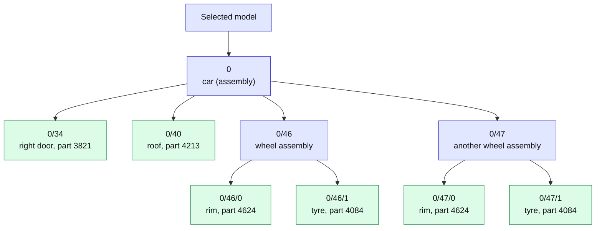

Read `0/46/1` like a postal address: item 1 inside item 46 inside item 0.
A few properties make addresses useful:

- **Repeats get different addresses.** All four tyres are part 4084, yet each
  has its own address, so each can move on its own.
- **Addresses belong to one version of the file.** The file is fingerprinted
  (SHA-256). If it changes, the plan reports it as stale rather than silently
  pointing at the wrong part, much like a seat number that is only valid for
  one concert.
- **Positions add up.** A tyre's position in the world is the car's position
  combined with the tyre's position inside the car:
  `world = parent's world × local`.

The complete list (address, part, colour, position and description of every
part) is called the *source manifest*. It is built by `Document.manifest()` in
[source.py](../ldraw_mechanisms/source.py).

### 3.3 Gather clues, but do not decide

The tool behaves like a detective. It collects evidence about which parts
might move, but it never decides on its own. Deciding is the agent's job.

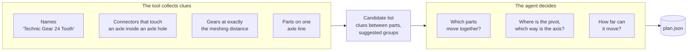

Why not let the tool decide? A clue such as "this axle touches this beam"
cannot tell whether the axle spins freely in a round hole or is locked in a
cross-shaped one. Getting that wrong would produce a confident but wrong
animation, so every clue is stored with the status `candidate` until someone
reviews it.

The four kinds of clue:

| Clue | How it is found | Example |
| --- | --- | --- |
| **Names** | Searching part descriptions for words like *gear, hinge, axle, piston, spring* | "Hinge Car Roof 4 x 4" |
| **Touching connectors** | pyldraw3 compares the connection points of neighbouring parts (from the LDCad *shadow library*) | An axle end sitting in an axle hole |
| **Meshing gears** | Two gears in the same plane whose centres are exactly *radius + radius* apart | See below |
| **Shared axle lines** | The rotation axes of two parts line up | A gear and the axle through it |

**Gear example.** Gear radius is 1.25 LDU per tooth, so an 8-tooth gear has
radius 10 and a 24-tooth gear has radius 30:

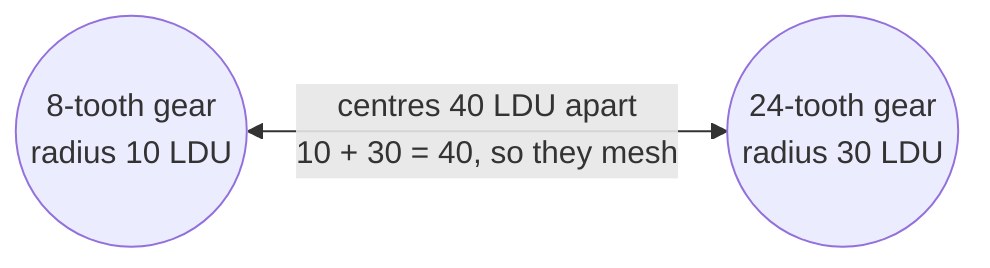

40 LDU is exactly two studs, the classic Technic spacing. The tool also
records the ratio: the small gear turns three times for each turn of the big
one, in the opposite direction.

**Suggested groups.** Clues are chained like friends of friends: if gear A
meshes with gear B, and B sits on axle C, then A, B and C are suggested as
one group to review:

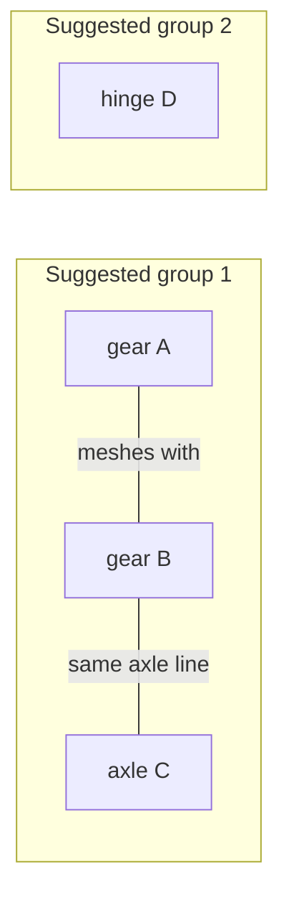

These groups are starting points for review. They are not final moving parts.

**A practical detail.** Some files store rotations that are very slightly
crooked from rounding (0.707 instead of 0.70710678…). That tiny error can hide
an axle contact, so for analysis only the tool straightens them
([placements.py](../ldraw_mechanisms/placements.py)). The file itself is never
changed.

`prepare` saves the clues into `plan.json` (with no motion yet), a summary in
`preparation.json`, and the 3D model in `model.glb`.

### 3.4 Write the plan

The plan is the recipe for the motion. It has three areas:

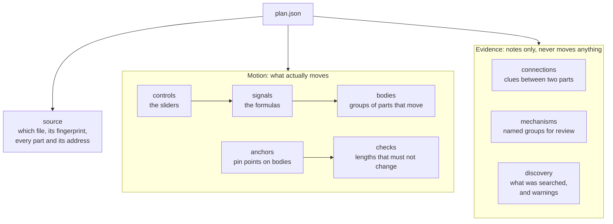

The smallest useful plan opens the 106 car's roof by up to 75 degrees
(1.309 radians):

```json
{
  "controls": {
    "open": {"default": 0, "min": 0, "max": 1.3089969389957472,
             "unit": "radian", "description": "Open the roof"}
  },
  "signals": {
    "lid_angle": {"expression": "clamp(a,0,1.3089969389957472)",
                  "variables": {"a": "control:open"}}
  },
  "bodies": {
    "lid": {"instances": ["0/40"], "kind": "revolute",
            "origin": [0,-92,36], "axis": [-1,0,0], "signal": "lid_angle"}
  }
}
```

Read it as: *the slider `open` feeds the formula `lid_angle`, which rotates
part `0/40` (the roof) around a hinge at (0, −92, 36) along the −X axis.*

#### Controls and signals work like a spreadsheet

If you have used a spreadsheet, you already know how signals work:

| Spreadsheet | Plan |
| --- | --- |
| A cell you type a number into | a **control** |
| A cell with a formula, `=B1*3` | a **signal** |
| The cells a formula refers to | the signal's **variables** |
| Recalculating in the right order | `signal_order` sorts formulas so inputs come first |
| "Circular reference" error | a loop between signals is rejected |

A steering system is a chain of such cells (simplified from the 42000 car
recipe):

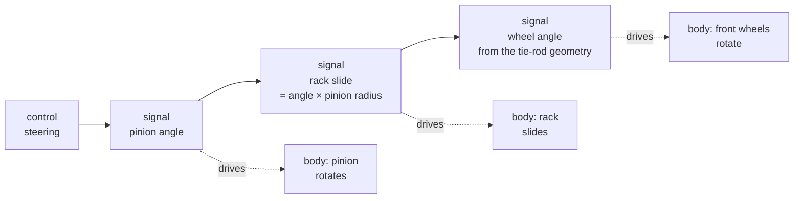

Formulas are deliberately limited so that Blender can run them natively:
numbers, `+ - * / ** %`, `pi`, and `sin cos tan asin acos atan atan2 sqrt floor
ceil min max abs pow clamp`. Each formula is at most 255 characters, and
anything else is refused ([plan.py](../ldraw_mechanisms/plan.py)).

#### Bodies: the five ways a group of parts can move

A *body* is a group of parts that move as one rigid piece. Each body has a
pivot point (`origin`), a direction (`axis`) and one of five kinds:

| Kind | Moves by… | Everyday example |
| --- | --- | --- |
| `revolute` | rotating around the axis | a door hinge, a wheel |
| `prismatic` | sliding along the axis | a drawer, a piston |
| `stretch` | getting longer or shorter along the axis | a coil spring (springs only) |
| `rod` | pointing from one pin to another | the arm linking a bicycle pedal to a pump |
| `fixed` | not moving on its own, only riding on its parent | a sticker on a door |

Rule: **each part belongs to at most one body.** A part cannot be in two
places at once.

#### How a rotation around a hinge is calculated

Rotating "by 30 degrees" only makes sense around a particular point. A door
turns around its hinge, not around the corner of the room. The maths does it
in three moves:

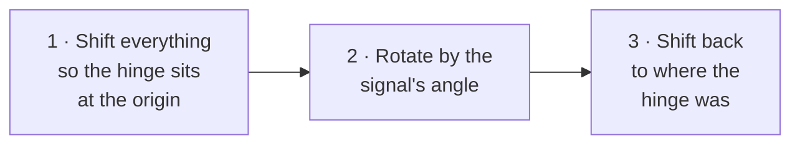

As a formula: `move = F · Rotate(angle) · F⁻¹`, where `F` is the hinge's
position and orientation (its *frame*, built so that the joint axis is the
frame's Z axis). A part's new position is `move × its original position`.
Sliding and stretching use the same three moves with "slide along Z" or
"stretch along Z" in the middle ([math3d.py](../ldraw_mechanisms/math3d.py)).

#### Motion that rides on motion (parents)

A body can have a **parent**. It then moves with its parent and adds its own
movement on top, like a crane:

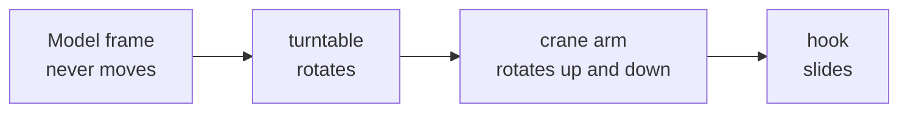

The hook's total motion is the turntable's movement, then the arm's, then
its own: `hook total = turntable × arm × hook`.

#### Rods: links pinned at both ends

A connecting rod has no hinge of its own. Each end is pinned to something
else that moves. The plan marks the two pin points as *anchors*, and the rod
simply sits on the first pin and points at the second:

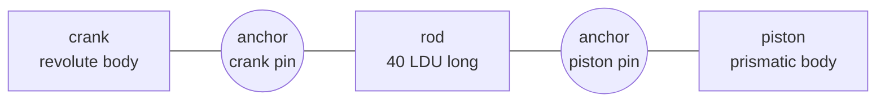

The rod must never stretch to hide a mistake, so every rod requires a
**distance check**: the two pins must stay 40 LDU apart, give or take
0.02 LDU. If the formulas move the piston wrongly, this check fails.

#### Helpers that write plans for you

| Helper | What it saves you |
| --- | --- |
| `mechanisms.add_joint` | Adds one hinge or slider: a control, its formula and its body |
| `recipes.Builder` and the recipes `106`, `928`, `42000`, `42083`, `10265` | Complete, studied plans for those exact models |
| `recipes.slider_cranks` | Piston formulas for an engine |
| `math3d.signed_gear_ratio`, `rack_ratio` | Gear and rack ratios with the right direction |
| `linkages.universal_joint`, `ball_link` | Exact formulas for a cardan joint and a ball link |
| `scripts/build_*.py` | Large builders for specific models: Defender, Chiron, minifigs, movables, plants |
| `scripts/extract_subsystem.py` | Saves one mechanism on its own, without the rest of the vehicle |
| `scripts/split_shortcuts.py` | Splits a one-piece part (such as a whole shock absorber) into its real sub-parts, so a spring can stretch |

### 3.5 Check the plan, no Blender needed

Four checks run in plain Python:

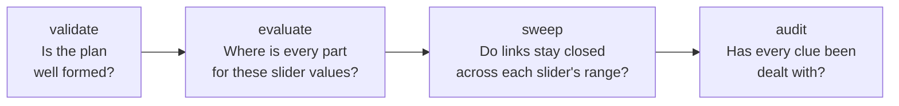

| Check | Catches, for example |
| --- | --- |
| `validate` | a typo in a formula, a part in two bodies, a rod without a distance check, a changed source file |
| `evaluate` | shows the position of every moving part for any slider values you choose |
| `sweep` | a linkage that comes apart halfway through a slider's travel |
| `audit` | a suggested mechanism nobody has reviewed yet |

When the motion is decided, the plan's `status` changes from `draft` to
`ready`. Only ready plans can be built into a rig.

### 3.6 Convert to 3D and attach name tags

The exporter `mpd2glb` turns the LDraw file into a standard 3D file
(`model.glb`). LDraw and Blender measure differently, which the conversion
handles:

| | LDraw | Blender |
| --- | --- | --- |
| Which way is up? | −Y | +Z |
| Unit | LDU (1 LDU = 0.4 mm; one stud = 20 LDU) | metre |
| Conversion | `C(x, y, z) = (x, −z, y)`, scale 0.0004 m per LDU | |

The 3D file does not know the part addresses, so
[glb.py](../ldraw_mechanisms/glb.py) attaches a **name tag** (`mecha_id`) to
each 3D object. Like a check-in desk comparing a passport photo, it only tags
an object after confirming the match:


Two identical parts at exactly the same spot are interchangeable and are
tagged in file order. Every object also gets the file's fingerprint
(`mecha_source`), so Blender can tell which plan it belongs to.

### 3.7 Build the puppet in Blender

Blender has a feature called a *driver*: a property whose value is computed
by a formula, much like a spreadsheet cell. The rig is built entirely from
drivers and helper objects called *empties* (invisible handles). Nothing else
is needed, so the rig keeps working after you save, close and reopen the file:
no add-on and no scripts that run on opening.

For the roof, the wiring is:

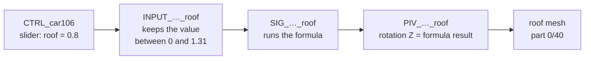

And this is how the objects are arranged inside the scene:

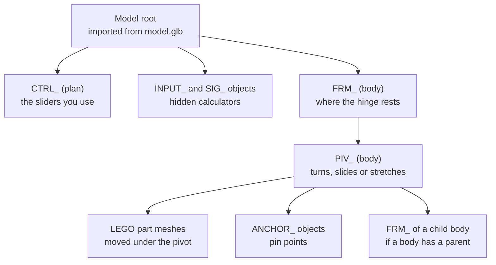

| Object name | Job |
| --- | --- |
| `CTRL_<plan>` | Holds one slider (custom property) per control. This is what you animate. |
| `INPUT_<plan>_<control>` | Keeps the slider value within its allowed range |
| `SIG_<plan>_<signal>` | Calculates one formula |
| `FRM_<plan>_<body>` | Marks where the joint sits at rest |
| `PIV_<plan>_<body>` | Moves: its Z rotation, Z position or Z scale follows the formula |
| `ANCHOR_<plan>_<anchor>` | A pin point that rides on a body |

A **rod** uses three ordinary Blender constraints: *copy location* (stick to
the first pin), *damped track* (point at the second pin) and *locked track*
(keep from rolling over).

Before moving any part into the rig, the builder saves where the part was.
The rig can therefore be removed later and every part returns exactly to its
original place. The full plan is also stored inside the .blend file.

### 3.8 Check: two calculators must agree

After building, `verify` acts as an exam: Blender and the Python evaluator
calculate the same poses separately, and the answers must match.

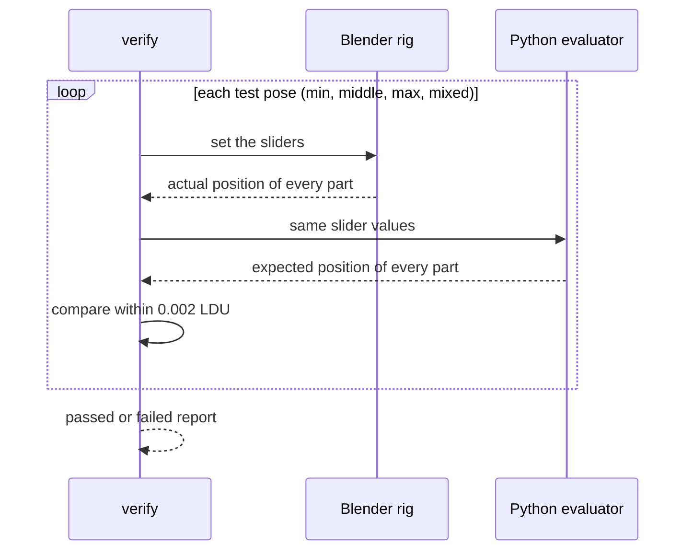

0.002 LDU is less than a thousandth of a millimetre. The check also confirms
that parts which should stay still did not move, that rods kept their length,
and that every driver is valid.

### 3.9 Animate

Animating means keyframing the **sliders only**. The drivers then move
everything else:

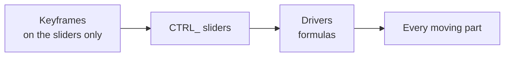

It is like recording only a car's steering wheel and pedals: a replay can
rebuild everything else. Because every frame is just a set of slider values,
any frame can be checked with the Python evaluator.

Where the keyframes come from:

| Source | What it does |
| --- | --- |
| `rig --animate` | A short demo for every slider: rest at frame 1, maximum at 40, minimum at 80, rest again at 120 |
| `animate_defender.py` | A driving sequence for the 42110 Defender: wheels at different speeds in corners, gears changing smoothly |
| `minifig_clips.py`, `movable_clips.py` | Reusable clips (wave, walk, open, close) using Blender's own easing curves, reproduced in Python |
| `wind_clips.py` | Plants swaying in a simulated wind, calculated step by step and saved as keyframes |

Reusable clips are stored as Blender *Actions* and arranged on *NLA tracks*,
Blender's clip library and timeline.

Extra checks before delivery:

- **Clearance** (`check_clearance`): moves the sliders step by step and reports
  parts that start to overlap, like checking that a door does not hit the
  frame.
- **Reopen**: opens the saved file in a fresh Blender to confirm the controls
  still work.
- **Lifecycle**: moves the whole model, makes copies, and rebuilds and removes
  the rig to confirm nothing breaks.

---

## 4. Try it: the 106 car in six commands

```sh
./setup.sh
export LDRAW_DIR=/path/to/ldraw

# Steps 2–4: addresses, clues and the 3D file
./ldraw-mecha prepare data/models-annotated/106-1.mpd --output output/study

# Step 5: use the studied recipe for this car as the motion
./ldraw-mecha plan data/models-annotated/106-1.mpd --recipe 106 \
  --study output/study/plan.json --output output/study/plan.json

# Step 6: check the plan
./ldraw-mecha audit output/study/plan.json
./ldraw-mecha validate output/study/plan.json
./ldraw-mecha sweep output/study/plan.json --output output/study/sweep.json

# Steps 7–9: build, check and animate in Blender
./ldraw-mecha rig output/study/plan.json --glb output/study/model.glb \
  --save output/study/rigged.blend --report output/study/blender-check.json --animate
```

Open `output/study/rigged.blend`, select `CTRL_car106` and look under
**Object Properties → Custom Properties** for the doors, roof and wheels.

---

## 5. Map of the code

The code is arranged in layers. Each layer only feeds the ones after it.

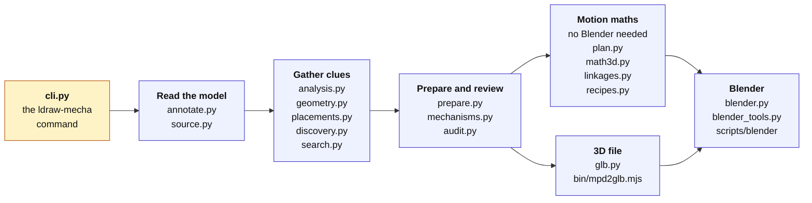

The command line (`cli.py`) is the front door: each `ldraw-mecha` command
calls into one of these layers.

| Layer | In one line |
| --- | --- |
| Read the model | Parse LDraw with pyldraw3, give parts addresses, add names |
| Gather clues | Find contacts, gear meshes and shared axles, and search the part catalogue |
| Prepare and review | Save clues and suggested groups, merge recipes, report what is still unreviewed |
| Motion maths | Check and calculate the plan; no Blender or pyldraw3 needed, so Blender can reuse it |
| 3D file | Run the exporter, then attach name tags to the 3D objects |
| Blender | Build, check, show or hide, animate and save the rig |

---

## 6. Class diagrams

Most of the package is plain functions, so the diagrams draw each **module**
as a box with its main functions. The only true classes are `Document` and
`Builder`.

How to read the arrows:

| Arrow | Meaning |
| --- | --- |
| `A ..> B` (dotted) | A uses B |
| `A *-- B` (filled diamond) | B is a part of A |
| `A --> B` (solid) | A refers to B |
| `A .. B` (dotted, no head) | A corresponds to B |

### 6.1 Modules, part one: from LDraw file to checked plan

To keep the picture readable, only the main links are drawn. `cli.py` calls
almost every module, so its arrows point at the two entry functions only.

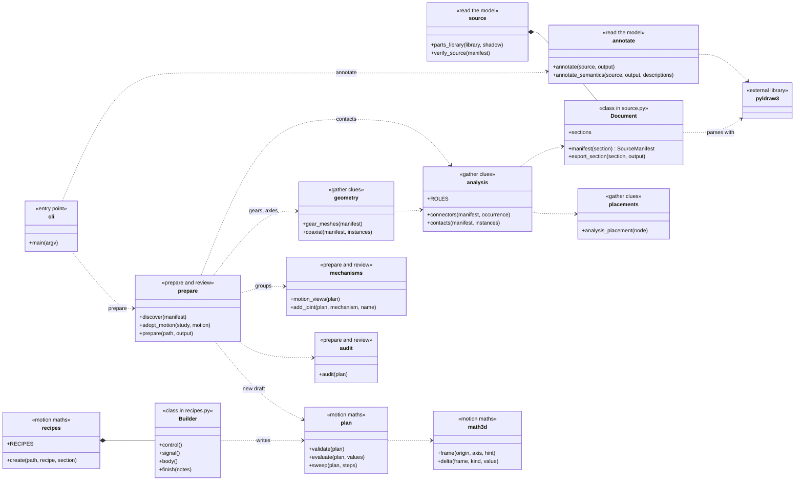

Also in this half: `discovery.py` (inventories of sub-models) and `search.py`
(part catalogue search) both read the model through `Document`;
`linkages.py` builds exact linkage formulas on top of `math3d.py`.

### 6.2 Modules, part two: from plan to animated Blender file

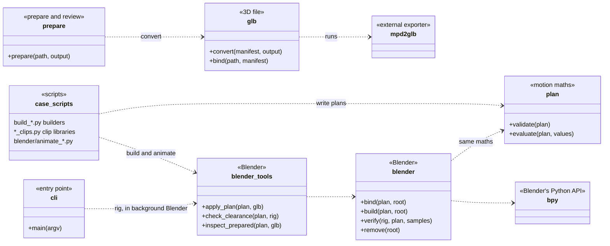

`blender.py` imports the same `plan.py` used outside Blender. That shared
module is what lets the two calculators of [step 3.8](#38-check-two-calculators-must-agree)
agree.

### 6.3 What is inside a plan

```mermaid
classDiagram
direction LR

class MotionPlan {
  +name
  +status draft or ready
  +notes
}
class SourceManifest {
  +path
  +sha256 fingerprint
  +section
}
class SourceNode {
  +id address such as 0/46/1
  +ref part file
  +kind part or assembly
  +colour
  +world position
}
class Control {
  +min
  +max
  +default
  +unit radian, ldu or scalar
}
class Signal {
  +expression the formula
  +variables its inputs
}
class Body {
  +kind revolute, prismatic, stretch, rod or fixed
  +instances part addresses
  +origin pivot point
  +axis direction
}
class Anchor {
  +body
  +point
}
class DistanceCheck {
  +length
  +tolerance
}
class Connection {
  +kind contact, gear_mesh, coaxial ...
  +status candidate, reviewed or rejected
  +evidence
}
class MechanismView {
  +label
  +disposition unresolved, planned, deferred or static
}

MotionPlan *-- SourceManifest : source
SourceManifest *-- SourceNode : every part
MotionPlan *-- Control : controls
MotionPlan *-- Signal : signals
MotionPlan *-- Body : bodies
MotionPlan *-- Anchor : anchors
MotionPlan *-- DistanceCheck : checks
MotionPlan *-- Connection : clues, optional
MotionPlan *-- MechanismView : review groups, optional
Signal --> Control : reads
Signal --> Signal : reads
Body --> Signal : is moved by
Body --> Body : rides on parent
Body --> SourceNode : owns parts
Body --> Anchor : rod ends
Anchor --> Body : sits on
DistanceCheck --> Anchor : measures between
Connection --> SourceNode : links two parts
MechanismView --> Body : groups
```

### 6.4 What each plan element becomes in Blender

```mermaid
classDiagram
direction LR

class SourceNode {
  <<plan>>
  +id
}
class Control {
  <<plan>>
}
class Signal {
  <<plan>>
}
class Body {
  <<plan>>
}
class Anchor {
  <<plan>>
}
class TaggedObject {
  <<3D file node>>
  +mecha_id
  +mecha_source
}
class PartMesh {
  <<Blender mesh>>
  +mecha_id
  +mecha_rest original place
}
class CTRL {
  <<Blender empty>>
  +one slider per control
}
class INPUT {
  <<Blender empty>>
  +clamp driver
}
class SIG {
  <<Blender empty>>
  +formula driver
}
class FRM {
  <<Blender empty>>
  +rest position of the joint
}
class PIV {
  <<Blender empty>>
  +driven rotation, position or scale
}
class ANCHOR {
  <<Blender empty>>
}

SourceNode .. TaggedObject : name tag
TaggedObject .. PartMesh : imported as
Control .. CTRL : slider
Control .. INPUT : range guard
Signal .. SIG : formula
Body .. FRM : rest frame
Body .. PIV : moving pivot
Anchor .. ANCHOR : pin point
INPUT --> CTRL : reads
SIG --> INPUT : reads
PIV --> SIG : follows
FRM *-- PIV
PIV *-- PartMesh : carries
PIV *-- ANCHOR : carries
```

---

## 7. What it does not promise

The tool is careful about what it claims:

- **Clues are not decisions.** Touching parts or meshing gears are evidence;
  the agent decides what moves.
- **Correct maths is not physical proof.** The checks show the declared
  motion is consistent and that Blender matches it. They do not simulate
  forces, friction, gear backlash or whether a real model could be built.
- **No collision guarantee.** The clearance check samples poses; it cannot
  promise that nothing ever overlaps.
- **Recipes are for exact models.** The studied recipes work for those exact
  files and selections. They are not automatic rigging for any model.

---

## 8. Glossary

| Term | Meaning |
| --- | --- |
| **Agent** | The person or AI that reviews clues and writes the motion |
| **Anchor** | A pin point fixed to a body, used for rod ends and length checks |
| **Body** | A group of parts that move together as one rigid piece |
| **Control** | A slider; the only thing you animate |
| **Driver** | A Blender property whose value comes from a formula |
| **Empty** | An invisible Blender object used as a handle or pivot |
| **Frame** | A position plus an orientation, such as where a hinge sits and which way it points |
| **GLB / glTF** | A standard 3D file format; `model.glb` holds the shapes |
| **Keyframe** | A value saved at a point in time; Blender fills in the frames between |
| **LDraw** | The open file format for digital LEGO models (`.ldr`, `.mpd`, `.dat`) |
| **LDU** | LDraw unit: 0.4 mm. One stud is 20 LDU; a plate is 8 LDU tall |
| **MPD** | An LDraw file that contains several sub-models |
| **NLA** | Blender's non-linear animation editor, a timeline for reusable clips |
| **Occurrence ID** | A part's address, such as `0/46/1` |
| **pyldraw3** | The Python library that reads LDraw files and their connection points |
| **Rig** | The set of controls, formulas and pivots that moves the model |
| **Shadow library** | Extra data (from LDCad) describing where parts connect: studs, axle holes, pins |
| **Signal** | A named formula that turns slider values into angles or distances |
| **Source manifest** | The full list of parts with addresses, positions, colours and the file's fingerprint |

For more depth, see the [workflow](workflow.md), the
[motion plan format](motion-plan.md), the [architecture](architecture.md) and
[validation](validation.md).
