# How I animate a LEGO model

*A walk-through, told by the agent while it works.*

Hi. I'm the agent: the one who reads a LEGO model, decides what should move,
and builds the animation in Blender. ldraw-mecha is my toolbox. Today I'll do
a real job from start to finish and tell you what I'm doing and why at each
step.

**Today's job:** make the doors, roof and wheels of LEGO set **106**, a small
blue UNICEF car, move in Blender.

Every number I quote below comes from an actual run of the tools on this
model. Words in *italics* are explained in the
[glossary at the end](#words-i-used).

**Contents**

- [My route for today](#my-route-for-today)
- [Step 1: I look for help that already exists](#step-1-i-look-for-help-that-already-exists)
- [Step 2: I give every part an address](#step-2-i-give-every-part-an-address)
- [Step 3: I gather clues](#step-3-i-gather-clues)
- [Step 4: I work out how the roof moves](#step-4-i-work-out-how-the-roof-moves)
- [Step 5: I write it down in the plan](#step-5-i-write-it-down-in-the-plan)
- [Side trip: what bigger models need](#side-trip-what-bigger-models-need)
- [Step 6: I check my maths before touching Blender](#step-6-i-check-my-maths-before-touching-blender)
- [Step 7: I put name tags on the 3D model](#step-7-i-put-name-tags-on-the-3d-model)
- [Step 8: I build the puppet](#step-8-i-build-the-puppet)
- [Step 9: I make two calculators agree](#step-9-i-make-two-calculators-agree)
- [Step 10: I check that nothing bumps](#step-10-i-check-that-nothing-bumps)
- [Step 11: I do the rest of the car](#step-11-i-do-the-rest-of-the-car)
- [Step 12: Action!](#step-12-action)
- [Step 13: I look at it and hand it over](#step-13-i-look-at-it-and-hand-it-over)
- [What I can't promise](#what-i-cant-promise)
- [My toolbox](#my-toolbox)
- [Words I used](#words-i-used)

---

## My route for today

I always travel the same route, in three phases:

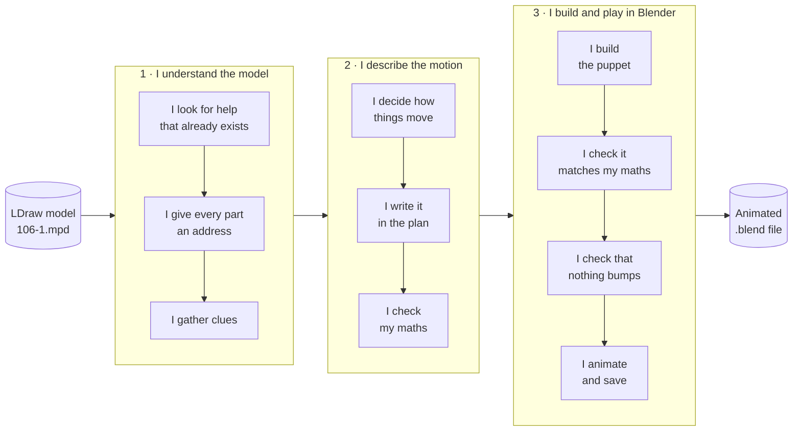

Throughout, I keep one picture in my head. The finished rig is a
**marionette**:

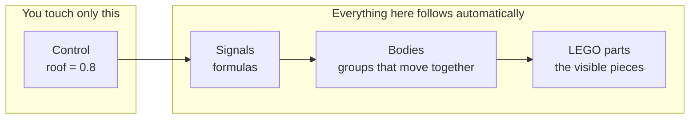

You pull a few strings (the *controls*, sliders in Blender). The strings run
over pulleys (the *signals*, small formulas). The pulleys move wooden limbs (the
*bodies*), and the limbs carry the LEGO parts. My whole job is to set up those
strings and pulleys correctly. After that, an animation is just a recording of
the sliders.

---

## Step 1: I look for help that already exists

Before measuring anything, I check whether someone has solved this before.
The [reference catalog](reference/README.md) and the studied *recipes* are my
notebook from earlier jobs. There is a recipe called `106` for this exact car.

I'll still work out the roof myself, because that's the best way to show you
how I think. Afterwards I'll use the recipe for the doors and wheels, and
check that it agrees with my own measurement.

Next I check whether the file is **annotated**, meaning every part has a
readable name and every sub-assembly a description. This copy,
`data/models-annotated/106-1.mpd`, already is, so I can skip that work today.

> **If the file weren't annotated,** I would do three things first:
>
> 1. Run `annotate`, which writes a copy with a readable comment above each
>    part:
>
>    ```plaintext
>    0 // Plate  2 x  2 (black)
>    1 0 80 8 0 1 0 0 0 1 0 0 0 1 3022.dat
>    ```
>
> 2. Write one descriptive line for the model and each sub-assembly, and apply
>    them with `annotate-semantics`.
> 3. Add meaningful groups such as "wheel assembly" where they are missing,
>    making sure every physical part survives exactly once.

---

## Step 2: I give every part an address

I run one command:

```sh
./ldraw-mecha prepare data/models-annotated/106-1.mpd --output output/study
```

The first thing it does is read the file and give every placed part an
*occurrence ID*, which works like a postal address. The model has 72
placements: 65 physical parts, plus 7 groups (the car, five wheel assemblies
and the driver). Here is a slice of the real address tree:

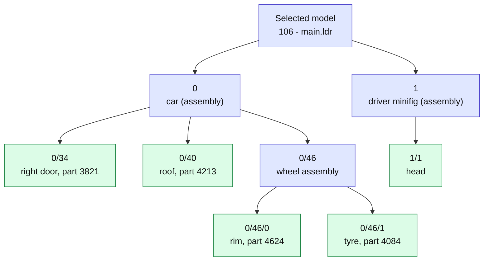

I read `0/46/1` as "item 1 inside item 46 inside item 0": a tyre on one
of the wheels. Three things about addresses matter to me:

- **Repeats get different addresses.** All five tyres are part 4084, but each
  has its own address, so I can spin each wheel separately.
- **Addresses belong to this exact file.** The tool records a fingerprint
  (SHA-256) of the file. If someone edits it later, my plan reports itself as
  stale instead of quietly pointing at the wrong part.
- **Positions add up.** A tyre's place in the world is the car's place
  combined with the tyre's place inside the car.

That complete list (address, part, colour, position and description for every
part) is the *source manifest*. It goes into `plan.json`, the single file
where I'll keep all my work.

---

## Step 3: I gather clues

`prepare` keeps going and collects clues about what might move. It behaves
like a detective's assistant: it gathers evidence but never makes the
decision. Deciding is my job.

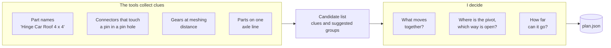

Here's what came back for the 106 car:

```plaintext
contacts: 53 between 37 of the 65 parts
  stud/stud_receptacle   20
  pin/pin_hole           25
  rim_seat/tyre_bead      5
  bar/clip                2
  hinge/hinge             1
```

Reading those like a detective:

| Clue | What I make of it |
| --- | --- |
| 20 studs in stud holes | Bricks stacked on bricks. Normal building, no motion. |
| 25 pins in pin holes | 18 are the wheels sitting on their wheel pins. Promising: those can spin. The other 7 are the driver's neck, hips and legs, which aren't part of today's job. |
| 5 rims in tyres | Each tyre on its rim. A tyre should turn with its rim. |
| 2 bars in clips | The radio and the shovel held in their clips. Accessories, staying put today. |
| **1 hinge in hinge** | The roof (`0/40`) on its roof holder (`0/39`). **Very promising.** |

The tools then chain clues into **suggested groups**, like friends of
friends: if A touches B and B touches C, all three are suggested together.
For this car I get seven:

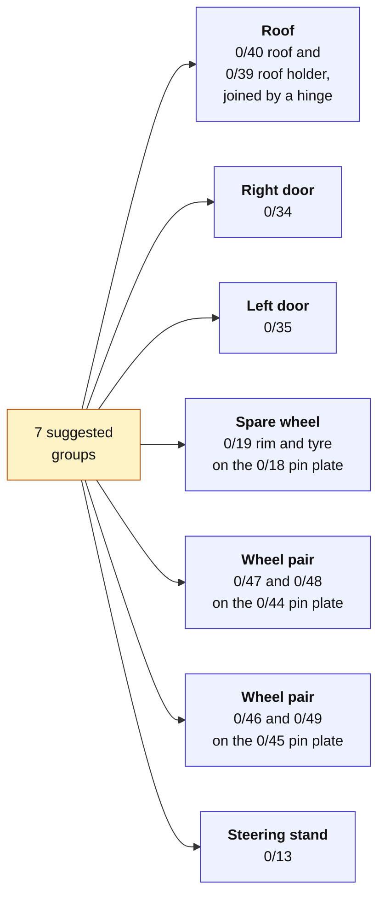

These groups are only starting points. They are not yet decisions.

The tools also warn me about a few things:

- **Six minifig parts were stored slightly crooked**, from rounded numbers in
  the file. The tools straightened them for the analysis only; the file
  itself is never changed.
- **Four minifig parts (arms and hands) are stretched**, and the right arm
  (part 3818) made the contact search incomplete. The driver isn't part of
  today's job, so I note it and move on.
- **No axle-line search ran,** because this car has no Technic axles or gears.
  That's expected here.

`prepare` saves all of this into `plan.json` (still with no motion),
writes a summary to `preparation.json`, and also creates the 3D file
`model.glb`. I'll come back to that in Step 7.

---

## Step 4: I work out how the roof moves

The hinge clue gives me a **point**, (0, −92, 36), and a **line** through
it along the X axis. That's where the roof turns. But a line points two ways,
and the clue can't tell me which way is "open". If I guess wrong, the roof
will swing down through the seats.

So I test it. I tilt the roof by 30° each way and watch where its centre
goes. One thing to know about LDraw: **up is negative Y**, so a smaller Y means
higher.

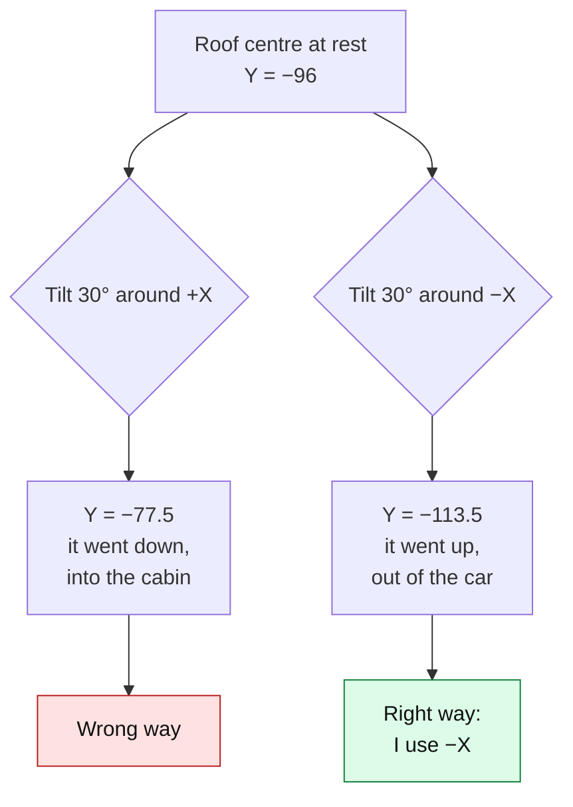

Now **how far can it open?** I start with a generous 90° and leave the real
answer to a bumping test later (Step 10). I'd rather measure that than
guess it.

---

## Step 5: I write it down in the plan

Everything I decide goes into one file, `plan.json`. It has three areas:

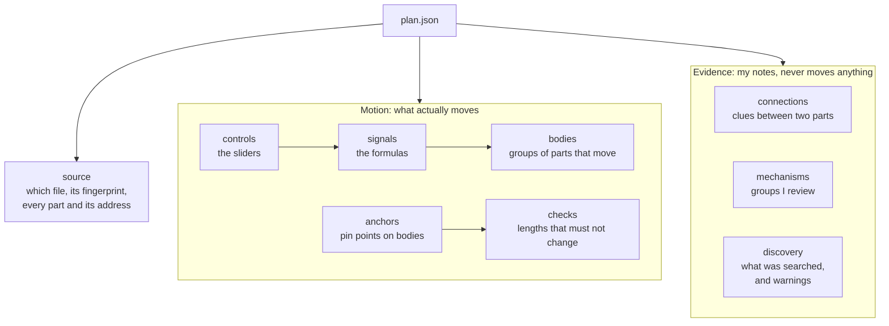

To add the roof, I use a small helper. It needs the suggested roof group (by
its key), the part, the pivot, the direction I just tested, and the range:

```python
from ldraw_mechanisms import mechanisms, plan as contract

p = contract.load("output/study/plan.json")
p = mechanisms.add_joint(
    p, mechanism="m_18fe96fb701a", name="roof", instances=["0/40"],
    origin=[0, -92, 36], axis=[-1, 0, 0],
    minimum=0, maximum=math.radians(90), description="Open the roof",
)
```

That writes three short entries into the plan. Here they are after Step 10
taught me the real limit, 75° (1.309 radians):

```json
"controls": {"roof": {"min": 0, "max": 1.3089969389957472, "default": 0.0,
                      "unit": "radian", "description": "Open the roof"}},
"signals":  {"roof": {"expression": "v", "variables": {"v": "control:roof"}}},
"bodies":   {"roof": {"instances": ["0/40"], "kind": "revolute",
                      "origin": [0, -92, 36], "axis": [-1, 0, 0], "signal": "roof"}}
```

I read it as: *the slider `roof` feeds the formula `roof`, which rotates part
`0/40` around the hinge at (0, −92, 36), along −X.*

**Controls and signals work like a spreadsheet.** A control is a cell you
type a number into. A signal is a cell with a formula that refers to other
cells. For the roof the formula is just "copy the slider" (`v`), but it could
be anything from this list: numbers, `+ - * / ** %`, `pi`, and `sin cos tan
asin acos atan atan2 sqrt floor ceil min max abs pow clamp`. Each formula is at
most 255 characters. That limit is deliberate: it lets Blender run my formulas
natively. Just as a spreadsheet refuses circular references, the plan refuses
formulas that depend on each other in a loop.

**How the tools turn "rotate 75°" into motion.** A rotation only makes sense
around a particular point: a door turns around its hinge, not around the corner
of the room. So the maths uses three moves:

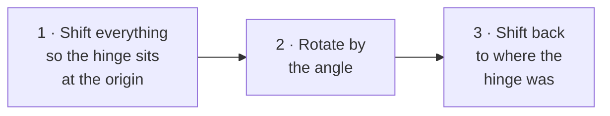

As a formula: `move = F · Rotate(angle) · F⁻¹`. Here `F` is the hinge's
*frame*: where it sits and which way it points, with the axis as its Z
direction. The roof's new position is `move × its original position`.

The roof is a `revolute` body. Altogether there are five kinds of body I can
use:

| Kind | Moves by… | Everyday example |
| --- | --- | --- |
| `revolute` | rotating around the axis | a door hinge, a wheel |
| `prismatic` | sliding along the axis | a drawer, a piston |
| `stretch` | getting longer or shorter | a coil spring (springs only) |
| `rod` | pointing from one pin to another | the link between a pedal and a pump |
| `fixed` | not moving on its own, only riding on a parent | a sticker on a door |

One firm rule: **each part belongs to at most one body.** A part can't be in
two places at once.

---

## Side trip: what bigger models need

This little car only needs hinges and spinning wheels. On a Technic model I
use more of the toolbox. Here's a quick look, so you'll recognise it.

**Gears.** The tools spot gears that mesh by their spacing: gear radius is
1.25 LDU per tooth, so an 8-tooth and a 24-tooth gear mesh when their centres
are exactly 10 + 30 = 40 LDU apart. That's two studs, the classic Technic
spacing.

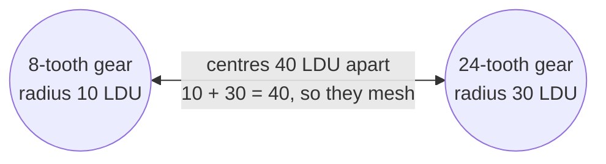

The small gear turns three times for each turn of the big one, in the
opposite direction. I write that as a formula: `big = -small / 3`.

**Chains of formulas.** In a steering system, one slider drives a whole chain
of formulas (simplified from the 42000 car recipe):

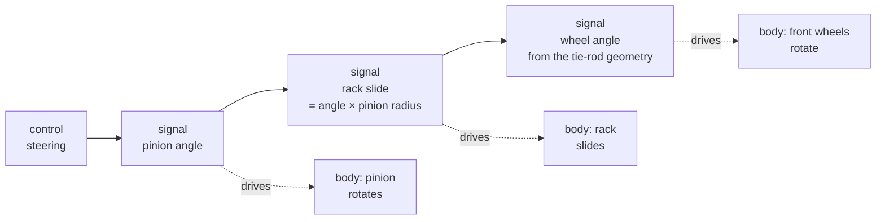

**Parents.** A body can ride on another body, like a crane. Each moves with
its parent and adds its own motion on top:

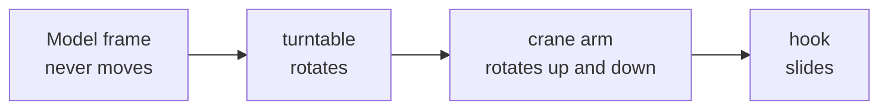

**Rods.** A connecting rod has no hinge of its own; it is pinned at both
ends to parts that move. I mark the pins as *anchors*. The rod sits on the
first pin and points at the second:

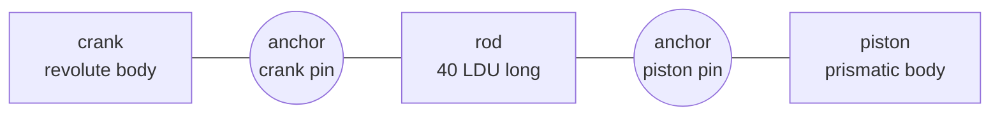

The tools won't let a rod stretch to hide a mistake in my formulas. Every rod
needs a **distance check**, so if the pins drift apart, I find out.

**Helpers that save me typing:**

| Helper | What it does for me |
| --- | --- |
| `mechanisms.add_joint` | One hinge or slider, as I used above |
| `recipes.Builder` and recipes `106`, `928`, `42000`, `42083`, `10265` | Complete studied plans for those exact models |
| `recipes.slider_cranks` | Piston formulas for an engine |
| `math3d.signed_gear_ratio`, `rack_ratio` | Gear and rack ratios with the right direction |
| `linkages.universal_joint`, `ball_link` | Exact formulas for a cardan joint and a ball link |
| `scripts/build_*.py` | Big builders for specific models: Defender, Chiron, minifigs, movables, plants |
| `scripts/extract_subsystem.py` | Saves one mechanism on its own, without the rest of the vehicle |
| `scripts/split_shortcuts.py` | Splits a one-piece part (such as a whole shock absorber) into its real sub-parts, so a spring can stretch |

---

## Step 6: I check my maths before touching Blender

Blender is slow to start and hard to debug, so I check everything I can in
plain Python first:

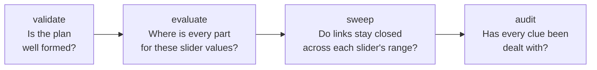

| Check | What it would catch |
| --- | --- |
| `validate` | a typo in a formula, a part in two bodies, a rod without a distance check, a changed source file |
| `evaluate` | nothing by itself; it tells me where every moving part is for any slider values (that's how I ran the 30° test in Step 4) |
| `sweep` | a linkage that comes apart partway through a slider's travel |
| `audit` | a suggested group that nobody has reviewed |

For the roof, `validate` answers:

```json
{"valid": true, "status": "ready", "moving_parts": 1, "bodies": 1, "signals": 1, "checks": 0}
```

I set the plan's `status` to `ready` only when I've decided the motion.
Blender refuses to build anything from a draft.

---

## Step 7: I put name tags on the 3D model

Back in Step 2, `prepare` also converted the model into a standard 3D file,
`model.glb`, using the exporter `mpd2glb`. LDraw and Blender measure things
differently, and the conversion handles that:

| | LDraw | Blender |
| --- | --- | --- |
| Which way is up? | −Y | +Z |
| Unit | LDU (1 LDU = 0.4 mm; one stud = 20 LDU) | metre |
| Conversion | `C(x, y, z) = (x, −z, y)`, scale 0.0004 m per LDU | |

The 3D file doesn't know my addresses, so the tool sticks a **name tag**
(`mecha_id`) on every 3D object. It works like a check-in desk comparing a
passport photo: a tag is only attached after the match is confirmed.

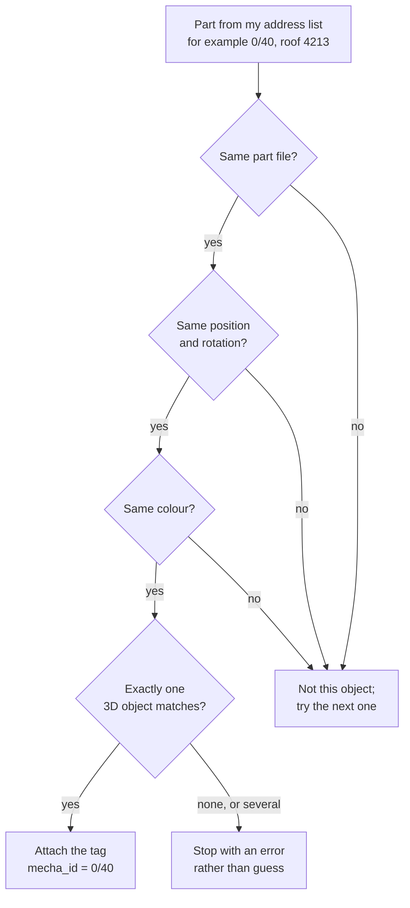

For the 106 car, all 72 placements got their tag. Each object also carries
the file's fingerprint (`mecha_source`), so later Blender can tell which plan
it belongs to.

---

## Step 8: I build the puppet

Now Blender. Blender has a feature called a *driver*: a property whose value
comes from a formula, just like a spreadsheet cell. I build the whole rig from
drivers and *empties* (invisible handles). Nothing else is needed, which is
why the rig still works after saving and reopening: no add-on, and no scripts
that run when the file opens.

For the roof, the strings run like this (shown with the names the finished
car rig will have in Step 11, where the plan is called `car106`):

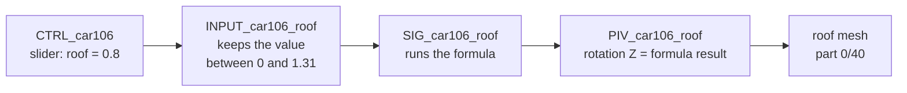

And this is how the objects are arranged inside the scene:

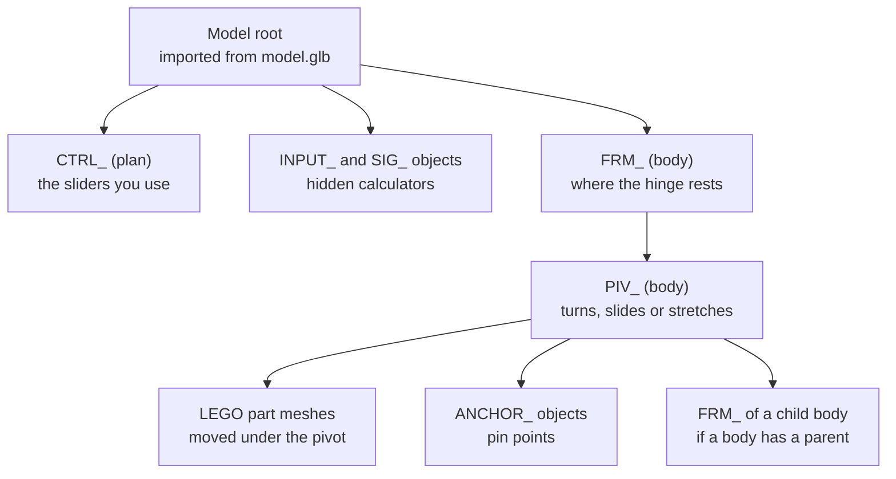

| Object | Its job |
| --- | --- |
| `CTRL_<plan>` | One slider per control. **This is what you animate.** |
| `INPUT_<plan>_<control>` | Keeps the slider within its allowed range |
| `SIG_<plan>_<signal>` | Calculates one formula |
| `FRM_<plan>_<body>` | Marks where the joint sits at rest |
| `PIV_<plan>_<body>` | Moves: its Z rotation, Z position or Z scale follows the formula |
| `ANCHOR_<plan>_<anchor>` | A pin point riding on a body |

A rod, if I had one, would use three ordinary Blender constraints: *copy
location* (stick to the first pin), *damped track* (point at the second pin)
and *locked track* (don't roll over).

Before I move a part into the rig, I write down where it was. That way I
can take the rig apart later and every part goes back exactly where it
started. I also store the whole plan inside the .blend file.

---

## Step 9: I make two calculators agree

I never assume Blender did what I meant. Python and Blender each calculate the
same poses separately, and the answers have to match:

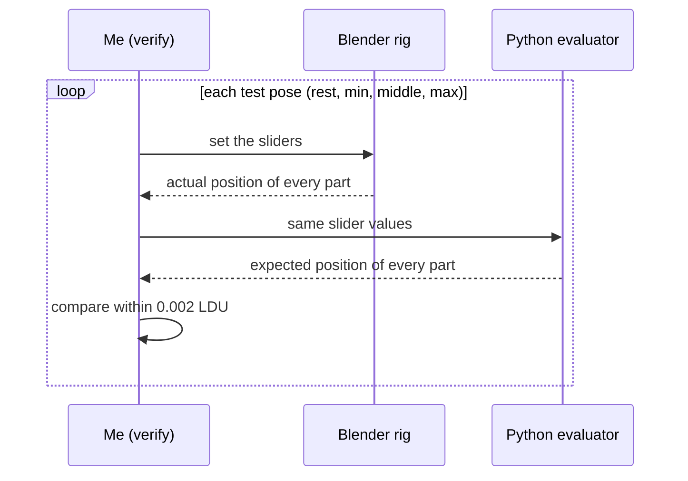

For the roof, all four test poses passed. The biggest difference was
0.00001 LDU, about four millionths of a millimetre. The allowed margin,
0.002 LDU, is itself less than a thousandth of a millimetre.

This only works because Blender runs the **same** formulas from the same
plan. Two calculators agreeing is strong evidence that the rig does what the
plan says.

---

## Step 10: I check that nothing bumps

Correct maths doesn't stop the roof from passing through other bricks. So I
run a bumping test (`check_clearance`). It moves the slider step by step and
reports any part whose surface starts to cross another's:

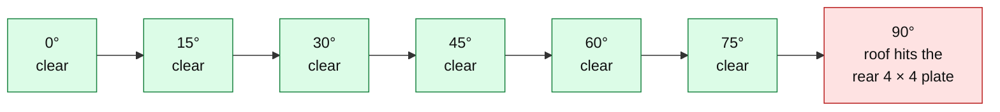

At 90° the roof (`0/40`) cuts into the 4 × 4 plate (`0/43`) at the back of
the car. So I lower the limit to **75°**, rebuild, and test again in finer
steps. This time all seven positions from 0° to 75° are clear.

That's why the plan in Step 5 says 75°. I didn't guess the number; this
test gave it to me.

---

## Step 11: I do the rest of the car

The doors and wheels follow the same pattern as the roof. Since the studied
recipe `106` already covers them, I adopt it. The recipe's motion replaces my
hand-made roof joint, while the tool keeps all my clues and notes:

```sh
./ldraw-mecha plan data/models-annotated/106-1.mpd --recipe 106 \
  --study output/study/plan.json --output output/study/plan.json
```

So I check that the recipe agrees with me about the roof. It does exactly:
pivot (0, −92, 36), direction −X, limit 75°. Good: two independent routes, same
answer, so nothing is lost by the swap.

The car now has eight sliders:

| Slider | Range | Moves |
| --- | --- | --- |
| `roof` | 0° to 75° | the roof, on its finger hinge |
| `door_left`, `door_right` | 0° to 75° | each door, on its stud hinge |
| `wheel_1` … `wheel_4` | one turn back to one turn forward | each road wheel, rim and tyre together |
| `spare` | one turn back to one turn forward | the spare wheel |

Then the audit reminds me that seven of the suggested clue groups from Step 3
haven't been reviewed yet. I go through them one by one:

- The roof, door and wheel groups are now covered by real motion, so I link
  each to its bodies and mark it **planned**. The pin plates in those groups
  stay still as supports.
- The steering stand (`0/13`) is a single moulded piece, and this car has no
  steering to animate. I mark it **static** and write down why.

Now `audit --require-reviewed` reports 14 planned groups, 1 static, and
**review complete**. `validate` and `sweep` pass for all eight sliders.

---

## Step 12: Action!

One command builds the rig, checks it and adds a demonstration animation:

```sh
./ldraw-mecha rig output/study/plan.json --glb output/study/model.glb \
  --save output/study/rigged.blend --report output/study/blender-check.json --animate
```

Before animating, the "two calculators" check from Step 9 runs again, this
time on 26 test poses: rest, plus minimum, middle and maximum for each of the
eight sliders, plus one pose with everything moved at once. Results:

- Moving parts: largest difference **0.00002 LDU**.
- Parts that should stay still: within **0.0013 LDU** of where they started.
  That's rounding inside the 3D file, and still under the 0.002 limit.
- Broken drivers: **none**.

Then I animate. I never key the LEGO parts themselves. I key **only the
sliders**, and the drivers move everything else:

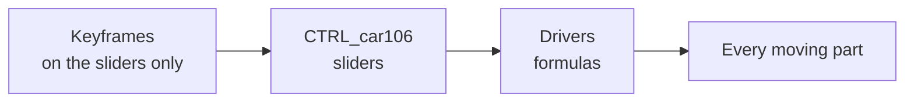

It's like recording only a car's steering wheel and pedals: from that, a
replay can rebuild everything else. And because every frame is just a set of
slider values, my Python calculator can check any frame I like.

The demonstration gives each slider four keyframes:

| Frame | Roof and doors | Wheels |
| --- | --- | --- |
| 1 | closed (0°) | at rest |
| 40 | fully open (75°) | one turn forward |
| 80 | closed again (0°) | one turn backward |
| 120 | closed (0°) | back at rest |

Here's the roof's angle over time:

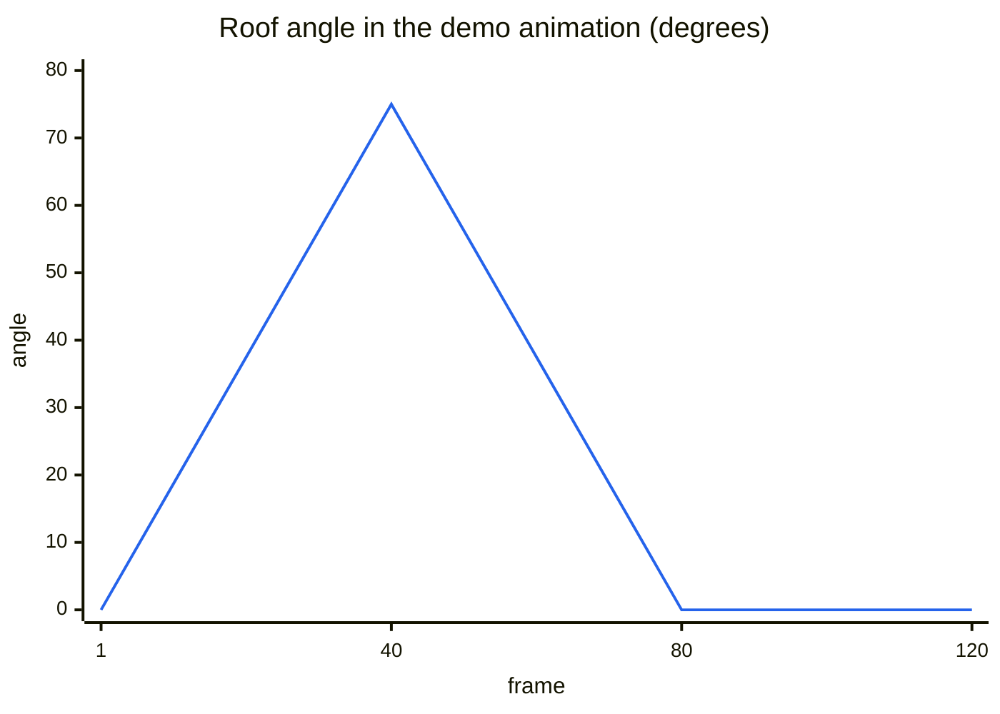

Blender smooths the curve between keyframes, so the roof eases in and out
rather than moving in straight lines.

For bigger jobs I write richer animations, still keying only sliders:

| Animation | What it does |
| --- | --- |
| `animate_defender.py` | A driving sequence for the 42110 Defender: wheels at different speeds in corners, gears changing smoothly |
| `minifig_clips.py`, `movable_clips.py` | Reusable clips (wave, walk, open, close) using Blender's own easing curves, reproduced in Python so I can check them |
| `wind_clips.py` | Plants swaying in simulated wind, calculated step by step and saved as keyframes |

Reusable clips go into Blender *Actions* and are arranged on *NLA tracks*,
Blender's clip library and timeline.

---

## Step 13: I look at it and hand it over

Numbers aren't enough, so I also look. I reopen the saved file in a **fresh**
Blender, the way you will, and run the calculator check on the existing rig
without rebuilding it. It passes, with the same tiny 0.00002 LDU difference.
Then I render a still with the roof and both doors fully open:


The roof tilts up on its hinge at the back, both doors swing outward, and
nothing passes through anything. That's what I wanted.

What I hand over:

| File | What it is |
| --- | --- |
| `plan.json` | My decisions: sliders, formulas, moving groups, notes and review |
| `model.glb` | The 3D model with name tags |
| `rigged.blend` | The finished rig with the demo animation |
| `blender-check.json` | The calculator comparison report |
| `sweep.json`, clearance report, render | The rest of my evidence |

To try it, open `rigged.blend`, select `CTRL_car106`, and look under
**Object Properties → Custom Properties**. Drag `roof` and watch it open.

---

## What I can't promise

I'm careful about what I claim:

- **Clues aren't decisions.** Touching parts and meshing gears are evidence. I
  decide what moves, and I write down why.
- **Correct maths isn't physical proof.** My checks show the motion I declared
  is consistent and that Blender follows it exactly. They don't simulate
  forces, friction or gear backlash, and they don't prove a real model would
  work.
- **No collision guarantee.** The bumping test samples positions. It can't
  promise that nothing ever overlaps between them.
- **Recipes fit exact models.** Recipe `106` works for this file. It isn't
  automatic rigging for any car.

---

## My toolbox

If you'd like to see inside my toolbox, here's how it is organised. Each
layer feeds the next. The `ldraw-mecha` command (`cli.py`) is the front door,
and each command calls into one of these layers.

```mermaid
flowchart LR
    cli["<b>cli.py</b><br/>the ldraw-mecha<br/>command"]
    L1["<b>Read the model</b><br/>annotate.py<br/>source.py"]
    L2["<b>Gather clues</b><br/>analysis.py<br/>geometry.py<br/>placements.py<br/>discovery.py<br/>search.py"]
    L3["<b>Prepare and review</b><br/>prepare.py<br/>mechanisms.py<br/>audit.py"]
    L4["<b>Motion maths</b><br/>no Blender needed<br/>plan.py<br/>math3d.py<br/>linkages.py<br/>recipes.py"]
    L5["<b>3D file</b><br/>glb.py<br/>bin/mpd2glb.mjs"]
    L6["<b>Blender</b><br/>blender.py<br/>blender_tools.py<br/>scripts/blender"]
    cli --> L1 --> L2 --> L3 --> L4 --> L6
    L3 --> L5 --> L6
    classDef layer fill:#eef2ff,stroke:#4338ca,color:#111
    classDef entry fill:#fef3c7,stroke:#b45309,color:#111
    class L1,L2,L3,L4,L5,L6 layer
    class cli entry
```

| Layer | Which steps use it |
| --- | --- |
| Read the model | Steps 1–2: annotation and addresses ([source.py](../ldraw_mechanisms/source.py)) |
| Gather clues | Step 3 ([analysis.py](../ldraw_mechanisms/analysis.py), [geometry.py](../ldraw_mechanisms/geometry.py), [placements.py](../ldraw_mechanisms/placements.py)) |
| Prepare and review | Steps 3, 5 and 11: saving clues, `add_joint`, the audit |
| Motion maths | Steps 4–6 and 9: formulas, the three-move rotation, the Python calculator ([plan.py](../ldraw_mechanisms/plan.py), [math3d.py](../ldraw_mechanisms/math3d.py)) |
| 3D file | Step 7: conversion and name tags ([glb.py](../ldraw_mechanisms/glb.py)) |
| Blender | Steps 8–13: building, checking, bumping test, animation ([blender.py](../ldraw_mechanisms/blender.py)) |

### Class diagrams

Most of my toolbox is plain functions, so these diagrams draw each **module**
as a box listing its main functions. The only true classes are `Document` and
`Builder`. How to read the arrows:

| Arrow | Meaning |
| --- | --- |
| `A ..> B` (dotted) | A uses B |
| `A *-- B` (filled diamond) | B is a part of A |
| `A --> B` (solid) | A refers to B |
| `A .. B` (dotted, no head) | A corresponds to B |

#### Part one: from LDraw file to checked plan (Steps 1–6)

Only the main links are drawn. `cli.py` calls almost every module, so its
arrows point at the two entry functions only.

```mermaid
classDiagram
direction LR

class cli {
  <<entry point>>
  +main(argv)
}
class annotate {
  <<read the model>>
  +annotate(source, output)
  +annotate_semantics(source, output, descriptions)
}
class source {
  <<read the model>>
  +parts_library(library, shadow)
  +verify_source(manifest)
}
class Document {
  <<class in source.py>>
  +sections
  +manifest(section) SourceManifest
  +export_section(section, output)
}
class placements {
  <<gather clues>>
  +analysis_placement(node)
}
class analysis {
  <<gather clues>>
  +ROLES
  +connectors(manifest, occurrence)
  +contacts(manifest, instances)
}
class geometry {
  <<gather clues>>
  +gear_meshes(manifest)
  +coaxial(manifest, instances)
}
class prepare {
  <<prepare and review>>
  +discover(manifest)
  +adopt_motion(study, motion)
  +prepare(path, output)
}
class mechanisms {
  <<prepare and review>>
  +motion_views(plan)
  +add_joint(plan, mechanism, name)
}
class audit {
  <<prepare and review>>
  +audit(plan)
}
class plan {
  <<motion maths>>
  +validate(plan)
  +evaluate(plan, values)
  +sweep(plan, steps)
}
class math3d {
  <<motion maths>>
  +frame(origin, axis, hint)
  +delta(frame, kind, value)
}
class recipes {
  <<motion maths>>
  +RECIPES
  +create(path, recipe, section)
}
class Builder {
  <<class in recipes.py>>
  +control()
  +signal()
  +body()
  +finish(notes)
}
class pyldraw3 {
  <<external library>>
}

cli ..> annotate : annotate
cli ..> prepare : prepare
annotate ..> pyldraw3
source *-- Document
Document ..> pyldraw3 : parses with
analysis ..> Document
analysis ..> placements
geometry ..> analysis
prepare ..> analysis : contacts
prepare ..> geometry : gears, axles
prepare ..> mechanisms : groups
prepare ..> audit
prepare ..> plan : new draft
recipes *-- Builder
Builder ..> plan : writes
plan ..> math3d
```

Also in this half: `discovery.py` (inventories of sub-models) and `search.py`
(part catalogue search) both read the model through `Document`.
`linkages.py` builds exact linkage formulas on top of `math3d.py`.

#### Part two: from plan to animated Blender file (Steps 7–13)

```mermaid
classDiagram
direction LR

class cli {
  <<entry point>>
  +main(argv)
}
class prepare {
  <<prepare and review>>
  +prepare(path, output)
}
class glb {
  <<3D file>>
  +convert(manifest, output)
  +bind(path, manifest)
}
class mpd2glb {
  <<external exporter>>
}
class plan {
  <<motion maths>>
  +validate(plan)
  +evaluate(plan, values)
}
class blender {
  <<Blender>>
  +bind(plan, root)
  +build(plan, root)
  +verify(rig, plan, samples)
  +remove(root)
}
class blender_tools {
  <<Blender>>
  +apply_plan(plan, glb)
  +check_clearance(plan, rig)
  +inspect_prepared(plan, glb)
}
class case_scripts {
  <<scripts>>
  build_*.py builders
  *_clips.py clip libraries
  blender/animate_*.py
}
class bpy {
  <<Blender's Python API>>
}

cli ..> blender_tools : rig, in background Blender
prepare ..> glb : convert
glb ..> mpd2glb : runs
blender_tools ..> blender
blender ..> plan : same maths
blender ..> bpy
case_scripts ..> plan : write plans
case_scripts ..> blender_tools : build and animate
```

`blender.py` imports the same `plan.py` I use outside Blender. That shared
module is what makes the two calculators in
[Step 9](#step-9-i-make-two-calculators-agree) agree.

#### What is inside a plan

```mermaid
classDiagram
direction LR

class MotionPlan {
  +name
  +status draft or ready
  +notes
}
class SourceManifest {
  +path
  +sha256 fingerprint
  +section
}
class SourceNode {
  +id address such as 0/46/1
  +ref part file
  +kind part or assembly
  +colour
  +world position
}
class Control {
  +min
  +max
  +default
  +unit radian, ldu or scalar
}
class Signal {
  +expression the formula
  +variables its inputs
}
class Body {
  +kind revolute, prismatic, stretch, rod or fixed
  +instances part addresses
  +origin pivot point
  +axis direction
}
class Anchor {
  +body
  +point
}
class DistanceCheck {
  +length
  +tolerance
}
class Connection {
  +kind contact, gear_mesh, coaxial ...
  +status candidate, reviewed or rejected
  +evidence
}
class MechanismView {
  +label
  +disposition unresolved, planned, deferred or static
}

MotionPlan *-- SourceManifest : source
SourceManifest *-- SourceNode : every part
MotionPlan *-- Control : controls
MotionPlan *-- Signal : signals
MotionPlan *-- Body : bodies
MotionPlan *-- Anchor : anchors
MotionPlan *-- DistanceCheck : checks
MotionPlan *-- Connection : clues, optional
MotionPlan *-- MechanismView : review groups, optional
Signal --> Control : reads
Signal --> Signal : reads
Body --> Signal : is moved by
Body --> Body : rides on parent
Body --> SourceNode : owns parts
Body --> Anchor : rod ends
Anchor --> Body : sits on
DistanceCheck --> Anchor : measures between
Connection --> SourceNode : links two parts
MechanismView --> Body : groups
```

#### What each plan element becomes in Blender

```mermaid
classDiagram
direction LR

class SourceNode {
  <<plan>>
  +id
}
class Control {
  <<plan>>
}
class Signal {
  <<plan>>
}
class Body {
  <<plan>>
}
class Anchor {
  <<plan>>
}
class TaggedObject {
  <<3D file node>>
  +mecha_id
  +mecha_source
}
class PartMesh {
  <<Blender mesh>>
  +mecha_id
  +mecha_rest original place
}
class CTRL {
  <<Blender empty>>
  +one slider per control
}
class INPUT {
  <<Blender empty>>
  +clamp driver
}
class SIG {
  <<Blender empty>>
  +formula driver
}
class FRM {
  <<Blender empty>>
  +rest position of the joint
}
class PIV {
  <<Blender empty>>
  +driven rotation, position or scale
}
class ANCHOR {
  <<Blender empty>>
}

SourceNode .. TaggedObject : name tag
TaggedObject .. PartMesh : imported as
Control .. CTRL : slider
Control .. INPUT : range guard
Signal .. SIG : formula
Body .. FRM : rest frame
Body .. PIV : moving pivot
Anchor .. ANCHOR : pin point
INPUT --> CTRL : reads
SIG --> INPUT : reads
PIV --> SIG : follows
FRM *-- PIV
PIV *-- PartMesh : carries
PIV *-- ANCHOR : carries
```

---

## Words I used

| Term | Meaning |
| --- | --- |
| **Agent** | Me: the person or AI who reviews clues and writes the motion |
| **Anchor** | A pin point fixed to a body, used for rod ends and length checks |
| **Body** | A group of parts that move together as one rigid piece |
| **Control** | A slider; the only thing that gets animated |
| **Driver** | A Blender property whose value comes from a formula |
| **Empty** | An invisible Blender object used as a handle or pivot |
| **Frame** | A position plus an orientation, such as where a hinge sits and which way it points |
| **GLB / glTF** | A standard 3D file format; `model.glb` holds the shapes |
| **Keyframe** | A value saved at a point in time; Blender fills in the frames between |
| **LDraw** | The open file format for digital LEGO models (`.ldr`, `.mpd`, `.dat`) |
| **LDU** | LDraw unit: 0.4 mm. One stud is 20 LDU; a plate is 8 LDU tall |
| **MPD** | An LDraw file that contains several sub-models |
| **NLA** | Blender's non-linear animation editor, a timeline for reusable clips |
| **Occurrence ID** | A part's address, such as `0/46/1` |
| **pyldraw3** | The Python library that reads LDraw files and their connection points |
| **Recipe** | A studied, ready-made plan for one exact model |
| **Rig** | The set of sliders, formulas and pivots that moves the model |
| **Shadow library** | Extra data (from LDCad) describing where parts connect: studs, pins, hinges |
| **Signal** | A named formula that turns slider values into angles or distances |
| **Source manifest** | The full list of parts with addresses, positions, colours and the file's fingerprint |

For more depth, see the [workflow](workflow.md), the
[motion plan format](motion-plan.md), the [architecture](architecture.md) and
[validation](validation.md).
