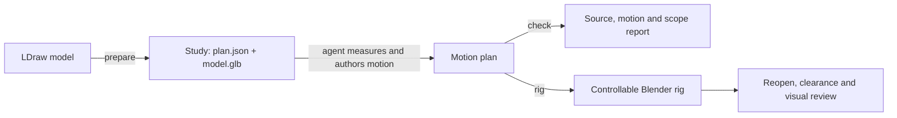
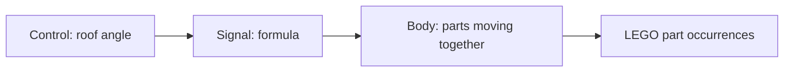

# How a LEGO model becomes an animation

The project has three main objects: **the source model, a motion plan, and a
Blender rig**. The source says where the parts start. The plan says how they
move. Blender displays that motion and records it as animation.



The everyday commands are `prepare`, `check` and `rig`. The agent edits the
plan between preparation and checking. [The workflow](workflow.md) gives the
commands; this page explains the decisions behind them.

## 1. Prepare the model

Preparation reads the source with pyldraw3 and gives each placed part an
**occurrence ID**. Two identical tyres have different IDs because they are
different physical pieces. In the annotated 106 car, `0/46/1` identifies the
tyre inside wheel assembly `0/46`, inside the car assembly `0`.

The source manifest stores those IDs, part references, colours and transforms,
plus file hashes. This lets the tools detect a stale source and follow the same
parts into Blender. IDs belong to that exact source revision and selected
section; they are not Blender object names.

Preparation also collects evidence: connectors that meet, possible gear meshes,
coaxial parts and descriptions suggesting movable pieces. It saves candidate
connections and provisional mechanism views in the plan. For example, the 106
study finds a hinge between roof `0/40` and holder `0/39`, and five rim/tyre
contacts. Those are useful clues for choosing pivots and moving groups.

**A contact is evidence to review.** A pin may hold parts rigidly or allow them
to rotate. A shared assembly may contain several moving bodies. Missing contacts
may reflect unsupported geometry or a skipped search. The agent inspects both
the report and the geometry before deciding.

Preparation writes three files:

| File | Purpose |
| --- | --- |
| `plan.json` | Source identities, evidence, review notes and eventually motion |
| `preparation.json` | Discovery coverage, warnings and conversion result |
| `model.glb` | Geometry tagged with verified source occurrence IDs |

For an unannotated source, [annotation](annotation.md) comes first, if the user
agrees to its token cost. The agent groups and describes the model's assemblies
with `ldraw-annotator`, which verifies that every physical occurrence survives.
Already annotated sources are reused. This improves understanding; it does not determine rigid bodies.

## 2. Describe motion in the plan

A simple joint needs four decisions: **which parts move, where the pivot is,
which way it points, and how far it travels**. The agent measures these in the
source model's frame and records the evidence and limitations.

The executable plan has a small dependency chain:



Controls are numbers the user can change. Signals are formulas using controls
or other signals. Bodies assign those results to groups of parts. Each physical
part belongs to at most one body. Parts without a body stay in their source pose.

For the studied 106 roof:

| Decision | Value |
| --- | --- |
| Moving part | `0/40`, the roof |
| Hinge origin | `[0, -92, 36]` LDU |
| Opening axis | `[-1, 0, 0]` |
| Travel | 0 to 75 degrees, stored in radians |

LDraw's up direction is negative Y. Testing both signs shows that rotation
around −X lifts this roof outward. The original 90-degree trial crossed
surrounding bricks; the studied example uses 75 degrees. Another model needs
its own measurements and clearance checks.

After identifying the roof's candidate view, the joint helper writes ordinary
plan fields:

```python
from math import radians
from ldraw_mechanisms import mechanisms, plan

p = plan.load("output/study/plan.json")
# Select the roof view from p["mechanisms"] after reviewing its parts/evidence.
p = mechanisms.add_joint(
    p, mechanism="m_18fe96fb701a", name="roof", instances=["0/40"],
    origin=[0, -92, 36], axis=[-1, 0, 0],
    minimum=0, maximum=radians(75), description="Open the roof",
)
plan.save("output/study/plan.json", p)
```

This example starts from a prepared draft **without** the 106 recipe. The helper
leaves it a draft: review the findings and set `status: ready` after deciding
the declared motion. The recipe is an alternative that supplies all studied car
controls at once, retaining the discovery evidence for review.

Larger mechanisms use the same plan:

| Need | Representation |
| --- | --- |
| Hinge, wheel or shaft | `revolute` body |
| Rack or piston | `prismatic` body |
| Wheel spinning while steering | Spin body parented to the steering body |
| Coupled gears | Signal equation using measured ratio and axis signs |
| Connecting rod | `rod` between two anchors, with a distance check |
| Flexible coil spring | `stretch` along its declared axis |
| Rigid item carried by another body | `fixed` child body |

Angles are radians; positions and slide lengths are LDraw units (LDU).
Joint origins and axes use the selected model's rest frame, even for child
bodies. Motion values are offsets from the source pose. The
[motion contract](motion-plan.md) defines the fields and supported equations.

## 3. Check, build and review

`check output/study` validates the source hashes and plan structure, sweeps each
control independently, evaluates default and mixed poses, and audits the recorded
scope. It writes `check.json`, including the plan digest, failures and unresolved
or deferred findings. `--set NAME=VALUE` adds a specific combined pose.

Independent sweeps can miss coupling: two wheels turning equally may hide a
differential error. Mixed poses help, but the agent still checks the relevant
ratios, link lengths and selector combinations. `--require-reviewed` requires
every recorded finding to have a disposition; explicit deferrals remain visible.

`rig output/study --animate --reopen` imports the bound geometry, creates native
Blender drivers and constraints, compares moving and static transforms with the
Python evaluator, adds demonstration keys, and saves `rigged.blend`. It then
reopens the file in a fresh process with Python auto-run disabled and verifies
again. The user operates ordinary custom properties; no running agent is needed.

Only source or selection changes require new geometry. Editing motion means
checking the plan and rebuilding the rig from the same GLB. The plan stays the
single record of mechanical decisions.

The final review has distinct questions:

| Question | Evidence |
| --- | --- |
| Does the declared motion satisfy its equations and link checks? | Python check report and mechanism-specific tests |
| Does Blender implement that motion, including after saving? | Build and reopen reports |
| Do the sampled surfaces cross? | Clearance checks and their exclusions |
| Does the delivered animation show the intended behavior? | Inspection of actual frames, transitions and limits |

Passing equations or transform comparisons cannot prove collision-free or
physically feasible motion. Clearance sampling has limits too, including
rest-contact exclusions and gaps between samples. Report those limits alongside
the delivered source, plan, blend and previews. See [validation](validation.md).

For source APIs and live inspection, use [the API guide](discovery-and-blender.md).
For code responsibilities, use [architecture](architecture.md). For measured
mechanisms to adapt, start with [the reference catalog](reference/README.md).
