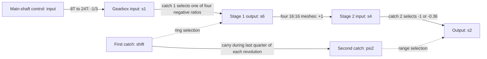
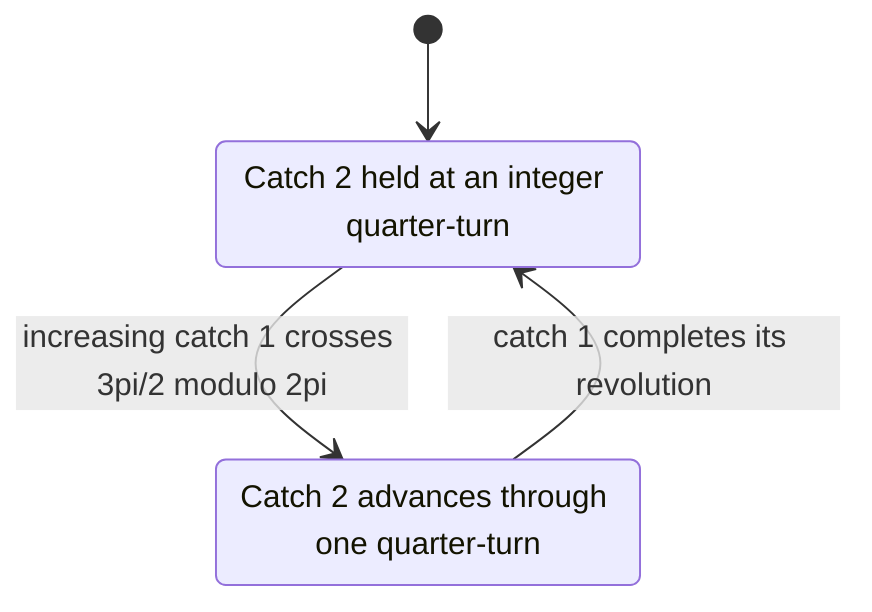

# Four-position selector with a second-stage carry

**Reference scope:** a reconstructed eight-speed gear network and prescribed
selector motion. The new idea beyond the [Defender's four-speed example](../42110/sequential-gearbox.md)
is advancing a second catch once per revolution of the first. Two added gears
are part of this implementation; the ratios below are not a claim about the
unchanged source assembly. See [scope and evidence](scope-and-evidence.md).

## Two stages and the ratio convention

Use the gearbox [plan](../../../output/42083-mechanisms/gearbox/plan.json).
Power-path shaft angles use +Z. The control `input` is the **neighbouring main
shaft**, not the gearbox input shaft: its 8T to 24T mesh gives
`s1 = -input/3`. Ratios quoted as output/input shaft mean `delta(s2)/delta(s1)`.



| First catch index | Stage 1 `delta(s6)/delta(s1)` | Gear in first range | Gear in second range |
| --- | ---: | ---: | ---: |
| 0 | -5/3 | 1: +1.666667 | 5: +0.600000 |
| 1 | -1.25 | 2: +1.250000 | 6: +0.450000 |
| 2 | -1 | 3: +1.000000 | 7: +0.360000 |
| 3 | -0.8 | 4: +0.800000 | 8: +0.288000 |

These are ideal increment relations with selectors fixed and phase offsets held.
Multiplying them by -1/3 gives output per unit of the control `input`. Two
equivalent second-catch orientations implement each range, so there are 16
physical catch-index combinations but eight distinct ratios.

## Rings and the carry crank

All IDs here use the [source-to-extract map](../../../output/42083-mechanisms/gearbox/source/idmap.json).

| Element | Selected-source ID | Extract ID | Plan role |
| --- | --- | --- | --- |
| First catch | `0/90/66` | `142` | `catch1_shaft`, signal `shift_v` |
| Second catch | `0/90/62` | `138` | `catch2_shaft`, signal `psi2` |
| Stage 1 rings | `0/90/54`, `0/90/55` | `130`, `131` | `ring_r1`, `ring_r2` |
| Stage 2 rings | `0/90/57`, `0/90/56` | `133`, `132` | `ring_r4`, `ring_r3` |
| Carry knob wheel | `0/90/93` | `169` | `carry_crank`, angle minus first catch |
| Carry crank towball | `0/90/155` | `211` | Carried with the crank |
| Detent rocker | `0/90/149` | `205` | Static context; detent dynamics omitted |

Let psi be `shift_v`, v=psi/(2*pi), and frac(v)=v-floor(v). The prescribed carry is:

```text
c2 = floor(v) + clamp(4*(frac(v)-0.75), 0, 1)
psi2 = (pi/2)*c2
```

The second catch holds through the first three quarter-turns and advances by
pi/2 during the fourth. The source crank faces the second catch near psi=7*pi/4,
which motivates the timing interval; constant transfer through that interval
is an approximation, not a solved cam-contact trajectory.



This diagram describes the increasing-angle schedule. The formula also reverses
for downshifts. With `shift = k*pi/2`, the nominal gear is `1 + (k mod 8)`;
the transition from eighth to the next first completes another carry.

The implementation rounds `p1=psi/(pi/2)` to index `n1`, then uses `n1 mod 4`.
For stage 2 it rounds c2 and uses its parity. Each stage engages only within
0.2 index units of a detent; elsewhere it is treated as disengaged. These
windows and the ring dwell function are authored approximations.

Absolute ring travel is 10 LDU times a saturated sine/cosine profile. One ring
per catch is fully displaced at a detent. Source ring `0/90/57` already sits at
-10 LDU, so its motion signal includes a +10 rest correction. Source ring
`0/90/54` is centred while the adopted first-gear cam state asks for -10;
the default rig deliberately differs from that part's source pose. Preserve
these offsets when remapping identities; do not zero all slider signals blindly.

## Reconstructed geometry

The original car source remains intact. This gearbox extract adds:

| Added pseudo-ID | Extract ID | Centre, LDU | Intended partner |
| --- | --- | --- | --- |
| `R/S6_12T` | `395` | (80, 0, 40) | 20T clutch `0/90/84`, on the stage 1 output path |
| `R/S5_12T` | `396` | (-80, -40, 160) | 20T `0/90/13`, on the low-range path |

Both use part `32270.dat`. Their type-1 lines are commented in the extracted
MPD and recorded separately from source IDs in `idmap.json`. The saved model
has 395 retained source parts plus these two additions.

The builder motivates them using vacant shaft locations and an inventory claim.
This curation checked the added geometry, resulting network and ratios; it did
**not** independently establish the official inventory or intended missing-part
locations. Treat this as a qualified reconstruction. Eight plausible ratios
alone cannot prove that a proposed repair reproduces the physical set.

## Keep angle continuity through the carry

The two stages use:

```text
s6 = e1*k1*s1 + phase_stage1
s4 = s6
s2 = e2*k2*s4 + phase_stage2
```

When any engagement/index state changes, the timeline recomputes each phase
carry so the corresponding shaft keeps its previous frame's angle. Update the
upstream carry first, then evaluate the downstream stage using that new value.
The [existing phase-carry reference](../42110/shift-animation.md) explains why
multiplying an accumulated angle by the newly selected ratio would jump.

The [42083 timeline](../../../scripts/timeline_42083.py) keys ordinary controls
every frame, with constant interpolation for `phase_*` and linear interpolation
for other controls. Checks cover integer frames; they do not establish subframe
continuity across a discontinuous engagement boundary or dynamics under load.
Moving `shift` interactively without updating phase carries can jump shafts.

The fresh review reproduces the saved motion definitions, verifies all 23
recorded meshes and both selected clutch locks in all 16 detents, and checks
480 timeline frames. Default `sweep` does not perform those mesh/lock checks:
the plan has no distance checks, so use the builder's mechanical state verifier.
Gearbox surface crossings remain reported, including rings, catches, pawls and
detent context. This is an ideal kinematic reference with explicit contact limits.

Implementation: `gearbox_ratios`, `build_gearbox` and `verify` in the
[builder](../../../scripts/build_42083_mechanisms.py). Visual evidence:
[gear 1](../../../output/42083-mechanisms/gearbox/previews/gear1.png),
[gear 5](../../../output/42083-mechanisms/gearbox/previews/gear5.png).
