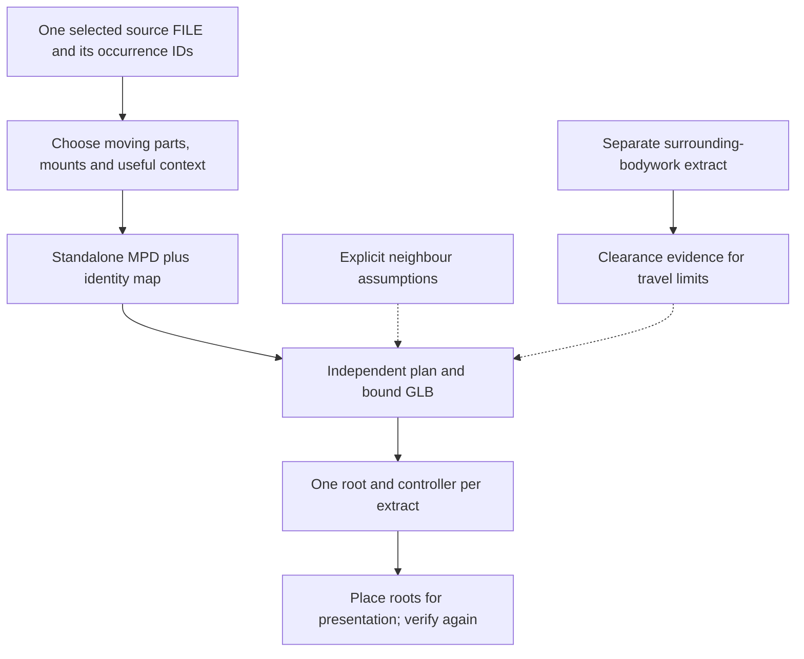

# Extracted mechanisms, context and movable Blender roots

The [combined scene](../../../output/42083-mechanisms/mechanisms.blend) places five
independent rigs side by side. The reusable technique is keeping source identity,
mechanical boundary assumptions and presentation placement separate. See
[scope and evidence](scope-and-evidence.md) for the selected artifacts.

## Extract from the same section you measured

The source inventory and motion authoring use `42083 - chiron.ldr`. IDs in that
selection differ from the outer `main.ldr` and the earlier W16 engine section.
Pass the exact same section to extraction:

```sh
.venv/bin/python scripts/extract_subsystem.py data/models-annotated/42083-1.mpd \
  --section '42083 - chiron.ldr' \
  --keep output/42083-mechanisms/wing/keep.json \
  --output output/new-wing/source/wing.mpd
./ldraw-mecha prepare output/new-wing/source/wing.mpd --output output/new-wing/study
```

The generic extractor flattens selected physical leaves using their composed
matrices and effective colours, retains embedded DAT definitions and attribution,
and writes `idmap.json`. Its report records the original `source_section`, source
hash and output hash. The new regression uses a translated/rotated parent to
check that section extraction preserves the selected section's frame rather
than baking the outer placement into it.

Remap every occurrence reference when transferring motion: body membership,
connection endpoints, view parts and part-valued inputs/outputs. Keep body names,
axes, anchors and equations only when the extraction preserves their coordinate
frame. See the earlier [suspension extraction reference](../42110-suspension-standalone/extraction-and-mounts.md)
for moving/mount/frame selection. Reconstructed gearbox gears are separate
derived geometry, as documented in [the cascade reference](cascaded-gearbox.md#reconstructed-geometry).

## State the boundary conditions



The drivetrain includes driven gearbox/D/N/R interface gears as context. The
D/N/R rig assumes a fixed third-gear output from its absent gearbox; it does not
read the gearbox rig's controller. An interface duplicated into two extracts
has two independent Blender objects. Side-by-side animation demonstrates local
mechanisms and cannot establish whole-car propagation.

To combine those extracts into one simulation, reconcile shared parts into one
owner, choose one interface angle and axis convention, and replace independent
drives with explicit shared signal relations. Then rerun the mechanism checks.

## Keep context when setting travel

An isolated opening mechanism can appear clear because its obstacles were
removed. This study keeps separate doors/wing clearance extracts with nearby
bodywork; the presentation extracts remain easier to see.

- Doors rotate about source pins `400` and `438`. Their mirror assemblies move
  with them, although they sit outside the door FILE sections. They are not
  independently actuated latches. This is why rigid membership needs inspection
  beyond submodel parenting.
- Choose the outward sign from a point behind the hinge: the X component of
  `axis cross (rear_point - pivot)` must point away from the car. Check both
  doors with asymmetric controls. Sampled surrounding-bodywork checks found no
  new crossings through 1.65 rad; the implemented limit is the smaller 1.2 rad.
- The [wing lift](wing-lift.md) has sampled context clearance through 0.40 rad,
  with new crossings at 0.45. The implemented limit follows that local study.

The context-selection boxes are themselves a scope choice. They do not prove
all obstacles were retained, and the clearance checker excludes rest-contact
pairs and does not test containment.

## Moving roots must preserve local mechanism motion

Import and build each plan against its explicit root, then position the entire
root. Do not bake display offsets into LDraw pivots or move individual rig parts.
The selected scene uses [separate controllers and collections](../../../scripts/blender/animate_42083_mechanisms.py)
and root-relative verification after layout.

This case exposed a rod-roll problem: a world-space copy-location offset included
the model root's translation, changing a rod's roll when its model moved. The
adapter now expresses the offset in the root's custom space:

```python
offset = reference.constraints.new('COPY_LOCATION')
offset.target = anchors[body['start']]
offset.use_offset = True
offset.owner_space = offset.target_space = 'CUSTOM'
offset.space_object = root
```

The reference remains parented to the model root. Its axis offset is a direction
in model space, not a second copy of the root's world position. The rod then aims
Y at its end anchor and uses that reference to establish roll.

The generic [lifecycle check](../../../scripts/blender/check_lifecycle.py) now
verifies nonzero motion with translated and translated/rotated roots, in addition
to rebuilding, removal/restoration, clamping and two-copy isolation. It passed
for the two-rod wing and the sixteen-rod W16. This test is useful whenever a rig
will be displayed beside another model.

## Reuse the saved scene without overwriting evidence

```sh
"$BLENDER_BIN" -b output/42083-mechanisms/mechanisms.blend --disable-autoexec \
  --python-exit-code 1 --python scripts/blender/check_42083_reopen.py -- \
  --report output/new-42083-review/reopen-check.json
```

Inspect the report's `passed` field and measured errors. The case verifier reads
the five saved plan files and now raises on failed checks. The scene builder can write a
fresh presentation with `--save` and `--report` paths, using existing plans/GLBs.
The source builder's selection commands additionally depend on
`output/42083-mechanisms/evidence/contacts-mechanical.json`; include that evidence
when sharing the case. Its default output path is the selected bundle, so use
the generic extraction API and new directories when studying another model.
