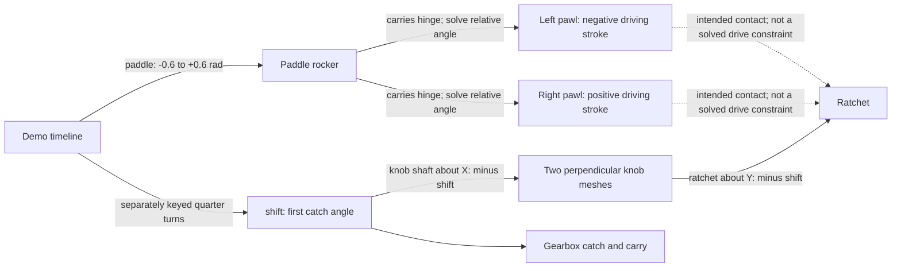
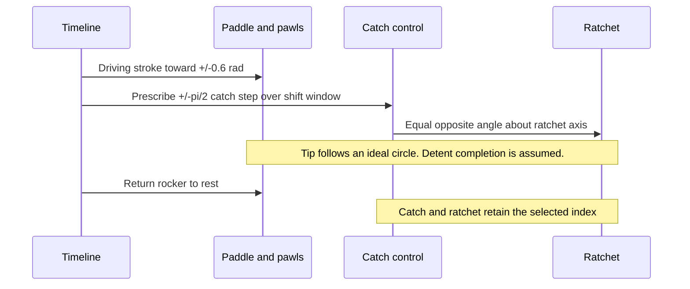

# Paddle rocker, driving pawls and an indexed ratchet

**Reference scope:** geometry for two hinged pawls carried by a rocking paddle
assembly, plus a prescribed quarter-turn shift animation. This introduces a
mechanism absent from the existing engine and suspension references. The saved
rig does **not** make a paddle stroke automatically drive the ratchet: `paddle`
and `shift` are separate controls. See [scope and evidence](scope-and-evidence.md).

## Parts and dependency directions

Use the gearbox [plan](../../../output/42083-mechanisms/gearbox/plan.json) and
[identity map](../../../output/42083-mechanisms/gearbox/source/idmap.json).

| Element | Selected-source ID | Extract ID | Motion role |
| --- | --- | --- | --- |
| Rocker support pin | `1/193/18` | `326` | Pivot O=(140,-38,-260); +Y axis |
| Left pawl hinge pin | `1/193/47` | `352` | Carried by `paddle_rocker`; pawl pivot starts at (100,-18,-260) |
| Right pawl hinge pin | `1/193/48` | `353` | Carried by the rocker; pivot starts at (180,-18,-260) |
| Left tip connector | `1/193/54` | `359` | In `pawl_l` |
| Right tip connector | `1/193/59` | `364` | In `pawl_r` |
| Ratchet axis piece | `1/193/23` | `331` | In `ratchet`, axis +Y through (140,22,-360) |
| First rotary catch | `0/90/66` | `142` | Angle `shift_v` about +Z |

The rocker owns 15 pieces. Each pawl owns five pieces and is a revolute child of
the rocker. The ratchet owns 11 pieces including its rollers.



The physical intended route is paddle → pawl → ratchet → knob shafts → catch.
The rig evaluates catch → knob shafts → ratchet, while animating the paddle
alongside it. A fresh check confirms that `paddle=-0.6, shift=0` leaves the
ratchet angle at zero. Diagrams must retain that distinction.

## Driving-stroke geometry

Work in XZ, rotating about +Y. Let O be the rocker pivot, P0 the pawl hinge,
T0 the tip point and C=(140,-360) the ratchet axis projected into that plane.
The two pawls have projected arm length ell≈83.849809 LDU and rest tip radius
rho≈24.652715 LDU. This **tip radius is not the roller-centre radius**: the
builder measures roller centres about 14.142 LDU from the axis. The tip-radius
circle is an idealized contact locus.

For rocker angle alpha, its moving hinge is:

```text
P.x = O.x + dx*cos(alpha) + dz*sin(alpha)
P.z = O.z - dx*sin(alpha) + dz*cos(alpha)
```

Intersect the circle of radius ell around P with the circle of radius rho around
C, using the [circle-intersection construction](wing-lift.md#close-each-rear-rod-on-the-rest-branch).
Select the solution matching T0 just inside the driving stroke. With the angle
convention `phi=atan2(T.x-P.x, T.z-P.z)`, set the child rotation to:

```text
pawl_relative = atan2(sin(phi-phi0-alpha), cos(phi-phi0-alpha))
```

Subtracting alpha prevents the parent rotation from being applied twice. On
the negative stroke only the left solution is used; the right pawl's relative
rotation stays at its rest value while its parent moves. The opposite happens
on the positive stroke. This models the inactive pawl lifting away, not contact
with individual rollers or a spring-loaded return.

Both driving branches were checked at 25%, 50%, 75% and 100% stroke against the
**transformed pawl tip**, not only intermediate signal coordinates. This checks
body parenting and the projected circle construction. It does not validate
surface engagement or forces.

## Demonstration sequence and its limits



Full pawl travel sweeps about **69.3 degrees**, short of a 90-degree index.
The remaining detent action is assumed, with the detent rocker and rubber bands
static. A future contact-driven model must solve that missing action; this
reference is suitable for branch geometry and coordinated demonstration.

In this source's signs, the negative stroke upshifts. Under the builder's
assumption that the driver pulls toward the steering wheel, that is the paddle
at X=180 on the driver's left. Remeasure this mapping instead of imposing a
conventional left/right label. The pawl body labels `l`/`r` identify their hinge
locations and should not be confused with the driver's paddle names.

The [timeline](../../../scripts/timeline_42083.py) uses 16-frame shift windows,
seven upshifts and seven downshifts. Its shaft phase carries are described in
[the gearbox reference](cascaded-gearbox.md#keep-angle-continuity-through-the-carry).
Gearbox clearance reports contain pawl/roller and detent contacts; neither those
reports nor the smooth animation prove a physically feasible stepper.

Implementation: `pawl_signals` and `build_gearbox` in the
[builder](../../../scripts/build_42083_mechanisms.py). Visual evidence:
[paddle stroke](../../../output/42083-mechanisms/gearbox/previews/paddle-up.png).
