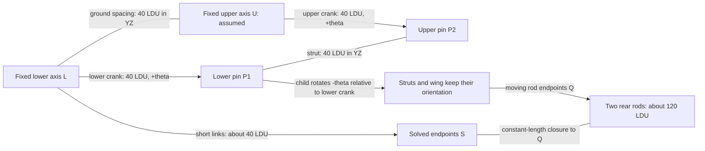

# Orientation-preserving wing lift with rear links

**Reference scope:** a manually driven parallelogram, with its upper axis assumed
fixed, plus two constant-length rear rods. This is useful for platforms, spoilers
and lifts that retain orientation. It does not establish the complete Chiron
top-speed-key mechanism. See [scope and evidence](scope-and-evidence.md).

## Four-bar geometry and identity

Use the wing [plan](../../../output/42083-mechanisms/wing/plan.json) and
[identity map](../../../output/42083-mechanisms/wing/source/idmap.json).
All revolute axes below are +X; the linkage is described in the YZ plane.

| Element | Selected-source ID | Extract ID | Body/role |
| --- | --- | --- | --- |
| Lower cross-axle | `107/11` | `42` | `wing_crank_lower`, rotates by theta |
| Lower crank pin | `107/12` | `43` | Point P1 carried by lower crank |
| Upper cross-axle | `107/14` | `45` | `wing_crank_upper`, rotates by theta about fixed U |
| Upper crank pin | `107/17` | `48` | Point P2 carried by upper crank |
| Links holding axis spacing | `107/13`, `107/16` | `44`, `47` | Static by assumption |
| Wing struts | `107/21`, `107/22` | `52`, `53` | Part of `wing_lift`; 24 pieces including the panel |
| Rear short links | `107/29`, `107/37` | `60`, `68` | `wing_link_l`, `wing_link_r` |
| Wing-side rear rod pins | `107/32`, `107/40` | `63`, `71` | Endpoints of `wing_rod_l`, `wing_rod_r` |

Measured rest-frame representatives:

```text
L  = ( 0,  -80.000000, 420.000000)
U  = ( 0, -118.637000, 430.353000)
P1 = (60,  -69.641227, 458.635422)
P2 = (60, -108.278227, 468.988422)
```

Project into YZ to measure the four nominal 40 LDU sides. L and U represent
points on axes; the crank pins are at X=60. Thus the plan's `upper_crank` check
uses a **72.111026 LDU spatial distance** from the representative U to P2,
approximately sqrt(60²+40²). That is not a 72 LDU crank radius.



## Two rotations produce translation

The controller `wing` supplies theta in [0, 0.4] radians. Both crank bodies rotate
by theta. `wing_lift` is a revolute child of `wing_crank_lower`, with origin P1
and signal `wing_neg = -theta`. Composing those rotations cancels orientation:

```text
wing orientation = R_X(theta) R_X(-theta) = identity
wing displacement = (R_X(theta) - identity) (P1 - L)
dy = ry*(cos(theta)-1) - rz*sin(theta)
dz = ry*sin(theta) + rz*(cos(theta)-1)
```

Here `(ry, rz) = (10.358773, 38.635422)`. At theta=0.4, the displacement is
approximately **(0, -15.863053, +0.984054) LDU**, with no tilt. At theta=0.27,
the Z displacement is about +1.363284 LDU. This is a shallow curved translation,
not an exact vertical slide; the earlier report's “straight up” is shorthand.

Parent composition is essential. Giving the panel only `-theta`, or rotating
the entire wing rigidly about L, describes different motion.

## Close each rear rod on the rest branch

In YZ, let Q be the wing-side endpoint after translation, S the short-link
endpoint to solve, r the short-link length and ell the rear-rod length. This
example measures r≈40.01 LDU and ell≈120.002258 LDU.

```text
v = Q - L; d = length(v); u = v/d
a = (r*r - ell*ell + d*d)/(2*d)
h² = r*r - a*a
S = L + a*u ± sqrt(h²)*perpendicular(u)
```

Choose the sign whose solution matches the source S at rest and retain that
branch over the allowed motion. Drive the short-link angle from `atan2` of S-L,
subtracting its rest angle and wrapping that offset with `atan2(sin(x),cos(x))`.
Use a `rod` body between S and Q, with a declared distance check; the rod never
stretches to repair a failed closure.

For another design, test circle reachability before accepting a range. The
builder clamps the square root against rounding, while endpoint distance checks
catch a false closure. Copying the clamp without those checks can hide an
impossible linkage. Changing branch at a toggle needs separate analysis.

## Checks and adaptation

The saved plan has 7 bodies, 50 moving parts, 22 signals and 3 distance checks.
Fresh source evaluation checks 65 travel samples and every one of the 480
animation frames; closure error remains below 0.000001 LDU. Fresh Blender
reopening and translated/rotated-root lifecycle checks pass at 0.002 LDU matrix
tolerance. These compare the rig with the declared model.

The retained clearance-context study adds nearby bodywork: samples through
0.40 rad reported no new crossings; 0.45 rad reported contact with rear fairing
pins. Adopted travel is 0..0.4. Sampling and its rest-contact exclusions do not
prove continuous clearance. U's fixed location and the static spacing links
remain assumptions; key-driven tilt has not been solved.

Implementation: `build_wing` in the
[builder](../../../scripts/build_42083_mechanisms.py). Visual evidence:
[lowered](../../../output/42083-mechanisms/wing/previews/lowered.png),
[lifted](../../../output/42083-mechanisms/wing/previews/lifted.png).
For another lift, remeasure both axis lines, all four sides, rod endpoints,
branch and surrounding travel limits before reusing the equations.
