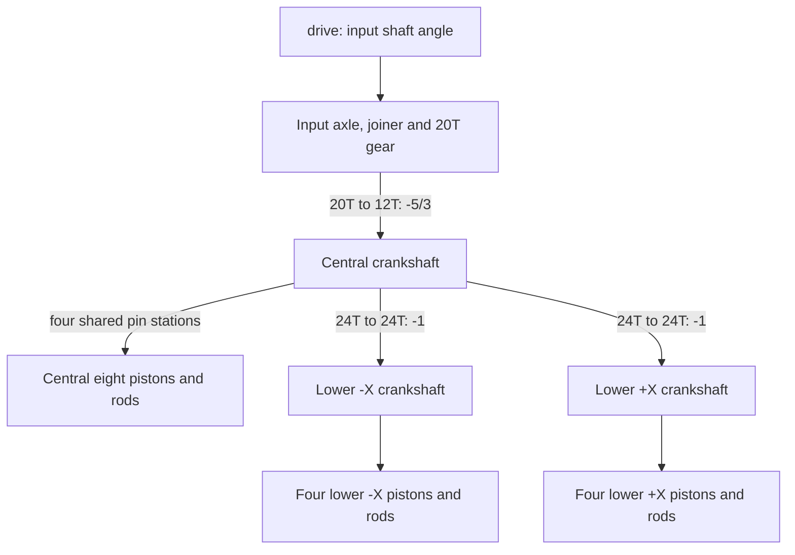

# 42083 W16: curated engine references

This collection describes the working engine rig selected by the user in
[archived 42083-w16](../../../examples/reference/42083-w16). It was recovered from the saved
motion plan, recipe, LDraw geometry, connector evidence, previews and Blender
file. Curation date: **2026-10-06**. The diagrams are fresh documentation of
that implementation, not executable plans.

The selected section contains **16 pistons on three crankshafts: 8+4+4**.
Its source description says “V8” and “two crankshafts”; the actual recursive
inventory and motion disagree with that description. Preserve the original
attribution and inspect the assembly instead of copying its label.

## Choose a mechanism

| Reference | Reusable idea | Qualification |
| --- | --- | --- |
| [Input and crankshaft gearing](gear-train.md) | One input, three geared crankshafts and explicit shaft groups | Ideal gear ratios; tooth phase and retention are not proved |
| [Central eight-cylinder assembly](central-eight.md) | Two banks sharing four crank-pin stations | Uses measured source phases and rounded dimensions |
| [Two lower four-cylinder banks](lower-banks.md) | Repeated, mirrored subassemblies with separate identities | Same signed crank angle does not mean the same world-space piston path |
| [Slider-crank linkage](slider-crank.md) | Analytic piston travel and endpoint-driven connecting rods | Planar, centred cylinder axes; no offset-cylinder solver |
| [Scope and evidence](scope-and-evidence.md) | Reproduction, Blender checks, clearance scope and provenance | Distinguishes checked kinematics from physical proof |

The lower banks share one page because they repeat the same mechanism. Their
individual part mappings and mirrored axes remain explicit. The linkage page
explains the construction shared by all sixteen cylinders.

## Overall arrangement

All three gear pairs use **parallel shafts**. “Double bevel” names the input
gears' tooth form; it does not imply a right-angle drive in this arrangement.

## Conventions and identity

- Original source: [42083-1.mpd](../../../data/models-annotated/42083-1.mpd), by
  Philippe Hurbain [Philo], CCAL 2.0. Selected section: `42083 - engine.ldr`.
- Occurrence IDs such as `83` and `84/16` belong to that **section selection**.
  They are not the paths those parts have in the complete car.
- The [standalone extraction](../../../examples/reference/42083-w16/engine-extracted.mpd)
  retains the section's physical identities and transforms; that equivalence
  was checked during curation.
- Lengths are LDU; angles are radians, right-hand rule, offsets from the source
  pose. All four rotating bodies use **+Z**. Up is -Y.
- Lower “left” / `crank_l` means the **-X** shaft in these documents;
  `crank_r` means +X. These names do not assert the installed car's handedness.
- Exact body membership, axes, anchors and signals are in the
  [saved plan](../../../examples/reference/42083-w16/plan.json).
  Diagram nodes summarize moving bodies or repeated linkage groups.

This engine is a useful reference for crank-and-conrod motion. The
[Defender engine](../42110/engine.md) demonstrates cam-driven followers instead.
Match the actual mechanism before choosing an example.

## Use the existing example

Open [rigged.blend](../../../examples/reference/42083-w16/rigged.blend), select
`CTRL_w16_42083` and inspect `drive`. Its range is -4*pi..+4*pi radians.
One control propagates through all three meshes, sixteen pistons and sixteen rods.

The saved scene contains a 1–480 frame demonstration at 24 fps, with linear
`drive` keys at frames 1, 120, 360 and 480: 0, +4*pi, -4*pi and 0.
It is a bidirectional demonstration sweep. It does not model engine acceleration,
combustion or torque. The [linkage page](slider-crank.md#cycle-length-and-animation)
explains how to choose a repeating geometric cycle.

For another model, remeasure gear tooth counts, shaft lines, rigid groups, rod
lengths, pin phases and cylinder directions. Agents can use these references
without authoring new reference diagrams.

## Evidence summary

The rig owns 66 moving parts in 36 bodies, with 20 signals and 16 distance checks.
The current recipe exactly reproduces its saved motion definitions. A fresh
97-position sweep, signed mesh checks, exact stroke-extrema checks and Blender
reopening/transform checks pass.

The retained 97-position clearance report found no new sampled surface crossings
under its exclusions. It did not test bore containment or continuous contact.
See [scope and evidence](scope-and-evidence.md) before extending that claim.
