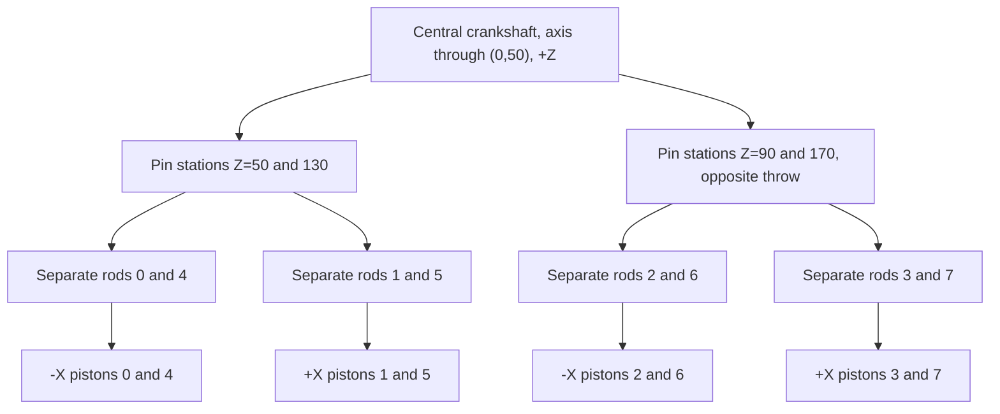

# Central eight-cylinder crank assembly

**Reference scope:** two rows of four pistons driven by four shared crank-pin
stations on `crank_c`. Each piston and connecting rod has its own body. The
rotation, slide and rod endpoints agree with the measured source geometry.

## Paired rods on one crank



“Rods 0 and 4” abbreviates `conrod0` and `conrod4`; these are two bodies at
different Z stations, not a rigid pair. At each station the left and right rod
anchors share the same crank-pin position. Their piston endpoints lie on
different cylinder lines, so they need separate closure solutions.

## Identity and phase map

All occurrence IDs below are relative to `42083 - engine.ldr`.
Phase is the rest crank-pin angle **relative to that cylinder's outward axis**,
as used in the [slider-crank equation](slider-crank.md).

| Piston body | Piston ID | Rod body / ID | Z (LDU) | Bank axis, approximately | Phase (degrees) |
| --- | --- | --- | ---: | --- | ---: |
| `piston0` | `41` | `conrod0` / `27` | 50 | (-0.8,-0.6,0) | -21.870802 |
| `piston1` | `42` | `conrod1` / `28` | 50 | (+0.8,-0.6,0) | -128.130773 |
| `piston2` | `43` | `conrod2` / `31` | 90 | (-0.8,-0.6,0) | +158.129056 |
| `piston3` | `44` | `conrod3` / `32` | 90 | (+0.8,-0.6,0) | +51.868974 |
| `piston4` | `45` | `conrod4` / `36` | 130 | (-0.8,-0.6,0) | -21.870802 |
| `piston5` | `46` | `conrod5` / `37` | 130 | (+0.8,-0.6,0) | -128.130773 |
| `piston6` | `47` | `conrod6` / `39` | 170 | (-0.8,-0.6,0) | +158.129056 |
| `piston7` | `48` | `conrod7` / `40` | 170 | (+0.8,-0.6,0) | +51.868974 |

The four crank-pin XY positions alternate:

- Z=50,130: (-9.659,47.412).
- Z=90,170: (+9.659,52.588).

Relative to the shaft at (0,50), the throw measures **9.999701 LDU**, nominally
10. Rod lengths are approximately 40.000166–40.000402 LDU. Preserve those measured
values when reproducing this source pose. The central crank's approximately
15° source orientation is already included in the phases; adding another 15°
driver offset would count it twice.

Piston parts are `2851.dat`; rods are `2852.dat`. Cylinder heads `15`, `20`,
`23`, `24`, `49`, `54`, `57` and `58` stay static.

## Motion

Each of the eight pistons uses `theta = crank_c = -(5/3)*drive`. With its
individual phase `phi`, radius `r`, rod length `L` and source distance `s0`:

```text
piston_offset = r*cos(phi+theta)
              + sqrt(L*L - r*r*sin(phi+theta)**2) - s0
```

The source starts between dead centres. Consequently the displacement ranges
are not all 0..20 LDU. For example:

| Body | Approximate source-relative displacement range |
| --- | ---: |
| `piston0` | -19.105861 .. +0.893542 LDU |
| `piston1` | -3.044299 .. +16.955103 LDU |
| `piston2` | -0.545898 .. +19.453505 LDU |
| `piston3` | -15.393135 .. +4.606268 LDU |

Pistons 4–7 repeat those respective profiles. This is the source's mechanical
phase pattern, not a claimed combustion firing order.

## Evidence and adaptation

All eight rod distances pass throughout the 97-position review sweep. Exact
extrema give a stroke of approximately **19.999402 LDU** for each central piston.
At the asymmetric phase `drive=0.37`, `piston0=-4.582876` and
`piston1=-2.732072` LDU; opposite bank directions do not imply opposite
scalar displacements.

The source cylinder-axis offsets from the crank line are no greater than
approximately 0.0002 LDU. The helper accepts up to 0.5 LDU, then uses a centred
radial cylinder direction. This tolerance handles this source's rounding; it
does not implement an intentionally offset slider crank.

Reuse the separate rod bodies, measured phases and source-relative slides.
Check the target's pin-sharing geometry, cylinder axes and possible rod/head
interference. Distance closure alone does not prove bore containment.

Implementation: [`slider_cranks` and `w16_42083`](../../../ldraw_mechanisms/recipes.py).
Preview: [exposed moving assembly](../../../examples/reference/42083-w16/pose-crank-quarter.png).
