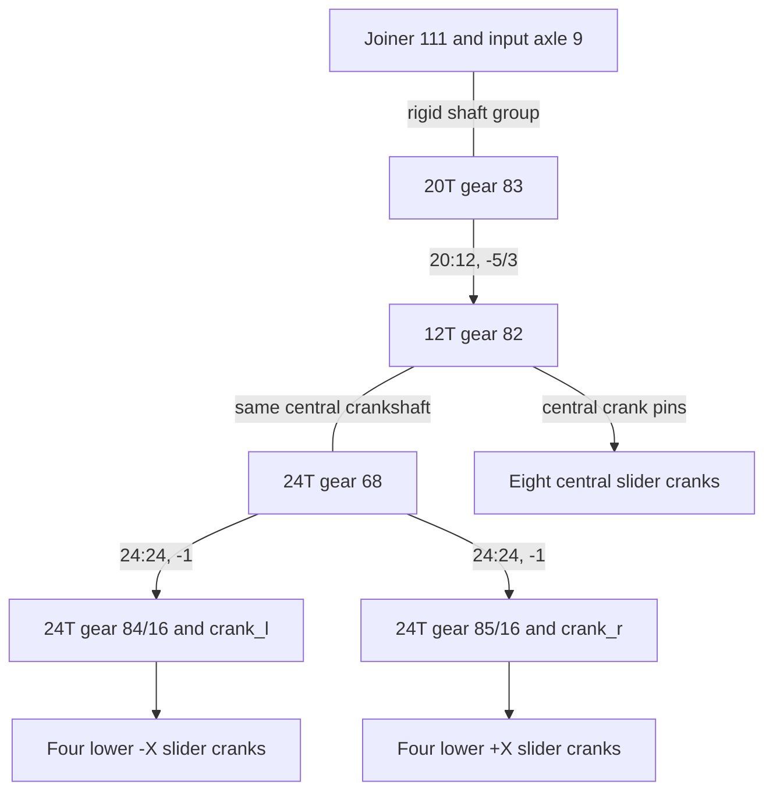

# Input shaft and three-crank gear train

**Reference scope:** three external gear meshes, four rotating rigid groups and
one input interface. The source uses a parallel 20T/12T double-bevel pair and
two 24T/24T spur pairs. All angles here are about +Z.

## Mechanical chain



There is no lower-left to lower-right mesh. Their centres are 72 LDU apart;
two reviewed 24T profiles require 60 LDU.

## Shaft identities

| Body | Shaft line through (LDU) | Representative members | Number of parts |
| --- | --- | --- | ---: |
| `input_shaft` | (0, 90, -40), +Z | axle `9` / `55013.dat`, 20T `83` / `18575.dat`, joiner `111` / `59443.dat` | 3 |
| `crank_c` | (0, 50, 200), +Z | 12T `82` / `32270.dat`, 24T `68` / `24505.dat`, axle `67` / `4519.dat`, crank end `38` | 11 |
| `crank_l` | (-36, 98, 200), +Z | 24T `84/16`, axle `84/15`, crank end `84/17` | 10 |
| `crank_r` | (36, 98, 200), +Z | 24T `85/16`, axle `85/15`, crank end `85/17` | 10 |

The origin's Z coordinate selects a point on a shaft line, not a particular
joint location. A single central body contains the gears at both ends and all
its crank pieces. Connecting rods are separate bodies.

The recipe selects reviewed crank-part types within 10.5 LDU of each shaft line
and checks the group sizes. This is a model-specific selector, not a general
rigid-group discovery rule. In particular, Beam 1 `110` has a round hole and
stays static around the input shaft; sharing an axis is not enough to join it.

## Geometry and ratios

| Input → output | Gear centres | Common gear plane | Distance | Output/input about +Z |
| --- | --- | --- | ---: | ---: |
| `83` → `82` | (0,90,-40) → (0,50,-40) | Z=-40 | 40 LDU | -5/3 |
| `68` → `84/16` | (0,50,200) → (-36,98,200) | Z=200 | 60 LDU | -1 |
| `68` → `85/16` | (0,50,200) → (36,98,200) | Z=200 | 60 LDU | -1 |

The reviewed pitch-radius rule is 1.25 LDU per tooth: 25+15=40 for the input
pair and 30+30=60 for each crank pair.

```text
d       = clamp(drive, -4*pi, +4*pi)
crank_c = -(5/3) * d
crank_l = -crank_c
crank_r = -crank_c
```

At `drive=0.37`, the central angle is -0.616666667 rad and both lower angles
are +0.616666667 rad. These are offsets from their different rest orientations.

### Axis signs in discovery reports

The source gears `68`, `82` and `83` report local Z pointing toward -Z.
Gears `84/16` and `85/16` report +Z. Consequently the discovery report gives
`b_per_a=+1` for the central-to-lower pairs. When both body angles are expressed
about +Z, the ratio is **-1**.

For the input pair, discovery lists `82` first and `83` second and reports
`b_per_a=-0.6`. Driving `83` instead requires the inverse, -5/3.
Always check ordering and axis direction before copying a ratio.

## Interfaces and evidence

Joiner `111` is the engine's interface to the omitted gearbox. The engine
section occurs at type-1 index 157 in `42083 - chassisrear.ldr`.
Selecting the engine gives it an independent frame and controllable input; it
does not establish the complete car's transmission ratios.

The original [input contact report](../../../examples/reference/42083-w16/evidence/contacts-input.json)
contains axle `9` mating with gear `83` and joiner `111`.
The [rear gear contact report](../../../examples/reference/42083-w16/evidence/contacts-24t.json)
contains lower axle/gear/crank connections. Its missing central-crank contacts
were a discovery gap, not evidence that the crank was disconnected.

Fresh [coaxial evidence](../../../examples/reference/42083-w16-reference-review/coaxial.json)
recovers shared connector lines for `38`, `67` and `68`.
Fresh [gear geometry](../../../examples/reference/42083-w16-reference-review/gear-meshes.json)
recovers exactly the three meshes. These are geometric candidates; their
agreement with the saved ratios does not prove tooth phase, axial retention,
backlash or torque capacity.

Implementation: [`w16_42083`](../../../ldraw_mechanisms/recipes.py).
Next: [central assembly](central-eight.md), [lower banks](lower-banks.md).
