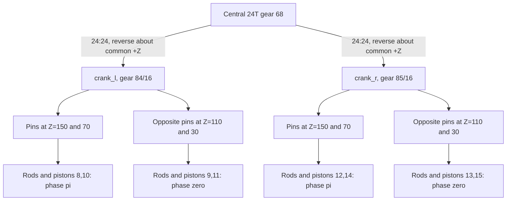

# Lower four-cylinder banks: mirrored nested assemblies

**Reference scope:** two repeated four-cylinder slider-crank assemblies, one at
-X and one at +X. Both crankshafts are coupled to the central shaft by 24T pairs.
Their source identities, shaft lines and cylinder axes remain separate.

## Connections



The corresponding -X/+X cylinders have the same scalar displacement profile.
Their translations point along mirrored world-space axes; the bodies must not
share a single translation vector.

## Identity map

| Group | Shaft line through (LDU) | Outward cylinder direction | Crank signal |
| --- | --- | --- | --- |
| Nested occurrence `84` | (-36,98,200), +Z | (-0.8,-0.6,0) | `crank_l = +(5/3)*drive` |
| Nested occurrence `85` | (+36,98,200), +Z | (+0.8,-0.6,0) | `crank_r = +(5/3)*drive` |

| Piston body | Piston ID | Rod body / ID | Z (LDU) | Phase | Source distance from shaft |
| --- | --- | --- | ---: | --- | ---: |
| `piston8` | `84/30` | `conrod8` / `84/18` | 150 | pi | 30 LDU |
| `piston9` | `84/31` | `conrod9` / `84/21` | 110 | 0 | 50 LDU |
| `piston10` | `84/32` | `conrod10` / `84/24` | 70 | pi | 30 LDU |
| `piston11` | `84/33` | `conrod11` / `84/27` | 30 | 0 | 50 LDU |
| `piston12` | `85/30` | `conrod12` / `85/18` | 150 | pi | 30 LDU |
| `piston13` | `85/31` | `conrod13` / `85/21` | 110 | 0 | 50 LDU |
| `piston14` | `85/32` | `conrod14` / `85/24` | 70 | pi | 30 LDU |
| `piston15` | `85/33` | `conrod15` / `85/27` | 30 | 0 | 50 LDU |

The recipe's numbering follows source occurrence order; it runs down Z in these
subassemblies. Do not assume `piston8` is the cylinder with the smallest Z.

Each crank body owns ten parts. The cylinder heads with suffixes `/0`, `/4`,
`/7` and `/9` under each occurrence stay static. The complete subassembly cannot
be parented to its crank: it includes fixed heads, rotating pieces, translating
pistons and rods that both translate and swing.

## Two alternating profiles

Here `r=10` and `L=40` LDU, to floating-point precision. Use
`theta=+(5/3)*drive` in both banks.

```text
phase pi: offset = 10*cos(pi+theta)
                 + sqrt(1600 - 100*sin(pi+theta)**2) - 30
phase 0:  offset = 10*cos(theta)
                 + sqrt(1600 - 100*sin(theta)**2) - 50
```

The first group travels 0..+20 LDU relative to rest; the second travels
-20..0 LDU. Both have a 20 LDU stroke. They are not simply opposite sine waves:
connecting-rod obliquity contributes the square-root term to both.

At `drive=0.37`:

- `piston8` and `piston12` move +1.421619 LDU.
- `piston9` and `piston13` move -2.262167 LDU.

The lower pin stations are displaced 20 LDU along Z from the corresponding
central-bank station pattern. This follows the nested source transforms and is
not an animation offset to add later.

## Evidence and adaptation

The eight lower rod closures pass the fresh sweep, and exact extrema confirm
20 LDU strokes. Original connector evidence supports each lower gear/axle/crank
chain; the recipe additionally relies on its reviewed part types and group counts.

For another mirrored assembly, expand both occurrence transforms before
measuring pins and cylinder axes. Verify source rest positions, signed rotation
axes and cylinder matching independently on each side. A shared submodel file
does not make two occurrences the same rigid body.

Implementation: [world-space bank loop in `w16_42083`](../../../ldraw_mechanisms/recipes.py).
Shared construction: [slider-crank linkage](slider-crank.md).
Input: [gear train](gear-train.md).
