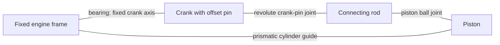
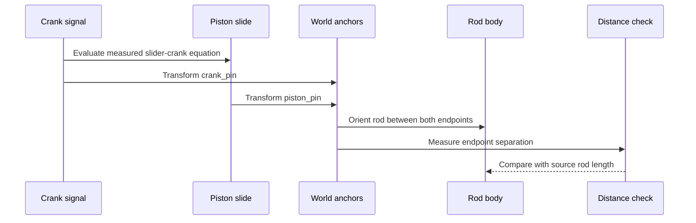

# Slider-crank linkage: a piston and its connecting rod

**Reference scope:** a reusable centred, planar slider crank with measured rest
phase. This is the construction behind all sixteen W16 cylinders. It solves
position and rod orientation; it does not simulate forces or cylinder contact.

## Mechanical loop



The rod belongs to neither the crank's rigid group nor the piston's rigid group.
Both endpoints determine its pose. The two heads in the
[central assembly](central-eight.md) can share a crank pin while needing
different piston and rod poses.

## Measurements and equation

In the selected section frame the crank rotates about +Z. At the relevant
cylinder station let:

| Symbol | Meaning |
| --- | --- |
| `C` | Point on the crank line at the pin's Z |
| `K0` | Source crank-pin position |
| `P0` | Source piston-ball position |
| `u` | Unit cylinder direction outward from `C` to `P0` |
| `r` | Crank throw, nominally 10 LDU |
| `L` | Rod pin-to-ball length, nominally 40 LDU |
| `s0` | Source distance from `C` to `P0` along `u` |
| `phi` | Source angle of `K0-C` minus source angle of `u` in the XY plane |
| `theta` | Crank angle offset from source, about +Z |

```text
q(theta) = r*cos(phi+theta)
         + sqrt(L*L - r*r*sin(phi+theta)**2)
slide    = q(theta) - s0
P(theta) = P0 + u*slide
K(theta) = C + Rz(theta)*(K0-C)
```

The positive square root selects the source's outward piston branch. At rest,
`slide=0`. Radius and rod length come from the actual source, so the central
bank keeps its small rounding differences.

The source rod `2852.dat` has its crank-pin anchor at local (0,0,0) and piston
ball at local (0,-40,0). The recipe transforms both and matches the nearest
`2851.dat` piston origin, rejecting a mismatch above 1 LDU. In a new assembly,
confirm the match and uniqueness instead of assuming proximity always identifies
the correct piston.

## How the plan expresses it



This sequence is evaluation order, not a claim that one physical event happens
later than another. A `pistonN` prismatic body receives the slide signal.
`crank_pinN` belongs to its crank body and `piston_pinN` belongs to the piston.
The `conrodN` body uses those anchors, a +Z plane normal and a measured rest
orientation; it has no independent rotation driver.

Every rod has a distance check with 0.02 LDU tolerance. The W16 review's maximum
97-position error was about 3.6e-14 LDU. Such closure is a property of the
kinematic model, not a mesh-collision result.

## Applicability

The helper requires a crank about +Z, cylinder motion in the XY plane and a
cylinder line passing through the crank centre. It checks the source cylinder
axis's lateral miss in **LDU**, accepting at most 0.5 LDU. In this engine the
largest measured miss is about 0.0002 LDU.

The authored slide axis is the radial `C`-to-`P0` line. The helper does not solve
a deliberately offset bore, a tilted motion plane or two noncoplanar rod ends.
Transform a suitable planar mechanism into a compatible frame or use an
appropriate linkage solver when these assumptions do not hold.

Remeasure `r`, `L`, `u` and `phi`. Copying only the nominal 10/40 dimensions loses
the source pose and bank phase. Check nonzero angles of both signs and multiple
turns; rest-pose agreement alone is weak evidence.

## Cycle length and animation

The crank runs at 5/3 of the input speed, with its sign given by the gear train.
Therefore:

| What must repeat | Input increment | What returns |
| --- | ---: | --- |
| Cranks, rods and pistons | 6*pi/5 rad = 0.6 input turns | All engine linkage transforms, excluding `input_shaft` |
| All four shaft-body frames | 6*pi rad = 3 input turns | Input shaft makes 3 turns; each crank makes 5 |

Both were checked against evaluated transforms. The second interval fits within
the controller's limits as a sweep from -3*pi to +3*pi. This states a sufficient
full-frame cycle; visual symmetries of individual parts may repeat sooner.

A continuous piston cycle has two dead centres and two travel directions.
It has no implemented intake/compression/power/exhaust state machine. Adding
those labels would assert combustion timing absent from this LEGO mechanism.
The saved 480-frame sweep reverses direction at its extremes; it is not a
constant-speed loop or a dynamic acceleration model.

Implementation: [`slider_cranks`](../../../ldraw_mechanisms/recipes.py),
[rod evaluation](../../../ldraw_mechanisms/plan.py).
Checks: [W16 motion tests](../../../tests/test_motion.py).
