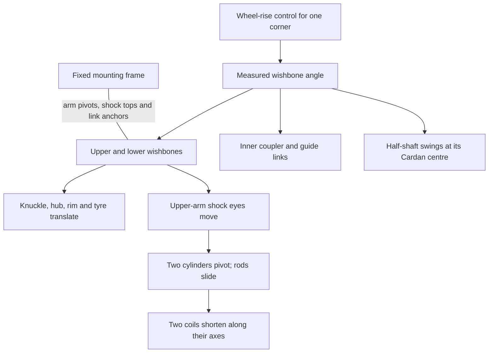

# 42110 standalone suspension: curated reference recipe

This case isolates the Defender's four suspension corners and their mounting
frame. The user selected its working animation in
[output/42110-suspension-standalone](../../../output/42110-suspension-standalone).
These references were recovered from the measured builder, saved plan, source
mapping, checks and previews; the previous generated diagrams were not used.
Curation date: **2026-10-06**.

This is a documentation recipe for adapting a mechanism. The existing build
scripts remain the executable example; no additional CLI recipe is required
to read or use the references.

## Choose a part of the mechanism

| Reference | Reusable construction | Qualification |
| --- | --- | --- |
| [Wishbones, knuckle and links](wishbones-and-links.md) | Equal parallel arms, wheel rise and orientation cancellation | This arrangement has no camber/toe change; that is not universal suspension behaviour |
| [Articulating half-shafts](halfshafts.md) | A constant-length shaft follows suspension travel | Articulation only; wheel spin and drive are absent |
| [Telescoping shocks and springs](shocks.md) | Separate cylinder, sliding rod and an axially scaled coil | Geometric compression, not spring forces or constant wire geometry |
| [Extraction and fixed interfaces](extraction-and-mounts.md) | Preserve source frames and identities while selecting a subsystem | Some omitted supports are represented by fixed boundary points |
| [Four-corner animation](animation.md) | Independent wheel inputs combined into a demonstration | Prescribed heave/roll/pitch patterns, not a dynamics simulation |
| [Scope and evidence](scope-and-evidence.md) | Checks, source tolerances, travel limits and provenance | Read before extending the claims to a complete vehicle |

## Mechanism overview

Each corner uses the same pattern, with different occurrence IDs and mirrored
axes. Front corners have one tie rod; rear corners have two toe links.

The static frame prescribes the support locations. No chassis-body motion, road
contact, steering, wheel spin or drivetrain torque is solved in this case.

## Controls and coordinates

| Control | Corner | Wheel rise from source |
| --- | --- | ---: |
| `travel_fl` | Front left | 0..30.5 LDU |
| `travel_fr` | Front right | 0..30.5 LDU |
| `travel_rl` | Rear left | 0..40.5 LDU |
| `travel_rr` | Rear right | 0..40.5 LDU |

The source pose is **full droop**, with shocks approximately 110 LDU long.
Zero does not mean normal ride height. Rise is measured along chassis-up,
perpendicular to the wishbone axes; the chassis has a small source pitch.

- Source: [standalone MPD](../../../output/42110-suspension-standalone/source/42110-suspension-standalone.mpd),
  derived from Philippe Hurbain's [42110 model](../../../data/models-annotated/42110-1.mpd),
  with attribution retained.
- Section: `42110-suspension-standalone.ldr`. The extract preserves the
  full-model coordinate frame: LDU, up approximately -Y, front -Z, left +X.
- Bare IDs in the reference tables are the **new standalone IDs**, not full-car
  paths. [idmap.json](../../../output/42110-suspension-standalone/source/idmap.json)
  maps the old paths to them.
- Angles are radians about explicit axes, relative to the imported source pose.
  Lengths and travel are LDU.
- [plan.json](../../../output/42110-suspension-standalone/plan.json) contains the
  complete membership, signals and anchors. The tables show useful representatives.

Open [animated.blend](../../../output/42110-suspension-standalone/animated.blend)
for the 612-frame, 24 fps demonstration. `SuspensionCamera` shows the complete
subsystem; `CornerCamera` shows the rear-left linkage. The controller exposes
the four `travel_*` properties.

## Evidence and reuse

The model contains 259 physical parts: 117 moving, 38 mounts and 104 further
frame parts. The rig has 50 bodies, 44 signals and 48 distance checks.

The measured full-model builder and standalone remapping reproduce the selected
motion exactly. Fresh asymmetric poses, a 196-case control sweep, all 612 timeline
frames and spring-endpoint checks pass. The saved animation was also reopened
and checked in Blender.

For another model, establish its pivot geometry and boundary conditions before
copying the equations. [The original Defender drivetrain reference](../42110/README.md)
is a separate rig: combining steering/drive with suspension requires reconciling
body ownership, moving joint frames and the coupled linkage equations.
