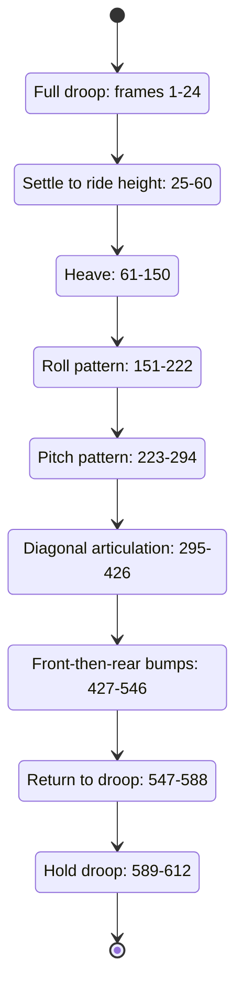

# Four-corner suspension demonstration

**Reference scope:** a source-only timeline drives four independent wheel-rise
controls through useful review poses. The frame stays fixed. The animation
shows suspension geometry under prescribed inputs, not vehicle dynamics.

## Demonstration sequence



This state diagram describes the demonstration's phases. It does not turn
continuous suspension travel into discrete mechanical states.

## Control patterns

The base ride-height input is one third of the smallest travel limit:
`30.5/3 = 10.166667` LDU at every corner. The common oscillation amplitude is
about 9.658333 LDU.

| Pattern | Prescribed relationship |
| --- | --- |
| Heave | All four controls receive the same rise |
| Roll | Left increases while right decreases, then reverses |
| Pitch | Front increases while rear decreases, then reverses |
| Articulation | FL+RR move toward 98% of their limits while FR+RL move toward droop; then the diagonal swaps |
| Single-side bump | Front and rear on that side receive matching raised-cosine pulses with a 14-frame delay |
| Return | All controls interpolate back to zero |

Each corner's own maximum is respected, so front/rear articulation amplitudes
differ. The bump's front/rear delay is authored timing; the scene does not compute
road speed or contact from a ground mesh.

For an asymmetric static check, use:

```text
travel_fl = 9.15
travel_fr = 30.5
travel_rl = 0
travel_rr = 28.35
```

All 48 declared distance checks pass there. Independent corner controls should
not inadvertently drive the other three corners.

## Keying and verification

[`animate_defender_suspension.py`](../../../scripts/blender/animate_defender_suspension.py)
provides `travel`, `timeline` and `continuity` functions usable without Blender.
The animation script keys all four controls once per frame, with linear
interpolation between frame samples.

At 24 fps, the stored clip contains 612 frames. The fresh source review checks
closure on every frame and verifies the script's per-frame thresholds:

| Motion type | Maximum permitted step in the continuity check |
| --- | ---: |
| Revolute angle | 0.2 rad |
| Prismatic slide | 3 LDU |
| Spring scale | 0.1 |

The selected Blender action was checked against timeline values at seven frames,
including asymmetric articulation. Existing animation evidence compares evaluated
Blender transforms at 17 frames; the fresh review also verifies rest, full bump
and two asymmetric control sets.

A passing step threshold bounds sampled motion changes. It does not establish
continuous contact, smooth subframe acceleration, spring forces or physical
weight transfer.

## Adapting the demonstration

Use the target's own limits and resting pose, then include both symmetric and
asymmetric inputs. Show intermediate travel and endpoints. A model whose source
starts at ride height will need different zero semantics and may support both
positive and negative travel.

Previews: [whole subsystem](../../../output/42110-suspension-standalone/preview-rest.png),
[rear-left articulation](../../../output/42110-suspension-standalone/preview-corner-articulation.png).
