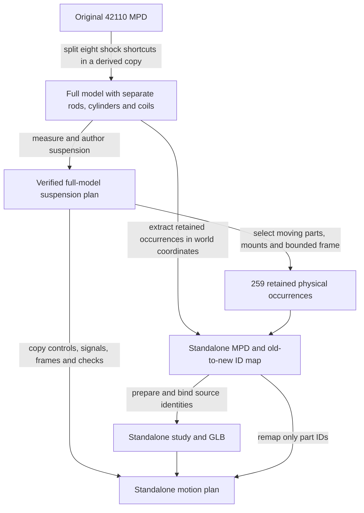

# Extracting a suspension with usable fixed interfaces

**Reference scope:** a reproducible way to study a subsystem on its own while
retaining its coordinate frame, motion and attribution. The selected mounting
parts provide context; fixed boundary points still stand in for some omitted
structure.

## Preparation and identity flow

Generated source files are written under `output/`; the reviewed copies are
retained in `examples/reference/`. The original attributed model and its
hierarchy remain intact.

## Split complete shocks before conversion

The original shock shortcuts `76537.dat` and `41838.dat` are physical leaves.
A merged imported mesh cannot provide three independent rigid/deforming motions.

[`split_shortcuts.py`](../../../scripts/split_shortcuts.py) creates derived
embedded assemblies from the official shortcut definitions:

| Child suffix in the derived full model | Physical part |
| --- | --- |
| `/0` | Piston rod `4254.dat` |
| `/1` | Cylinder `4255.dat` |
| `/2` | Coil `22977.dat` or `41837.dat` |

The shortcut's original type-1 placement becomes an assembly at the same ID.
All other occurrence identities stay valid. Tests check the official subpart
transforms, attribution and that the original source is unchanged.

This step is relevant whenever a shortcut combines components that need
different motion. Splitting arbitrary mesh triangles would lose this source
identity and assembly information.

## Selection boundary

[`build_suspension_standalone.py select`](../../../scripts/build_suspension_standalone.py)
retains:

| Role | Count | Rule |
| --- | ---: | --- |
| Moving | 117 | Every occurrence owned by the suspension plan |
| Mount | 38 | Static parts joined to the moving pieces by contacts, connector lines or coincident joint centres |
| Frame | 104 | Bounded connector expansion, depth at most four, stopping at the first supporting beams/liftarms |

The reviewed selection excludes the rack, drivetrain, engine, bodywork and
Cardan input yokes. It also excludes parts moved by the separate Defender
drivetrain rig. The stored [keep.json](../../../examples/reference/42110-suspension-standalone/keep.json)
records each retained part's role and reason.

Two front tie-rod inner pins remain as fixed anchors: old paths
`0/0/111/9` and `0/0/111/10` become standalone `74` and `75`.
The rack and angle connectors holding them are absent, so those pins have no
visible holder. The three static Cardan crosses likewise belong to a cut through
the omitted input-side assemblies.

These fixed locations are legitimate boundary conditions for a kinematic
subsystem example. They are not evidence that the extracted collection is a
self-supporting physical build.

## Frame-preserving extraction

[`extract_subsystem.py`](../../../scripts/extract_subsystem.py) writes each
retained occurrence with its composed world matrix and effective colour.
Embedded bearing, hub and rim DAT definitions remain physical leaves with their
required subfiles. Attribution and old occurrence comments are retained.

The source therefore becomes a flat selection in the **same coordinate frame**.
The original IDs change, but no coordinate rebasing is needed. Example:

| Original path | Standalone ID | Role |
| --- | --- | --- |
| `0/0/53` | `26` | Front-left upper wishbone |
| `0/0/79/0` | `56` | Front-left first shock rod |
| `0/0/79/1` | `57` | Its cylinder |
| `0/0/79/2` | `58` | Its spring |
| `0/380` | `251` | Front-left rim |

[The ID map](../../../examples/reference/42110-suspension-standalone/source/idmap.json)
is a bijection onto all 259 retained leaves. Curation found a maximum world-matrix
difference of approximately 5.7e-14. Re-extraction is also covered by a
byte-for-byte reproduction test.

The standalone `remap` function copies controls, signals, body origins/axes,
anchors and checks, changing only each body's instance membership IDs.
Compared poses produce identical body transforms to the full suspension plan.

## Reusing the method

Choose the subsystem boundary explicitly, including each input and fixed mount.
Keep the ID map with the extract. If a new extraction changes the coordinate
frame, transform the motion frames and anchors as well; simply renaming IDs
would then be insufficient.

A small extract allows bounded discovery to cover the whole selection. Here
the saved preparation reports 419 contacts and axle-hole evidence for all
36 axles. That supports further analysis; it does not infer every rigid group
or prove a mechanically complete mounting structure.

Executable workflow: [original reproduction commands](../../../examples/reference/42110-suspension-standalone/REPORT.md).
Those commands recreate the selected output paths; choose a new output directory
when making an independent copy.
