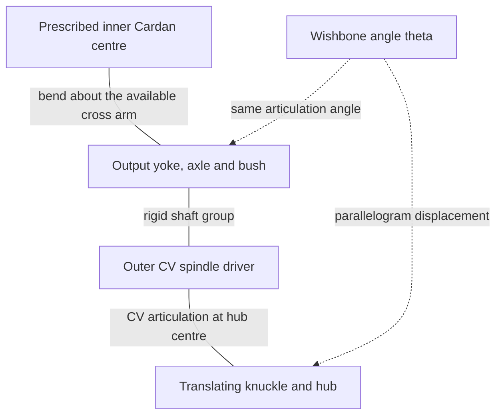

# Half-shafts that follow suspension travel

**Reference scope:** bending a stationary-drive half-shaft as a wheel rises.
The shaft keeps its length and pivots at a fixed Cardan centre. Drive rotation,
universal-joint speed variation and wheel spin are outside this example.

## Connection path



The dashed arrows describe the shared motion parameter. They do not represent
a gear train. At rest and during travel, one joint centre stays fixed and the
other follows the wheel assembly.

## Standalone identities

| Corner | Output yoke | CV spindle driver | Cross | Cross treatment |
| --- | --- | --- | --- | --- |
| FL | `14` | `32` | `15` | Static |
| FR | `12` | `37` | `13` | Static |
| RL | `79` | `122` | `80` | Static |
| RR | `81` | `129` | `82` | Included in `halfshaft_rr` |

Bodies are `halfshaft_fl`, `halfshaft_fr`, `halfshaft_rl` and `halfshaft_rr`.
Each includes the output yoke, axle, bush and spindle driver. The rear-right
body additionally includes its cross because that corner's fork phase puts
the required articulation on the input-yoke arm. The builder checks which
cross arm is parallel to the wishbone axis; it does not assume all corners
have the same phase.

The input yokes were excluded from the standalone model. The three static
crosses and fixed hinge locations therefore describe a cut through the omitted
drivetrain, not a complete mounted Cardan input assembly.

## Geometry and motion

| Corner | Fixed Cardan centre (LDU) | Rest outer CV centre (LDU) |
| --- | --- | --- |
| FL | (80,-125.04,-299.88) | (177.81,-104.228,-299.942436) |
| FR | (-80,-125.04,-299.88) | (-177.81,-104.228,-299.942436) |
| RL | (80,-123.3,280.12) | (177.81,-102.488,280.057564) |
| RR | (-80,-123.3,280.12) | (-177.81,-102.488,280.057564) |

All four lengths measure approximately **99.999697 LDU**. Their vectors differ
from the corresponding 100 LDU wishbone vector by about 0.00975 LDU, within the
builder's 0.3 LDU tolerance. The source is close to the ideal parallel-link
construction; it is not an exact coincident-endpoint proof.

Let `J` be the fixed Cardan centre and `S0` the source outer centre:

```text
S(theta) = J + R(n,theta)*(S0-J)
```

Each half-shaft rotates by the corner's `theta` about the same axis direction
`n` used for the wishbones. It needs no telescoping degree of freedom in this
particular model.

The checks preserve the Cardan-to-knuckle distance and the relationship between
the moving shaft end and the knuckle. They do not validate an exact CV spin
law, pin retention or ball seating.

## Reuse

Match both joint centres, link lengths, bend axis and cross phase. If the outer
centre is driven by a non-parallelogram suspension, a fixed-length shaft with
this single angular signal may no longer reach it.

When adding drive, the cross and yokes need their rotational kinematics as well
as articulation, and the hub needs a separate spin motion. The stationary
construction here must not be copied as a rotating Cardan solution.
The [Defender Cardan reference](../42110/internal-propshafts.md) explains the
rotational case for fixed geometry; combining both cases requires solving their
moving frames.

Implementation: [half-shaft grouping and hinge selection](../../../scripts/build_defender_suspension.py).
