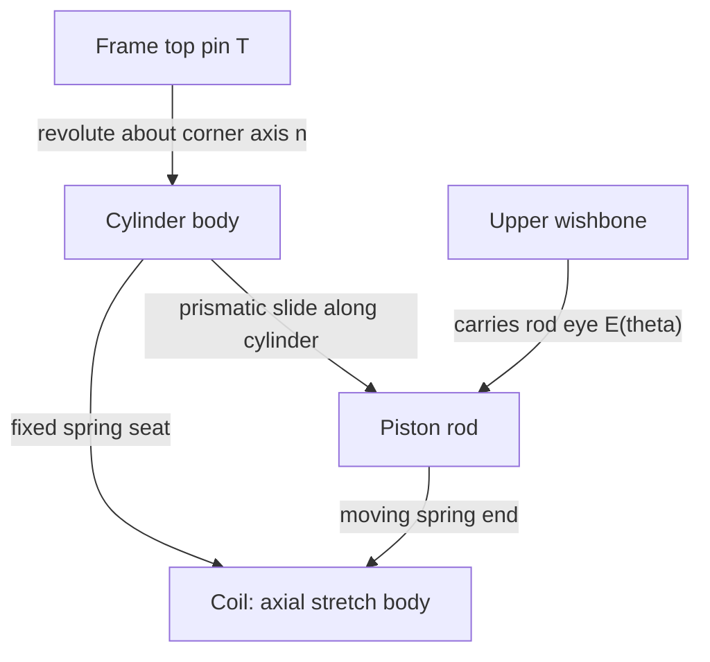

# Telescoping shocks and axially compressed springs

**Reference scope:** eight shocks, two per corner, split into a cylinder, sliding
rod and coil. The upper-arm eye moves, the cylinder pivots at its fixed top mount,
and the coil shortens between its seats. No force, damping or spring-rate model
is present.

## Moving parts and attachments



The model's original complete-shock shortcuts were single physical leaves.
[Splitting the shortcuts](extraction-and-mounts.md) exposes the parts needed
for these different motions.

## Standalone part map

| Corner / shock | Rod `4254.dat` | Cylinder `4255.dat` | Spring | Spring part |
| --- | --- | --- | --- | --- |
| FL 0 | `56` | `57` | `58` | `22977.dat` |
| FL 1 | `59` | `60` | `61` | `41837.dat` |
| FR 0 | `49` | `50` | `51` | `22977.dat` |
| FR 1 | `52` | `53` | `54` | `41837.dat` |
| RL 0 | `174` | `175` | `176` | `22977.dat` |
| RL 1 | `178` | `179` | `180` | `22977.dat` |
| RR 0 | `187` | `188` | `189` | `22977.dat` |
| RR 1 | `190` | `191` | `192` | `22977.dat` |

For FL 0, the bodies are `cyl_fl0`, `rod_fl0` and `spring_fl0`. The other names
follow the same corner/index convention. Both rod and spring are children of
the cylinder; the spring does not parent another body or carry a constraint anchor.

## Geometry and equations

Let `T` be the fixed top pin, `A` the upper-arm pivot and `E0` the rod-eye
position at rest:

```text
E(theta) = A + R(n,theta)*(E0-A)
w(theta) = E(theta) - T
L0       = length(E0-T)
extension = length(w(theta)) - L0
```

Compression makes `extension` negative. The cylinder pivots through the signed
angle from `w(0)` to `w(theta)` in the arm plane. In local plane coordinates:

```text
cylinder_angle = atan2(w0x*wy - w0y*wx, w0x*wx + w0y*wy)
```

The rod slides by `extension` along its source cylinder direction, composed
with the cylinder parent's rotation. It therefore follows the upper-arm eye.

The source pin-to-pin free length measures **110.028 LDU**, approximately the
nominal 110. The coil extent used for scaling is **44 LDU**; the builder reads
that dimension from the supplied part-bounding-box database. Its fixed seat is
approximately 56.0143 LDU from the top pin.

```text
spring_scale = (44 + extension) / 44
```

The `stretch` body scales only along the shock axis about that seat. Its opposite
end follows the rod. This changes the coil mesh's axial dimensions, including
wire shape; it is an economical visual deformation, not a constant-wire-diameter
spring model.

## Travel limits and sample values

| Corner group at maximum | Wheel rise | Arm angle | Shock compression | Coil scale |
| --- | ---: | ---: | ---: | ---: |
| Front | 30.5 LDU | 0.306683 rad | 11.858828 LDU | 0.730481 |
| Rear | 40.5 LDU | 0.407827 rad | 15.898254 LDU | 0.638676 |

Wheel travel and shock compression are different quantities. The mounting
geometry determines their relationship; a linear “shock equals wheel rise”
driver would be wrong here.

The chosen shock-compression ceiling is 16 LDU within the reported 20 LDU
piston-to-bore-floor stroke. The computed wheel rise for 16 LDU is about
40.749 LDU, rounded down to 40.5. The front stops earlier because of an observed
lower-arm tile/liftarm crossing. See [scope and evidence](scope-and-evidence.md)
for the sampling and exclusions behind that limit.

Both shocks at a corner have equal compression within numerical tolerance.
The source includes two coil part types, but the motion does not assign
different stiffnesses to them.

## Evidence and reuse

Tests check monotonic compression and keep the spring's fixed seat on the
cylinder and its free end on the rod. Fresh asymmetric-pose endpoint errors
were below 1.4e-13 LDU. Those checks do not establish coil binding, fatigue,
damping or physical spring forces.

For another shock, measure the two eyes, fixed seat, coil extent and stroke.
Keep the rigid cylinder and rod unscaled, split a shortcut if necessary, and
check both travel endpoints and intermediate poses.

Implementation: [shock block](../../../scripts/build_defender_suspension.py).
Contract: [`stretch` bodies](../../motion-plan.md).
