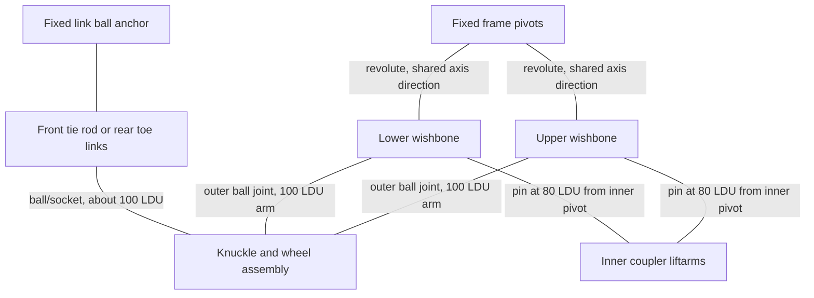

# Wishbones, translating knuckle and guide links

**Reference scope:** a measured parallelogram suspension corner. Equal upper/lower
arms keep the knuckle orientation fixed while it follows an arc. This gives
vertical wheel rise plus a small lateral displacement, not a straight vertical slide.

## Mechanical connections



The coupler is its own translating group. Its attachment points lie **80 LDU**
along the wishbones, whereas the outer knuckle balls lie 100 LDU away.
It therefore follows a smaller translation than the wheel. Older plan notes
loosely called all these links 100 LDU; that description should not be copied
as a coupler dimension.

## Representative standalone identities

| Corner | Upper / lower wishbone | Bearing / hub | Rim / tyre | Guide link IDs | Coupler liftarms |
| --- | --- | --- | --- | --- | --- |
| FL | `26` / `11` | `30` / `38` | `251` / `252` | `77` | `42`, `43` |
| FR | `27` / `10` | `35` / `39` | `258` / `257` | `76` | `46`, `47` |
| RL | `117` / `98` | `118` / `121` | `253` / `254` | `109`, `110` | `138`, `139` |
| RR | `133` / `93` | `125` / `128` | `256` / `255` | `111`, `112` | `140`, `141` |

Bodies use suffixes `fl`, `fr`, `rl` and `rr`:
`lower_fl`, `upper_fl`, `knuckle_fl`, `coupler_fl` and `link_fl0`, for example.
Rear guide links use both suffixes `0` and `1`. Axles and attached decorative
pieces belong to the measured rigid groups listed in the plan.

The wheel, hub and bearing share the knuckle body in this suspension-only
example; they are not independently spinning or steering.

## Measured corner frame

| Corner | Lower inner pivot A (LDU) | Positive-bump axis n, approximately |
| --- | --- | --- |
| FL | (80,-85.04,-300) | (0,-0.003,-0.999996) |
| FR | (-80,-85.04,-300) | (0,+0.003,+0.999996) |
| RL | (80,-83.3,280) | (0,-0.003,-0.999996) |
| RR | (-80,-83.3,280) | (0,+0.003,+0.999996) |

Upper pivots differ from their lower pivots by (0,-80,+0.24) LDU.
The outer-ball arm vector at rest is approximately
`v=(+97.812325,20.802528,-0.062408)` on the left and
`v=(-97.812325,20.802528,-0.062408)` on the right. Its length is 100 LDU.
Upper and lower vectors agree in the source.

Use a local in-plane basis: `e2` is world-up projected perpendicular to `n`,
and `e1=cross(e2,n)`. Then `vx=dot(v,e1)`, `vy=dot(v,e2)`,
`r=hypot(vx,vy)` and `a=atan2(vy,vx)`.

```text
theta(t) = asin(sin(a) + t/r) - a
delta(v) = R(n,theta)*v - v
```

Here `r≈100` and `a≈-0.2095565923` rad. At front maximum travel,
`theta≈0.3066830151`; at rear maximum, `theta≈0.4078268656`.

The source branch of asin matters. A different linkage, travel range or arm
phase can require another branch or a different solver.

## How the body hierarchy preserves orientation

Both wishbones rotate by `theta` about their inner pivots. The knuckle is a child
of the lower arm and rotates by the same signal about **-n** at its outer
attachment. The two rotations cancel, leaving translation `delta(v)`.

The coupler uses the same parent/counter-rotation construction at its 80 LDU
attachment radius. It translates by about 0.8 times the wheel displacement.
Tie/toe links rotate about fixed inner endpoints by `theta` because their
measured vectors are parallel to the wishbones.

This is why there is no camber change or bump steer in the implemented model.
Unequal arms, nonparallel links or steering input would invalidate that shortcut.

## Tolerances and boundaries

The builder requires arm lengths within 0.1 LDU of 100 and parallel-link vectors
within 0.3 LDU. Its ball matching accepts gaps up to 3 LDU: front wishbone
cup/towball metadata differ by about 2.01 LDU, and one rear toe-link socket per
side differs by about 1.99 LDU. The plan uses the selected cup/socket points.
Passing distance checks does not resolve the actual seating of those surfaces.

Front link inner pins `74` and `75` remain fixed, while the rack and their
holders are omitted. They represent boundary anchors in this extracted rig.
The [mounting reference](extraction-and-mounts.md) explains that cut.

Implementation: [`Corner` and `build`](../../../scripts/build_defender_suspension.py).
Evidence: [measured review](../../../output/42110-suspension-standalone-reference-review/review.json).
