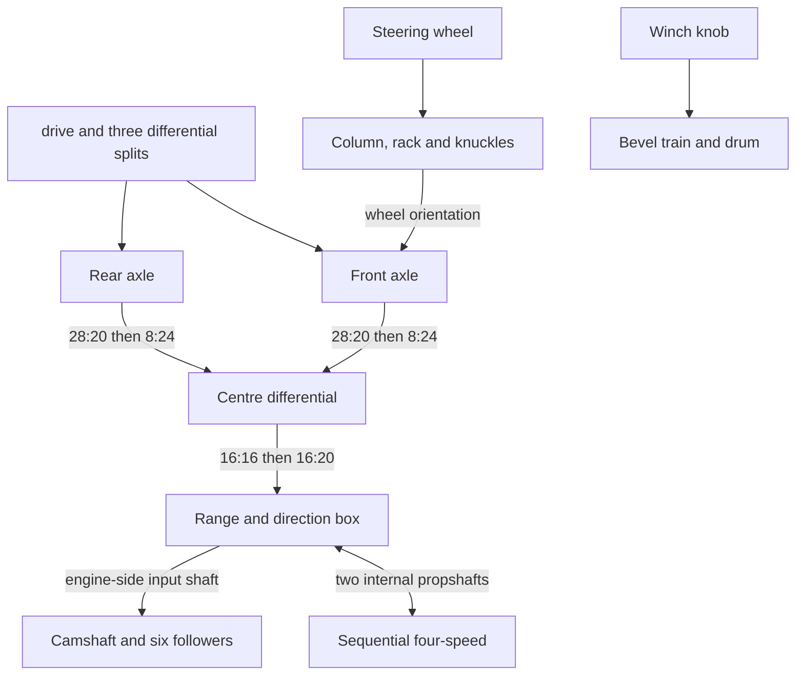

# 42110 Defender: curated mechanism references

These documents describe the **saved working rig selected by the user**, using
its source model, motion plan, authoring scripts, numerical reports and previews.
The previous generated diagrams were not used. Curation date: 2026-10-05.

Use each page as a worked example with an explicit scope. The diagrams show
functional groups and mechanical relationships recovered from the implementation.
They are documentation, not input to the diagram generator or an executable rig.

## Choose a subsystem

| Reference | Reusable idea | Qualification |
| --- | --- | --- |
| [Front axle](front-axle.md) | Differential, Cardan half-shafts, steering-parented wheels | Hub spin uses a projection approximation |
| [Rear axle](rear-axle.md) | Differential and fixed-height half-shafts | Same hub approximation; no suspension travel |
| [Centre differential and transfer](centre-differential.md) | Three-port differential and signed gear reductions | Checked gear/carrier relationships |
| [Range and direction gearbox](range-direction-gearbox.md) | Conditional clutch locks, independent ring extensions and fork levers | Ideal engagements; contact play unresolved |
| [Sequential four-speed](sequential-gearbox.md) | Constant-mesh trains and alternating driving rings | Ratios checked; selector cam profile assumed |
| [Internal propshafts](internal-propshafts.md) | Two Cardan joints with phase cancellation | Fixed geometry; small fork-phase correction |
| [Cam-driven six-cylinder engine](engine.md) | Phased flat followers with a rest offset | Cam law is a documented hypothesis |
| [Steering](steering.md) | Cardan column, compound gears, rack and closed tie rods | Closure checked; sampled crossings remain |
| [Winch](winch.md) | Two bevel meshes between three rotating shafts | Rope and ratchet action are static |
| [Shift animation](shift-animation.md) | Preserve shaft angle when changing transmission ratios | Animation continuity; no dynamic synchronization |
| [Scope and evidence](scope-and-evidence.md) | Checks, omitted mechanisms, provenance and corrections | Read before calling an example physically verified |

An agent adapting a mechanism should read its qualification, match its arrangement,
measure the new source's frames and dimensions, then test nonzero and asymmetric
inputs. Part numbers, locations, shaft phases, travel and tooth counts are
parameters to remeasure. Axle contact evidence alone does not establish every
rigid attachment or axial retention.

## Overall arrangement

This diagram traces the rig's convenient evaluation direction from the
`drive` control toward the engine. It does not assert a physical torque source.
Steering and the winch have separate inputs.

The two internal propshafts are a closed transmission route between the two
gearboxes; they are distinct from the front/rear final-drive propshafts.

## Conventions shared by all pages

- Source: [42110-1.mpd](../../../data/models-annotated/42110-1.mpd), by
  Philippe Hurbain. Selected section: `42110 - main.ldr`.
- IDs such as `0/1/133/18` are physical type-1 occurrence paths in that **full-model**
  selection. Selecting an MPD subsection changes the coordinate frame and IDs.
- Lengths are LDU. Angles are radians, right-hand rule, offsets from the source pose.
  `X = (1,0,0)` points to the car's left; front is `-Z`.
  `ZC ≈ (0,0.003,0.9999955)` is the normalized longitudinal chassis axis.
  `UP ≈ (0,-0.9999955,0.003)`.
- Names in backticks identify bodies, signals or controls in
  [the saved plan](../../../output/42110/plan.json). A body owns the complete
  `instances` list; tables on these pages show representative parts.
- A signed ratio means **output angular increment / input angular increment**
  about the specified axes, with selectors and phase offsets held fixed.
  A spider's angle is relative to its carrier.
- Solid arrows trace implemented kinematic relations; labelled dashed arrows
  identify selector influence or an approximation. They do not certify engagement,
  clearance or a physically one-way drive.
- Several controls deliberately select independent differential motion.
  The rig prescribes kinematics; it does not solve forces or wheel traction.

## Evidence and reuse

The saved rig has 91 bodies, 301 moving occurrences, 194 signals and 37 gear meshes
in its dedicated drivetrain checker. The selector knob pair is a separate
declared 1:1 relation outside that 37-mesh list.

The curation review rebuilt the motion definitions in memory and obtained exactly
the saved controls, signals, bodies, anchors and checks. It reran the 16 engaged
direction/range/gear cases and all 696 animation frames for continuity, plus
nonzero asymmetric and neutral cases. See [scope and evidence](scope-and-evidence.md)
for the limits and the retained artifacts.

This collection is useful for reproducing and adapting the implemented mechanisms.
Suspension travel, hidden body openings, flexible-element motion and ratchet
clicking are not completed reference rigs in this example.

The separate [standalone suspension reference](../42110-suspension-standalone/README.md)
now documents wheel travel, shock compression and their fixed mounting interfaces.
Its motion belongs to a separate saved rig.
