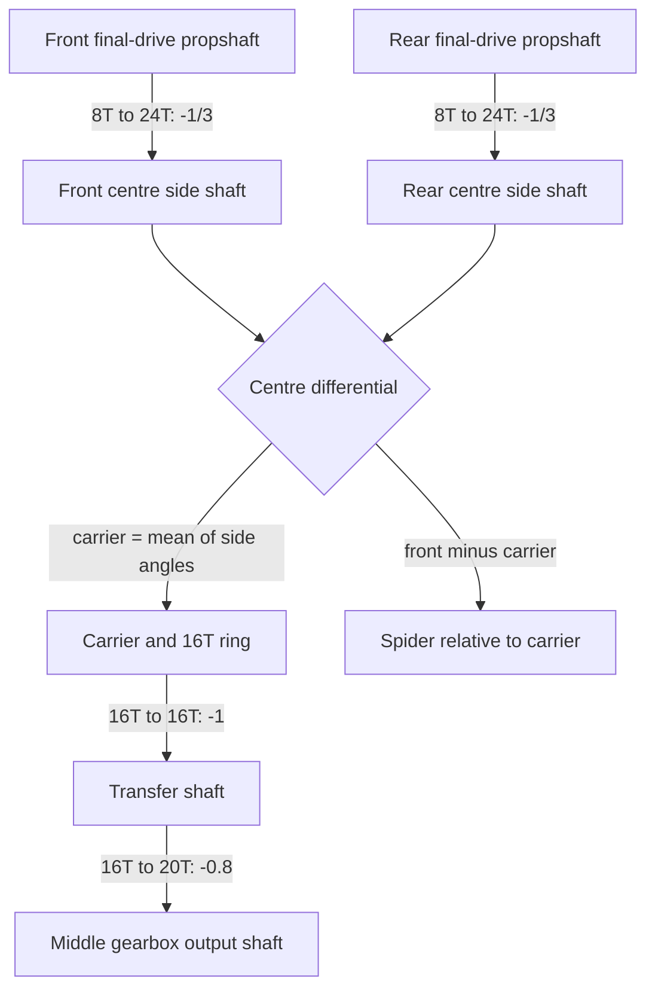

# Centre differential and transfer gearing

**Reference scope:** checked ideal gear/differential relations between the front
and rear final drives and the middle gearbox. This is a useful three-port
differential example; it does not simulate traction or torque distribution.



Both side-shaft and carrier angles use +ZC. The spider uses its own +X axis,
composed with its carrier parent. The arrows follow the rig's wheel-driven
evaluation; the mechanical gearing is not inherently limited to that direction.

| Role | Plan body | Source anchor parts |
| --- | --- | --- |
| Front longitudinal shaft | `prop_front` | 8T `0/9` |
| Rear longitudinal shaft | `prop_rear` | 8T `0/1/7` |
| Front centre side shaft | `cdiff_front_shaft` | 24T `0/1/193`, 12T side gear `0/1/157` |
| Rear centre side shaft | `cdiff_rear_shaft` | 24T `0/1/133/56`, 12T side gear `0/1/158` |
| Carrier | `cdiff_carrier` | `0/1/155` |
| Spider | `cdiff_spider` | `0/1/159` |
| Transfer shaft | `transfer` | 16T gears `0/1/172` and `0/1/190` |
| Middle gearbox interface | `gb_output` | 20T `0/0/128/69` |

## Equations and signs

```text
cdiff_front   = -prop_front / 3
cdiff_rear    = -prop_rear / 3
cdiff_carrier = (cdiff_front + cdiff_rear) / 2
cdiff_spider  = cdiff_front - cdiff_carrier
transfer     = -cdiff_carrier
out          = -0.8 * transfer
```

Combining the axle final drives gives:

- `cdiff_front = (7/15)*(drive + diff_center)`.
- `cdiff_rear = (7/15)*(drive - diff_center)`.
- `cdiff_carrier = (7/15)*drive`.
- `cdiff_spider = (7/15)*diff_center`.
- `out = (28/75)*drive`.

Front/rear left-right splits change their side gears and spiders, not these axle
means. A centre split changes the two centre side shafts while preserving their
mean. This distinction is important when verifying a rotating carrier: compare
a spider's rotation in the carrier frame, not its absolute world angle.

## Evidence and adaptation

All listed meshes enter the build script's 37-mesh check. Unequal front/rear
splits are exercised in all 16 engaged gearbox states. This is an ideal kinematic
constraint, not a conclusion about loaded wheel speeds or differential friction.

In a different differential, remeasure side-gear axes, spider axis, ring tooth
count and which body carries the spider. Recompute signed ratios around the
actual body axes; a gear's local LDraw orientation may point in the opposite
direction.

Implementation: [centre differential block](../../../scripts/build_defender_rig.py).
Next interface: [range/direction gearbox](range-direction-gearbox.md).
