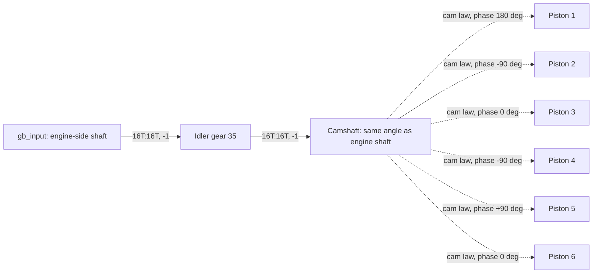

# Inline-six engine: cam-driven axle followers

**Reference scope:** six animated followers driven by phased liftarm cams.
This is a cam/follower demonstration, not a crankshaft-and-conrod engine.
Its lift law matches the source rest positions, but remains a documented surface-
contact hypothesis. Do not use it as a reference for slider-crank geometry.



The dashed links identify the assumed follower law. The same shape with a
different phase supplies each piston signal; the phases are measured from the
source cams, not selected to imitate a combustion firing order.

## Bodies and source phases

| Body | Piston axle | Cam occurrence | Rest lobe angle alpha | Rest lift h0 |
| --- | --- | --- | ---: | ---: |
| `piston1` | `0/0/126/7` | `0/0/127/2` | 180° | 0 LDU |
| `piston2` | `0/0/126/10` | `0/0/127/3` | -90° | 0 LDU |
| `piston3` | `0/0/126/13` | `0/0/127/5` | 0° | 0 LDU |
| `piston4` | `0/0/126/16` | `0/0/127/4` | -90° | 0 LDU |
| `piston5` | `0/0/126/19` | `0/0/127/6` | +90° | 10 LDU |
| `piston6` | `0/0/126/22` | `0/0/127/7` | 0° | 0 LDU |

`camshaft` owns the shaft/cams grouped around axle `0/0/127/0` and 16T gear
`0/0/127/16`. `gb_input` carries 16T `0/0/128/27`; the separate idler body
`gear_0_0_128_35` carries `0/0/128/35`.

## Implemented follower law

Camshaft rotation `theta` is about +ZC. Each follower translates along UP.
The lobe angle is measured from +X toward UP, so positive shaft rotation
subtracts from the lobe angle.

```text
camshaft = engine
h(theta) = max(0, 20*sin(alpha - theta) - 10)   # lift above lower stop, LDU
h0       = max(0, 20*sin(alpha) - 10)
piston_displacement = h(theta) - h0           # offset from the source pose
```

The model assumes a stadium-shaped liftarm cam with eccentricity 20 LDU, radius
10 LDU, a flat follower and a stop 20 LDU above the shaft. Lift is 0..10 LDU.
The lower piston end is at height `20+h` relative to the shaft.

Piston 5 starts raised. Its source-relative displacement is therefore -10..0 LDU;
the other five use 0..10 LDU. Giving all six the same zero offset would visibly
change the imported source pose.

## Evidence and adaptation

The builder checks cam eccentricity and each piston rest height. Both input/idler/
camshaft meshes are in the gear verifier. The animation and previews exercise
the followers. Rest agreement and a plausible render do not establish continuous
surface contact, gravity-driven return or clearance through a full cycle.

Remeasure the target cam profile, eccentricity, follower geometry, stop and phase.
For a conventional piston engine with connecting rods, use its measured
slider-crank relation instead. Do not infer an internal engine layout from the
name "six-cylinder" alone.

Implementation: [engine block](../../../scripts/build_defender_rig.py).
Preview: [cams and pistons](../../../output/42110/preview-engine.png).
Input: [range/direction gearbox](range-direction-gearbox.md).
