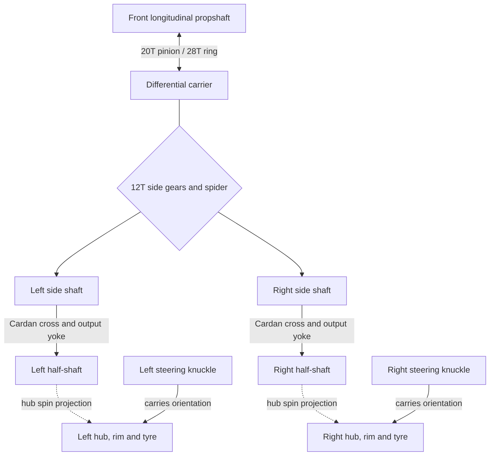

# Front axle: differential, Cardan shafts and steered wheels

**Reference scope:** the differential and fixed-height Cardan chains are implemented.
The wheel-hub spin mapping is an approximation; steering changes wheel orientation
through parenting. Suspension travel is absent. See [conventions](README.md#conventions-shared-by-all-pages).

## Mechanical chain



The diamond is a three-member differential constraint, not an ordinary gear-pair
edge. The side gears can rotate differently while their mean follows the carrier.

## Identity and motion map

| Role | Plan body | Representative source IDs |
| --- | --- | --- |
| Carrier with 28T ring | `front_diff` | `0/0/27/11` |
| Spider, parented to carrier | `front_spider` | `0/0/27/14` |
| Left/right side shafts | `front_side_l`, `front_side_r` | gears `0/0/27/13`, `0/0/27/12` |
| Left/right crosses | `front_cross_l`, `front_cross_r` | `0/0/27/20`, `0/0/27/17` |
| Left/right output yokes | `front_halfshaft_l`, `front_halfshaft_r` | `0/0/27/19`, `0/0/27/16` |
| Hub spindle drivers on those shafts | same half-shaft bodies | `0/0/59`, `0/0/64` |
| Hubs and wheel assemblies | `wheel_fl`, `wheel_fr` | hubs `0/0/65`, `0/0/66`; rims `0/380`, `0/387` |
| Final-drive pinion shaft | `prop_front` | pinion `0/0/27/8`, 8T gear `0/9` |

Let `d = drive`, `c = diff_center`, `s = diff_front`:

- Carrier angle about +X: `m_front = d + c`.
- Left/right side angles about +X: `side_fl = m_front + s`,
  `side_fr = m_front - s`.
- Thus `side_fl + side_fr = 2*m_front`.
- `front_spider = -s` about the spider body's own axis, **relative to `front_diff`**.
  The parent contributes the carrier rotation.
- `prop_front = -1.4*m_front` about +ZC: the 28T ring drives the 20T pinion.

Each side has an approximately 12° Cardan bend. The input is about +X on the
left and -X on the right; consequently the right joint input is `-side_fr`.
Use the measured shaft directions and fork axes with
[`linkages.universal_joint`](../../../ldraw_mechanisms/linkages.py).
The cross rotates relative to its input yoke. It is not a rigid extension of
either shaft, and its output yoke must receive the returned output signal.

## Hub mapping: reproduce deliberately, do not mistake it for an exact CV law

The saved plan uses:

```text
wheel_fl =  0.978102966480559 * uj_fl_out
wheel_fr = -0.978102966480559 * uj_fr_out
```

These coefficients are the half-shaft axes projected onto X. The minus sign
accounts for the right-side axis direction; the magnitude also scales rotation.
At `drive = 2*pi`, all splits zero and steering zero, each wheel signal is
`6.145602187899416`, rather than `2*pi`. The Cardan output completes a full turn.

This is an observable limitation of the selected rig, not evidence for a physical
CV reduction. An exact constant-velocity coupling would preserve the angular
increment magnitude, with the appropriate axis sign. Do not propagate this
projection factor into a new rig as a universal rule.

The front wheel bodies are children of `knuckle_l` / `knuckle_r`; spin follows
their steering orientation. The half-shaft geometry remains at fixed ride height.

## Evidence and adaptation

The differential gear relationships are included in the 16-state mesh check.
The Cardan helper checks cross-arm orthogonality and unwrapped output over multiple
turns. Those checks do not validate the hub projection or sliding/retention at the
CV interface. Sampled drive clearance reports spindle-driver/bearing crossings.

Recheck carrier and side-gear frames, cross phases, shaft bend, hub axis and CV
centre in the target model. Couple the front hubs to the target steering knuckles;
do not introduce steering by rotating the entire differential.

Implementation: [axle authoring and wheel assembly](../../../scripts/build_defender_rig.py).
Related: [steering](steering.md), [rear axle](rear-axle.md), [centre differential](centre-differential.md).
