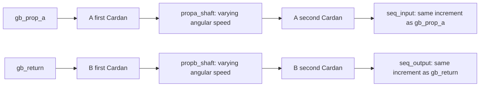

# Internal propshafts: paired Cardan joints

**Reference scope:** two fixed-geometry Cardan pairs connecting the middle and
rear gearboxes. The end shafts are parallel, their bend angles match and their
intermediate forks are phased together. That particular arrangement cancels the
single-joint speed variation at the far end.

These are internal gearbox shafts A and B. They are not `prop_front` and
`prop_rear`, which lead to the axle differentials.



Each Cardan consists of an input yoke, a cross and an output yoke. The cross is
parented to the input shaft and rotates about the input fork axis; the output
shaft receives its own computed rotation. Simply parenting every piece to the
input shaft would keep the joint visually assembled but produce the wrong motion.

| Item | Propshaft A | Propshaft B |
| --- | --- | --- |
| First cross | `0/1/200` / `propa_cross1` | `0/1/207` / `propb_cross1` |
| First input / output yokes | `0/1/199` / `0/1/198` | `0/1/205` / `0/1/206` |
| Middle shaft body | `propa_shaft` | `propb_shaft` |
| Second cross | `0/1/196` / `propa_cross2` | `0/1/203` / `propb_cross2` |
| Second input / output yokes | `0/1/195` / `0/1/194` | `0/1/202` / `0/1/201` |
| Approximate joint bend | 32.2° | 41.8° |
| Measured fork phase corrected in analysis | 0.0117° | 0.0191° |
| Input signal | `gb_c42` | `mid` |
| Final output signal | `uj_pa2_out` | `uj_pb2_out` |

## Reusable construction

The helper [`linkages.universal_joint`](../../../ldraw_mechanisms/linkages.py)
accepts input/output shaft directions and the two rest fork axes. Its output is
unwrapped across multiple turns. Feed the first output signal into the second
joint and use the same intermediate fork line at both ends.

For this arrangement, to numerical precision:

```text
uj_pa2_out = gb_c42
uj_pb2_out = mid
```

The intermediate angles `uj_pa1_out` and `uj_pb1_out` generally differ from
their inputs. Their variation must remain visible; directly driving the middle
shaft at uniform speed would erase the mechanism being demonstrated.

The source's small fork-phase discrepancy is corrected to a common line.
The build rejects more than 0.5° of discrepancy. This tolerance and correction are
part of the example, not a license to erase arbitrary phase differences.

## Evidence and adaptation

The Cardan helper checks cross orthogonality and orientation by explicit vector
rotations. Its tests include nonzero fork phases and multiple revolutions.
The paired-joint test checks cancellation with a nonzero bend and phase.

For a new model, measure each joint centre, both shaft directions and all fork
axes. Equal bends and correct phasing are essential to the cancellation used
here. If suspension or another motion changes the shaft geometry, these fixed
driver expressions need a corresponding updated model; this example does not
solve telescoping shafts or moving joint centres.

Implementation: [`propshaft` helper and body assembly](../../../scripts/build_defender_rig.py).
Behavior checks: [Cardan tests](../../../tests/test_defender_rig.py).
