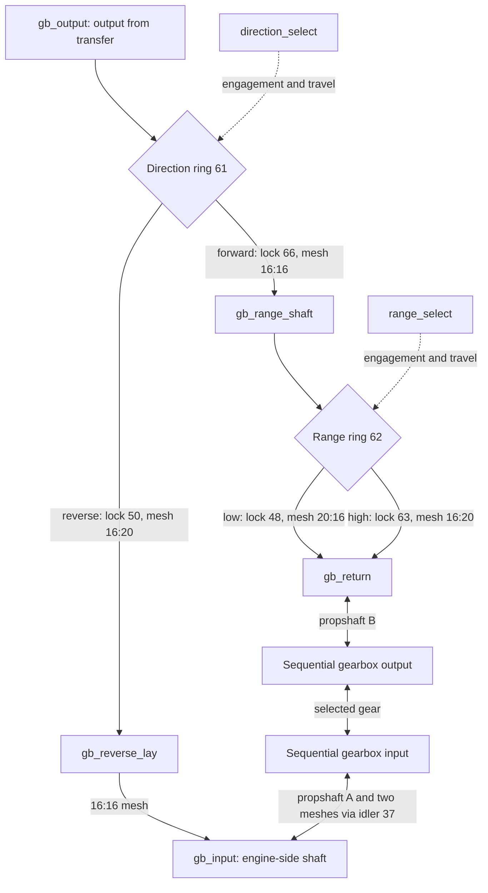
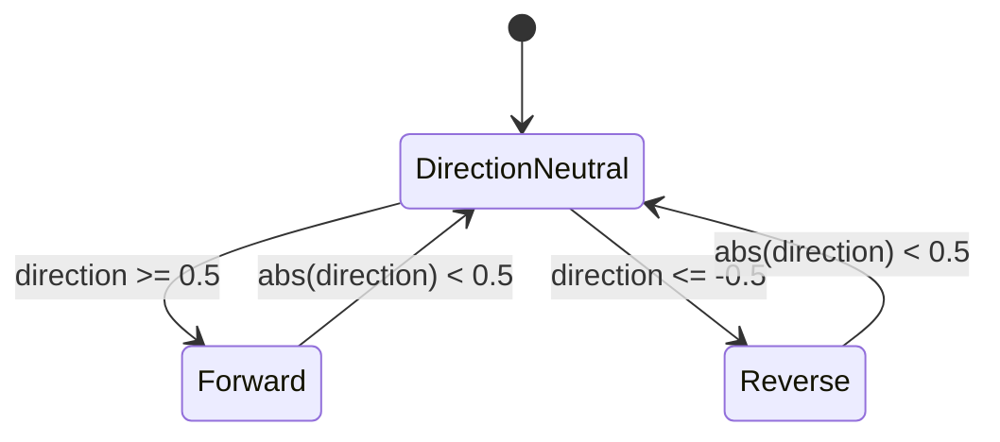
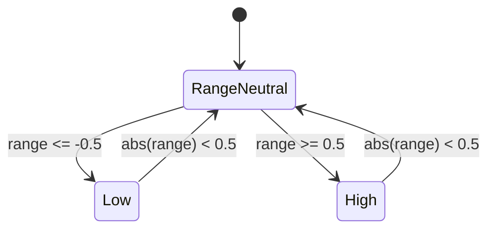

# Middle gearbox: forward/reverse and low/high range

**Reference scope:** a checked ideal clutch/gear network, plus animated driving
rings, extensions and cab levers. Engagement conditions are discrete; the fork
and ring surfaces are not solved as contact constraints.

All shaft increments below use +ZC and the [shared conventions](README.md#conventions-shared-by-all-pages).

## The two routes

Neutral disconnects the corresponding selected route. It does not remove the
constant-mesh gear pairs or necessarily stop every free gear.

| Role | Body or physical part |
| --- | --- |
| Output shaft and ring carrier | `gb_output`; axle `0/0/128/51`, output gear `0/0/128/69` |
| Direction ring / extension | `ring_direction` = `0/0/128/61`; `ext_direction` = `0/0/128/65` |
| Range shaft and ring carrier | `gb_range_shaft`; axle `0/0/128/58` |
| Range ring / extension | `ring_range` = `0/0/128/62`; `ext_range` = `0/0/128/57` |
| Sequential return shaft | `gb_return`; gears `0/0/128/45` and `0/0/128/55` |
| Engine-side shaft | `gb_input`; 16T `0/0/128/27` |
| Reverse layshaft | `gb_reverse_lay`; 16T `0/0/128/26` and 20T `0/0/128/31` |
| Internal propshaft A interface | `gb_prop_a`; 16T `0/0/135` |
| Cab changeover catches | `lever_direction`: `0/0/128/76/19`; `lever_range`: `0/0/128/76/10` |

## Engagement and ratios

| Selector condition | Engaged physical pair | Fixed-state increment relation |
| --- | --- | --- |
| `direction_select >= 0.5` | clutch `0/0/128/66` locks to output shaft `0/0/128/51` | `delta(c26) = -delta(out)` |
| `direction_select <= -0.5` | clutch `0/0/128/50` locks to the same output shaft | `delta(engine) = +0.8*delta(out)` |
| `range_select <= -0.5` | clutch `0/0/128/48` locks to range shaft `0/0/128/58` | `delta(c26) = -0.8*delta(mid)` |
| `range_select >= 0.5` | clutch `0/0/128/63` locks to range shaft | `delta(c26) = -1.25*delta(mid)` |

Between -0.5 and +0.5, the respective selector is neutral. These are the thresholds
implemented by `fwd/rev/lo/hi` signals, not measured synchronizer geometry.

These diagrams describe continuous lever sweeps through neutral. The CLI can jump
between values; it does not enforce a physical interlock or synchronization.

With forward engaged, both range and the sequential detent must be active to
drive the engine from `out`. Reverse drives the engine directly through the
layshaft and bypasses the selected forward ratio. Reverse can also back-drive
other shafts through any remaining engaged clutches.

Signed engine increments per `drive` increment, at fixed selectors and phase offsets:

| Configuration | 1st | 2nd | 3rd | 4th |
| --- | ---: | ---: | ---: | ---: |
| Forward, low | -2.333333 | -1.400000 | -0.777778 | -0.466667 |
| Forward, high | -1.493333 | -0.896000 | -0.497778 | -0.298667 |
| Reverse, either range | +0.298667 | +0.298667 | +0.298667 | +0.298667 |

These denominators are the rig's `drive` coordinate, not measured wheel rotation;
see the [hub projection qualification](front-axle.md). The old report displayed
magnitudes in its forward table.

## Sliding parts and forks

Ring travel is `10*selector` LDU, about a neutral centre. Each ring is a prismatic
child of its rotating shaft. Rotation and axial translation are separate motions.

The extension is a separate body, also parented to the shaft:
`push_ring_direction = max(0, ring61)` and
`push_ring_range = min(0, ring62)`. Gluing an extension to the ring would drag it
away from its resting side when the ring retracts.

The measured catch arm is approximately 40 LDU. Its lever angle is the signed
`asin(ring_travel / arm_length)` about X, yielding about 14.5° at 10 LDU travel.
The fork tip follows an arc while the ring follows a line. The report notes
roughly 1.3 LDU of groove play at full travel and sampled fork/ring crossings.

## Evidence and adaptation

All four clutch choices participate in the 16-state increment checks. These do
not establish absolute tooth phase, synchronizer behavior or safe shifts under
load. Preserve the separate ring/extension bodies, verify which clutch is selected
on each side, and retain [phase carries](shift-animation.md) when ratios change.

Implementation: [middle gearbox and locks](../../../scripts/build_defender_rig.py).
Original close-up: [2nd/low gearbox preview](../../../examples/reference/42110/preview-gearbox-2nd-low.png).
