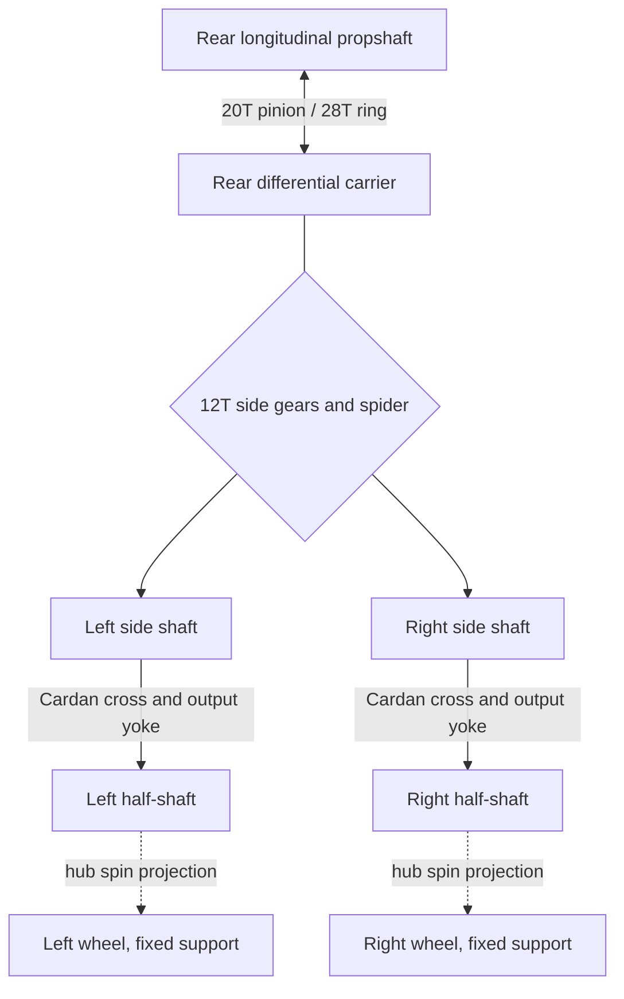

# Rear axle: differential and fixed-height half-shafts

**Reference scope:** implemented rear differential and Cardan joints, with fixed
wheel orientation and ride height. Hub spin has the same projection approximation
as the [front axle](front-axle.md#hub-mapping-reproduce-deliberately-do-not-mistake-it-for-an-exact-cv-law).



| Role | Plan body | Representative source IDs |
| --- | --- | --- |
| Carrier | `rear_diff` | `0/1/12` |
| Carrier-relative spider | `rear_spider` | `0/1/15` |
| Left/right side shafts | `rear_side_l`, `rear_side_r` | gears `0/1/14`, `0/1/13` |
| Left/right crosses | `rear_cross_l`, `rear_cross_r` | `0/1/18`, `0/1/21` |
| Left/right output yokes | `rear_halfshaft_l`, `rear_halfshaft_r` | `0/1/16`, `0/1/20` |
| Spindle drivers | same half-shaft bodies | `0/1/93`, `0/1/100` |
| Rear wheel assemblies | `wheel_rl`, `wheel_rr` | hubs `0/1/92`, `0/1/99`; rims `0/382`, `0/385` |
| Pinion and propshaft | `prop_rear` | 20T pinion `0/1/6`, 8T gear `0/1/7` |

## Relations

Use the [shared coordinate convention](README.md#conventions-shared-by-all-pages).
With `d = drive`, `c = diff_center`, `s = diff_rear`:

```text
m_rear  = d - c
side_rl = m_rear + s
side_rr = m_rear - s
rear_spider = -s                 # relative to rear_diff, on its own axis
prop_rear = -1.4 * m_rear         # about +ZC
wheel_rl =  0.978102966480559 * uj_rl_out
wheel_rr = -0.978102966480559 * uj_rr_out
```

Carrier and side angles use +X; the right Cardan input uses -X, as on the front.
The two half-shafts bend by approximately 12°. Rear wheel bodies have no steering
parent. Static rear knuckles should not be confused with axle-locked wheel hubs.

## What to reuse

Reuse the carrier-plus-split parameterization, carrier-relative spider and separate
cross/yoke motions. The source has one spider; it still constrains both side gears.
A pair of independent wheel-spin controls does not explain this differential.

The 16-state check covers the bevel/ring ratios, including unequal axle splits.
It does not prove the CV projection, suspension motion, bearing retention or
clearance. Remeasure the target shaft directions and fork phases and decide
explicitly whether its hubs need a proper CV mapping.

Implementation: [axle loop and rear wheel bodies](../../../scripts/build_defender_rig.py).
Evidence: [curation review](../../../examples/reference/42110-reference-review/review.json),
[original kinematic report](../../../examples/reference/42110/kinematics.json).
