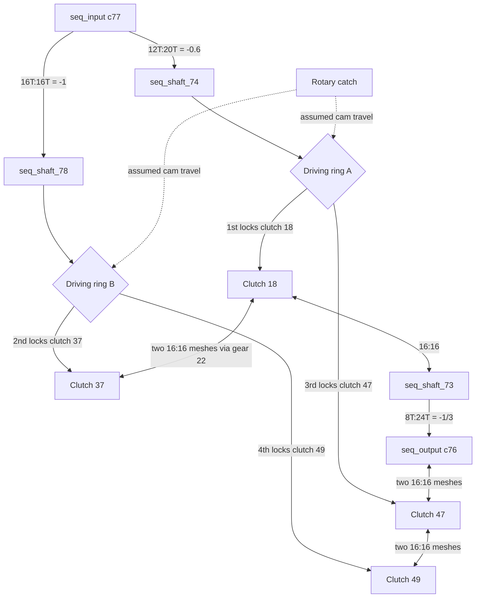
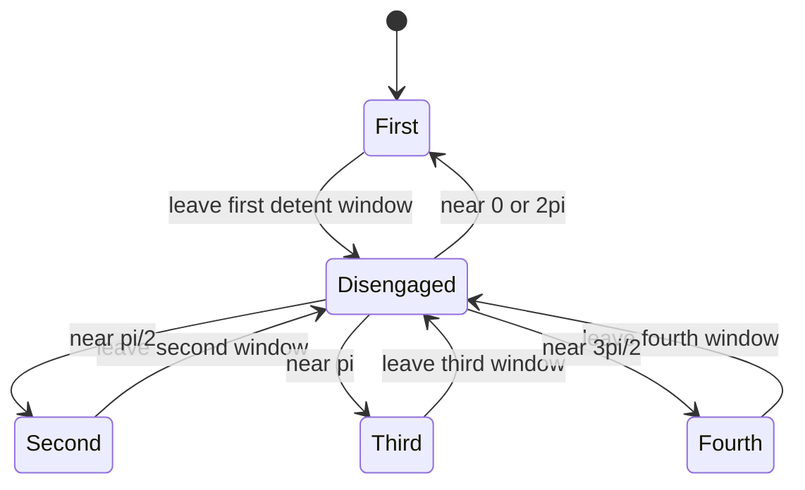

# Sequential four-speed: constant meshes and two driving rings

**Reference scope:** four checked ratios and explicit clutch choices. The rotary
catch's ring-motion profile is an animation approximation, not a measured cam
surface. This example separates constant meshes from state-dependent locking.

## Shaft and clutch topology

All shaft angles below are about +ZC. The input/output names use the conventional
engine-to-road direction; the saved evaluator can solve the train from the road side.



For exact branch ordering, use the following constant-mesh chains. Arrows here
identify adjacent gear meshes, not selected clutch engagements:

- `0/1/133/13 -> 18 -> 22 -> 37`: all 16T; gear 13 belongs to `seq_shaft_73`.
  (Only the first item spells out the common `0/1/133/` prefix.)
- `0/1/133/42 -> 48 -> 47 -> 46 -> 49`: all 16T; gear 42 belongs to `seq_output`.
- Input gear 32 (16T) meshes with 36 (16T) on `seq_shaft_78`.
- Input gear 52 (12T) meshes with 51 (20T) on `seq_shaft_74`.
- Gear 14 (8T) on `seq_shaft_73` meshes with output gear 29 (24T).

The 18-to-37 connection in the overview comprises two meshes, via gear 22;
the entire 13-to-37 branch has three meshes.

## State table: the definitive engagement map

| Gear | `gear_select` | Ring and locked pair | Ring A absolute / source offset (LDU) | Ring B (LDU) | Output/input increment ratio |
| --- | --- | --- | --- | --- | ---: |
| 1 | 0 | A: clutch `0/1/133/18` to shaft joiner `0/1/133/19` | +10 / 0 | 0 | -0.2 |
| 2 | pi/2 | B: clutch `0/1/133/37` to shaft joiner `0/1/133/38` | 0 / -10 | +10 | -1/3 |
| 3 | pi | A: clutch `0/1/133/47` to shaft joiner `0/1/133/19` | -10 / -20 | 0 | -0.6 |
| 4 | 3*pi/2 | B: clutch `0/1/133/49` to shaft joiner `0/1/133/38` | 0 / -10 | -10 | -1 |

Bodies: `seq_input`, `seq_output`, `seq_shaft_73`, `seq_shaft_74`,
`seq_shaft_78`, `ring_seq_a`, `ring_seq_b`. Loose gears have bodies such as
`gear_0_1_133_18`; they must not be permanently joined to the shaft they surround.

The source pose has ring A already at +10 LDU toward 1st gear. Consequently
`ring20_rel = ring20 - 10`, while `ring40` is already a source-relative value.
Forgetting that distinction shifts the authored rest pose.



`g_i` is the nearest quarter-turn index modulo four. `g_on` permits engagement
within approximately ±18° of that detent; outside those windows the forward
transmission route is open. This is a state description, not a physical detent
or ratchet simulation.

## Selector and ring motion

`seq_selector` contains knob wheel `0/1/212` and rotary catch `0/1/133/25`.
The dial shaft `seq_dial` carries `0/1/220` and has angle `-gear_select`.
That 1:1 knob-wheel relation is outside the 37 ordinary gear meshes checked
by the drivetrain verifier.

For `u = cos(gear_select)` on ring A, or `u = sin(gear_select)` on ring B:

```text
ring_absolute = 10 * clamp((abs(u)-0.75)*5, 0, 1) * u/max(abs(u), 1e-6)
```

The profile alternates the rings without simultaneous nonzero travel; it is
deliberately assumed. The ring is a prismatic child of its shaft, so it slides
while retaining the shaft's rotation.

## Evidence and adaptation

All four locks and mesh increment ratios are checked in combination with both
ranges and both directions. Saved animation checks include passage through the
disengaged windows, but they check continuity rather than clutch tooth alignment.
Sampled selector/gear/bracket crossings remain.

Recheck the target's loose/locked gears, axial clutch faces, source ring offsets,
selector phase and engagement windows. An arbitrary four-speed transmission will
not share this state order or cam law.

Implementation: [rear-box authoring](../../../scripts/build_defender_rig.py).
Interfaces: [internal propshafts](internal-propshafts.md), [middle gearbox](range-direction-gearbox.md).
Preview: [3rd gear](../../../examples/reference/42110/preview-sequential-3rd.png).
