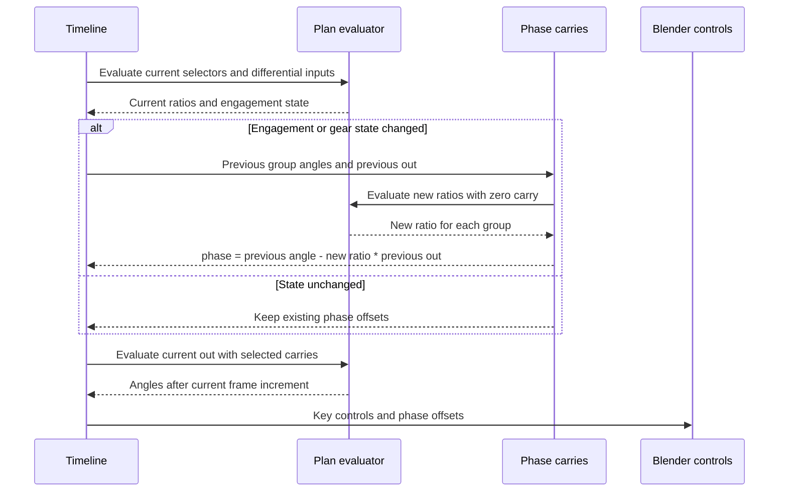

# Animation across gear changes: carry the shaft phase

**Reference scope:** a reusable technique for keeping evaluated shaft angles
continuous when a piecewise gear ratio changes. This is animation bookkeeping;
it does not simulate synchronizers, angular momentum or tooth engagement.

## Why an offset is necessary

A shaft defined only by `angle = ratio * out` jumps if the ratio changes while
`out` is nonzero. The Defender uses three independent carry offsets:

| Driven group | Signal | Control holding the offset | Current ratio signal |
| --- | --- | --- | --- |
| Engine side, camshaft and sequential input side | `engine` | `phase_engine` | `ratio_e` |
| Sequential return and range gears | `mid` | `phase_mid` | `ratio_m` |
| Range output shaft | `c26` | `phase_c26` | `ratio_c26` |

Their common form is `angle = ratio * out + phase`.

## What the animation script does



Using the **previous** output coordinate in the carry equation preserves the
old angle at the transition point while allowing the new ratio to govern the
current frame's advance.

The state tuple is `(fwd, rev, lo, hi, g_on, g_i)`. Each tuple change triggers
an update of all three carries. The source script keys all controls every frame;
phase curves use constant interpolation, the other control curves use linear
interpolation.

## Differential motion during steering

The timeline estimates a turning centre from the mean knuckle angle and wheelbase.
It computes each wheel's path-radius-based rate, integrates four desired angles
and derives:

```text
drive       = (FL + FR + RL + RR) / 4
diff_center = (FL + FR - RL - RR) / 4
diff_front  = (FL - FR) / 2
diff_rear   = (RL - RR) / 2
```

This feeds the axle and centre differential parameterization. It is a prescribed
Ackermann-style speed approximation, not a tyre-contact simulation. In particular,
the saved [wheel-hub projection](front-axle.md) means the desired angles used here
are not exactly the resulting wheel rotations.

## Selected demonstration

The existing clip has 696 frames at 24 fps: forward/low engagement, upshifts,
high-range selection, steering, deceleration/downshifts, reverse, neutral and
winch operation. There are 24 recorded state changes.

The curation review reran the complete timeline. The existing continuity check
passes: per-frame revolute jumps remain below its 0.8 rad threshold and prismatic
jumps below 6 LDU. The original Blender report checked 15 frames against the
portable evaluator. This does not prove subframe continuity or physical
synchronization during clutch engagement.

Reuse the carry method for piecewise kinematic animation, preserving the identity
of independently rotating shaft groups. Measure the target's state rules and
check every ratio transition. An exact ratio table alone does not preserve phase.

Implementation and callable source-only functions:
[`timeline` and `continuity`](../../../scripts/blender/animate_defender.py).
Evidence: [animation report](../../../output/42110/animation-check.json),
[curation rerun](../../../output/42110-reference-review/review.json).
