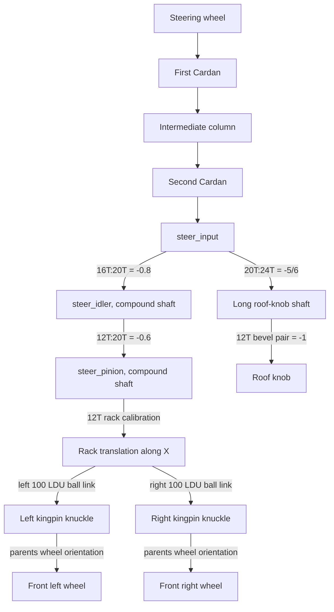

# Steering: Cardan column, compound gears, rack and tie rods

**Reference scope:** implemented steering propagation and two closed 100 LDU
ball links at fixed suspension height. The column uses measured Cardan frames;
the roof knob follows the same input shaft. Sampled contact crossings remain.

## Complete route



The shaft-to-rack path now includes the rack/pinion coupling explicitly. Each
knuckle has an independent closure solution, allowing unequal left/right angles.
Wheel spin comes from the [front axle](front-axle.md); steering does not replace it.

## Identity map

| Role | Body | Representative parts |
| --- | --- | --- |
| Driver wheel/column input | `steering_wheel` | seed `0/32`, first yoke `0/24` |
| First cross and middle column | `steer_cross1`, `steer_column` | cross `0/25`, shaft `0/27`, yokes `0/26` and `0/0/123` |
| Second cross and output | `steer_cross2`, `steer_input` | cross `0/0/125`, yoke `0/0/124` |
| 16T input / 20T branch gear | `steer_input` | `0/0/121`, `0/0/120` |
| 20T/12T compound idler | `steer_idler` | `0/0/94/22`, `0/0/94/23` |
| 20T driven gear / 12T rack pinion | `steer_pinion` | `0/0/50`, `0/0/116` |
| Rack assembly | `rack` | `0/0/111/0` and its fixed members |
| Left/right rods | `tierod_l`, `tierod_r` | `0/0/111/12`, `0/0/111/11` |
| Left/right knuckles | `knuckle_l`, `knuckle_r` | `0/0/57`, `0/0/62` |
| Roof-knob shaft and column | `hog_shaft`, `hog_column` | 24T `0/0/103`; bevels `0/1/282/4` and `0/1/282/1`; knob `0/358` |

## Motion and measured geometry

The control `steering` spans ±2.583 rad; positive is clockwise for the driver and
turns the car right. Two Cardan solvers take it to `steer_in` about +ZC. Do not
assume that the intermediate column is a uniform 1:1 coupling.

```text
steer_mid    = -0.8 * steer_in
steer_pinion = -0.6 * steer_mid
rack         = -15.278874536821952 * steer_pinion   # LDU along +X
hog_shaft    = -(5/6) * steer_in
hog_column   = -hog_shaft                           # about UP
```

The rack coefficient uses the toolkit's existing 8 LDU circular-pitch calibration
(12*8/(2*pi)), rather than the 1.25 LDU/tooth pitch-radius rule used to check the
spur centres. Treat that calibration as part of this example and recheck a target
rack's actual pitch. Nominal rack travel is about ±18 LDU.

The 16T/20T centres measure 44.72 LDU against nominal 45; the roof 20T/24T branch
measures 56.57 against nominal 55 and was accepted with a 2 LDU tolerance.
These are source-fit tolerances, not exact manufactured dimensions.

Kingpin lines, expressed in the selected source frame:

| Side | Origin (LDU) | Axis |
| --- | --- | --- |
| Left | (177.81, -62.228045, -300.068436) | UP |
| Right | (-177.81, -62.228045, -300.068436) | UP |

Each steering arm's ball is about 40 LDU from its kingpin. The two links are
99.999717 LDU in the rounded source, nominally 100. The
[`ball_link` solver](../../../ldraw_mechanisms/linkages.py) finds the knuckle
angle on the branch through the source pose. The rod body then follows its two
anchors; it does not receive an independently guessed angle.

The two plan distance checks, `tierod_l` and `tierod_r`, allow 0.02 LDU error.
Front wheel bodies are children of their knuckles, composing spin with steering.
The roof knob is an output of this rig; its own Blender rotation is not a second
independently editable steering control.

## Evidence and adaptation

The saved asymmetric evaluation closes the rods to about 4e-7 LDU in pure Python.
Blender comparisons use 0.01 LDU transform tolerance. Clearance samples include
tie-rod/lower-wishbone grazing and a Cardan cross/axle-tip crossing; this example
does not establish a freely moving linkage throughout the range.

Remeasure the rack axis, tooth pitch, kingpin lines, arm balls, link endpoints
and source branch. Check both signs and unequal wheel angles. If suspension
travel is added, the loop must include the moving suspension geometry.

Implementation: [steering authoring](../../../scripts/build_defender_rig.py).
Preview: [full lock](../../../output/42110/preview-full-lock.png).
Evidence: [steering clearance](../../../output/42110/clearance-steering.json).
