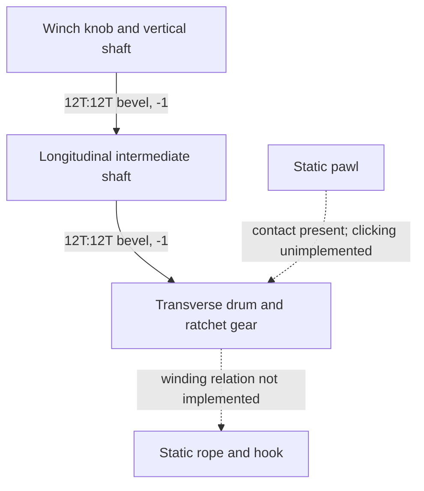

# Winch: two bevel meshes and a drum

**Reference scope:** the knob-to-drum rotation is implemented. Rope winding and
ratchet-pawl clicking are not. This is a bevel-transmission example, not a complete
winch simulation.



| Role | Plan body | Axis | Representative source parts |
| --- | --- | --- | --- |
| Knob/input | `winch_knob` | UP | knob `0/69`, input bevel `0/58/1` |
| Intermediate shaft | `winch_mid` | +ZC | driven bevel `0/58/5`, second bevel `0/58/10` |
| Drum assembly | `winch_drum` | +X | output bevel `0/94`, ratchet gear `0/111` |
| Unanimated pawl | none | not solved | `0/113` |
| Rope/hook | none | not solved | rope below assembly `0/103`, hook `0/98` |

For the `winch` control, clamped to ±400 radians:

```text
winch_mid  = -winch
winch_drum = -winch_mid = winch
```

Those signs are relative to the different axes in the table. They do not mean
the two shafts appear to turn the same way from an arbitrary camera.

The first mesh is `0/58/1` to `0/58/5`; the second is `0/58/10` to `0/94`.
There are **two checked bevel meshes and three rotating bodies**. An older
description called this three meshes; the authoring code and checker contain two.

## Boundaries and evidence

The animation drives the knob through two revolutions near the end of the clip.
Both meshes are in the 37-mesh check, and evaluated Blender transforms were checked.
The clearance report contains drum ratchet gear / static pawl crossings.

The rope was authored as 395 cylinder leaves merged into one imported mesh.
It remains static, as does the hook. Rotating the drum does not establish a
rope-length, payout or tension relation. The rig also allows both spin directions
without animating the pawl; it does not enforce a one-way ratchet.

To reuse the transmission, measure the target bevel apexes, shaft axes and signed
ratio. A functional winch additionally needs drum radius/payout, rope deformation
or replacement geometry, hook motion and the pawl's release/engagement behavior.
Do not infer those from this example's drum animation.

Implementation: [winch block](../../../scripts/build_defender_rig.py).
Motion sequence: [shift and demonstration animation](shift-animation.md).
