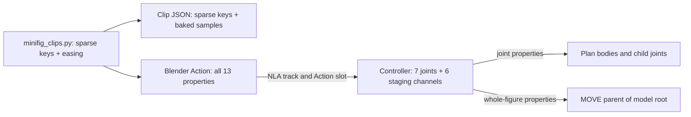

# Reusable clips with explicit channel meanings

The reusable unit is an Action targeting a shared controller interface, backed
by a pure Python clip definition. The ten figures have identical **13 channel
names, units, neutral values and positive meanings**. Matching names alone on
a different rig is insufficient: axes, limits, rest pose and root movement must
also agree.



## Author once, evaluate in two places

[minifig_clips.py](../../../scripts/minifig_clips.py) provides `Clip`, `wave`,
`hop`, `gait`, `value_at`, `check` and `clip_document` without importing Blender.
Keys use clip-local frames starting at 1. Interpolation/easing is attached to
the key beginning each segment. The Blender builder writes the same SINE,
QUAD, LINEAR or CONSTANT segments into F-curves instead of accepting default
Bezier handles that could change the intended motion.

Small source-only example, run from the repository root:

```python
import sys
sys.path.insert(0, "scripts")
import minifig_clips as mc

clip = mc.Clip("study", "head_turn", "Head turn", "Look left and return", 72)
clip.seq("neck", [(1, 0), (24, 0.6), (48, 0.6), (72, 0)])
assert mc.check(clip) == []
joint_pose = {name: clip.value(name, 36) for name in mc.JOINTS}
```

`Clip.keys()` supplies boundary keys, including zero-valued channels with no
authored movement. Keying all channels prevents a previous clip's pose leaking
into the next. The library starts neutral and returns home; selected periodic
channels may end at a whole turn. That is an equivalent orientation, not the
same numeric angle. Preserve winding for full rotations; verify transitions
when blending or repeating clips. `check()` tests limits and quarter-frame
step sizes; it is not a mathematical proof of smooth derivatives. A recorded
`loop` interval is a reuse hint, not a guarantee that all thirteen channels,
root travel and velocities loop seamlessly.

## Blender Action and NLA setup

In [animate_minifigs.py](../../../scripts/blender/animate_minifigs.py),
`build_action()` creates one OBJECT slot named `minifig_controller`, a keyframe
layer/strip and its channel bag. Each F-curve addresses a custom property such
as `["shoulder_l"]`. The Action has a fake user and clip metadata. `place_clips()`
puts the three Actions into separate NLA tracks with `REPLACE` blending and
sets the strip's `action_slot` explicitly. No active Action competes with NLA.

The first track uses `HOLD`; later tracks use `HOLD_FORWARD` so they do not mask
earlier clips before their own start. Gaps are part of the checks, not just
frames inside Actions. This slotted Action code is verified with the saved
Blender **5.2.2 LTS** result; do not assume older Blender APIs are identical.

For a temporary transfer in a scratch scene, the
[reopen checker](../../../scripts/blender/check_minifigs_reopen.py)'s
`transfer_test()` is the tested pattern: preserve NLA mute flags, mute the
target tracks, assign the source Action **and slot**, sample it, then restore
the prior playback state. Its tested source is `MF03_knight.sword_slash`, target
`CTRL_minifig_05_chef`. This verifies channel transfer, not that every gesture
is appropriate or clear with every accessory.

To adapt a clip, first check the [compatibility matrix](../../../output/minifigs/CATALOG.md)
and then sample its combined poses with the new figure. Use the generated
`clips/<figure>.<clip>.json` for portable data or the existing Action for Blender
playback. Neither route requires reverse-engineering rendered movement.
