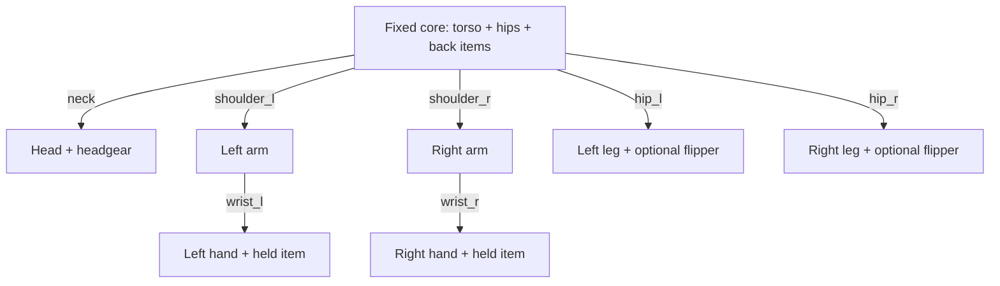

# Seven joints, separate limbs and rigid attachments

The [source builder](../../../scripts/build_minifigs.py) uses pyldraw3-expanded
LDCad connector frames to place separate parts, then creates seven `revolute`
bodies. No skin weights, deforming limbs, knees or elbows are introduced.
The torso and hips form the fixed core; each hand is a child of its arm.

Arrows are relative revolute motion. Items grouped inside a node move rigidly
with it; they do not receive duplicate motion. In a hand's source frame,
`world = shoulder_motion * wrist_motion * source_placement`. The plan stores
origins/axes in the source rest frame; the adapter composes the parent motion.
Setting a wrist without its arm parent makes the hand rotate about a stationary
axis when the shoulder moves.

## Exact example: chef

Identity map: [MF05_chef/source/parts.json](../../../output/minifigs/MF05_chef/source/parts.json).
Motion: [MF05_chef/plan.json](../../../output/minifigs/MF05_chef/plan.json).
These are occurrence IDs in `mf05_chef.ldr`, not universal minifig IDs.

| Body or fixed group | Occurrences and part references |
| --- | --- |
| Fixed core | `0` torso `973p2a`; `3` hips `3815b` |
| `head` | `1` head `3626cp7c`; `2` hat `3898` |
| `arm_l`, `arm_r` | `6` left arm `3819`; `9` right arm `3818` |
| `hand_l`, parent `arm_l` | `7` hand `3820`; `8` frying pan `4528` |
| `hand_r`, parent `arm_r` | `10` hand `3820`; `11` ladle `4337` |
| `leg_l`, `leg_r` | `4` left leg `3817c`; `5` right leg `3816c` |

LDraw frame: torso neck at the origin, **-Y up, face -Z, figure's left +X**.
Angles are radians. Rounded values below explain this case; use the plan's
full values and remeasure new parts.

| Control | Origin in LDU | Directed axis | Positive meaning |
| --- | --- | --- | --- |
| `neck` | (0, 0, 0) | (0, -1, 0) | Face turns left |
| `shoulder_l` | (15.552, 9, 0) | (-0.985431, 0.170074, 0) | Arm forward/up |
| `shoulder_r` | (-15.552, 9, 0) | (-0.985431, -0.170074, 0) | Arm forward/up |
| `wrist_l` | (23.690824, 26.758413, -9.8839) | (-0.120261, -0.696805, 0.707107) | Grip direction rolls outward |
| `wrist_r` | (-23.690824, 26.758413, -9.8839) | (-0.120261, 0.696805, -0.707107) | Grip direction rolls outward |
| `hip_l` | (2, 44, 0) | (-1, 0, 0) | Leg forward |
| `hip_r` | (-2, 44, 0) | (-1, 0, 0) | Leg forward |

The neck/wrist ranges are ±π, shoulders ±4π, and hips ±π/2. These are authored
catalog ranges, **not measured physical stops or clearance guarantees**.
Shoulders are tilted about 9.79 degrees; wrists are oblique too. Axis-aligned
guesses lose the actual hand path.

## From connector evidence to control meaning

`mate(parent, female, male)` aligns the connector axes and sets
`translation = female_position - R * male_position`, then composes the parent
placement. Matching an axis leaves roll undetermined; the builder chooses the
shortest rotation as this figure's rest-pose convention. Check orientation
against the geometry instead of treating axis coincidence as a complete pose.

`semantic_check()` moves a test point by +0.3 rad and verifies the intended
direction. It flips the raw connector axes for `shoulder_r`, `wrist_r` and
`hip_l`. Thus left and right controls share meanings despite mirrored geometry.
The raw joint evidence in `source/parts.json` and `connections` can have the
opposite axis sign to the authored **body**. Use body axes for motion.

[Tests](../../../tests/test_minifigs.py) check connector coincidence on all ten
figures and mirrored/nonzero/asymmetric motion. A comparison with the minifig
in [6682-1.mpd](../../../data/models-annotated/6682-1.mpd) confirms the basic
orientations but records a roughly 1 LDU arm/hand placement difference: the
shadow shoulder sockets use Y=9, while that source places arms at Y=8. Preserve
an existing target model's source pose; this construction choice is not a reason
to silently reposition an imported figure.

## Held items need more than a grip axis

`place_item()` uses the hand's clip and the item's bar feature, chooses grip
depth and working-end direction, then sets roll around the bar. A sword blade,
pan bowl or ladle can point the wrong way even when the grip is coaxial. Inspect
the complete mesh and record the choice in `ITEMS`.

For this chef, the pan has a 285-degree grip roll; `PAN_LEVEL` uses
`shoulder_l=0.45`, `wrist_l=-1.31` to hold it approximately level. The ladle's
working end is reversed to point its bowl down. These values belong to these
parts and placements, not to arbitrary utensils. Rigidly attach each item to
the hand body, headgear to the head, tanks to the core, and flippers to the legs.

The saved contact evidence confirms the seven joints for each figure. Some
headgear, shield, nozzle and flipper attachments are not mated by the connector
checker; their placement uses geometry/frame conventions. Missing contact
metadata does not prove detachment, and coincident connectors do not settle
all attachment or clearance questions. See [pose clearance](pose-clearance.md).
