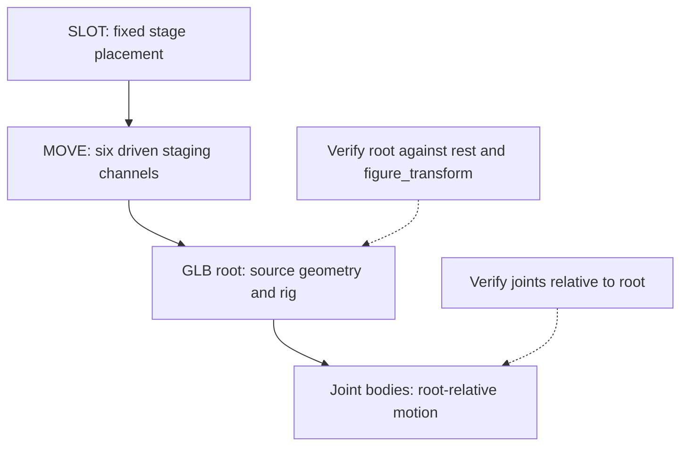
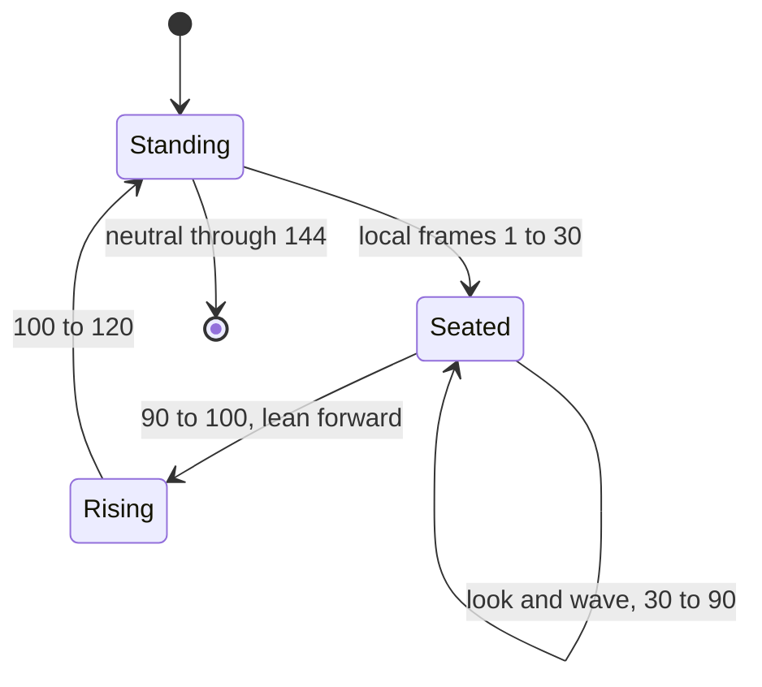

# Whole-figure movement without extra toy joints

Walking, bowing, sitting and swimming use a separate transform for the whole
figure plus the seven actual joints. The plan does not invent a waist hinge,
elbow or knee to imitate a person. Whole-figure movement is authored staging;
it does not simulate balance, forces or foot contact.



## Pivot, directions and composition

The pivot is the centre of the hip axes, **P=(0,44,0) LDU**. Bare feet rest at
Y=72, so the neutral pivot height is 28 LDU. The model frame has forward=-Z,
left=+X, up=-Y and back=+Z. Translation controls follow these **home-frame**
directions, even after yaw; they are not automatically character-local velocity.

| Property | Meaning | Unit |
| --- | --- | --- |
| `move_forward`, `move_left`, `move_up` | Offset along the home directions | LDU |
| `turn` | Yaw, positive left | rad |
| `pitch` | Positive lean forward | rad |
| `roll` | Positive lean left | rad |

For column vectors, the source-space transform is:

```text
d = (move_left, -move_up, -move_forward)
F = T(P) T(d) R(up, turn) R(left, pitch) R(back, roll) T(-P)
```

Thus roll acts first, then pitch, then yaw, then translation around the pivot.
`minifig_clips.figure_transform()` is the portable evaluator. For this scene's
upright GLB orientation, `MOVE` uses Blender `rotation_mode='YXZ'`, Euler values
`(pitch, roll, turn)`, and location
`(move_left, -move_forward, move_up) * 0.0004` metres. `figure_mover()` asserts
the expected imported axes before installing these drivers. Do not copy this
basis mapping onto an arbitrarily oriented root; transform/verify the axes.

Create the six custom properties and update the evaluated controller **before**
adding drivers. The builder records that drivers evaluated before those
properties existed could remain invalid. It refreshes the dependency graph and
checks every driver. Keep each figure's own root and controller when laying out
multiple copies.

## Gaits, jumps and the seated pose

`gait()` uses alternating hips and arm swings. For straight legs, a useful
height correction is `move_up = -28 * (1 - cos(hip_angle))`. It approximates the
reduced vertical reach during a symmetric leg split. It does not solve stance
contact; the supplied walk/run travel permits foot sliding.

`hop()` uses QUAD-out then QUAD-in interpolation to form
`height = 4 * H * u * (1-u)` over normalized flight time `u`. That gives an
exact authored parabola, not a calibrated gravity or landing simulation.

The diver's `sit_down_stand_up` clip uses both hips at `π/2 - 0.27`, whole-body
pitch `-0.27`, and a seated hip height
`8.75*cos(0.27) + 10*sin(0.27) ≈ 11.10 LDU`. The backward lean keeps the legs
approximately horizontal while avoiding the resting hands sinking into the
thighs in a fully upright 90-degree sit. Flippers and tanks affect apparent
ground height; these values are specific approximations. See the
[seated preview](../../../examples/reference/minifigs/previews/figures/MF10_diver-B2-f239.png).



This state diagram describes the clip's phases; it is not a contact-triggered
controller. The keys remain the authority for interpolation and timing.

## Two checks are necessary

Root-relative rig verification is deliberately unaffected by staging. Therefore
it cannot catch a figure flying to the wrong place or rotating around the wrong
pivot. The animation/reopen checks separately compare the evaluated root with
`rest * (C * F * C_INV)`, alongside controller values and joint transforms.
Use nonzero combined translation, yaw, pitch and roll in tests; checking only
the rest pose cannot expose order/sign errors. Floor, neighbours and imaginary
props require separate world-space clearance/contact review.
