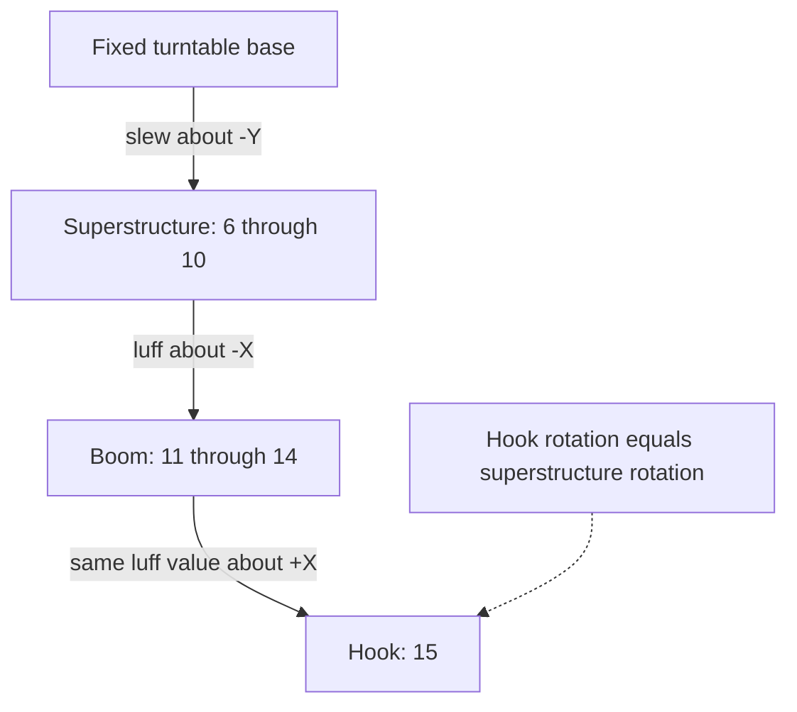
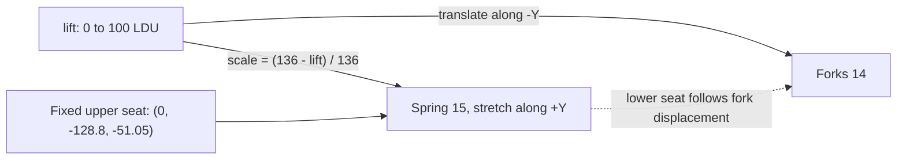

# Dependent motion: plumb hook and forklift spring

Part of the [movables reference](README.md); [evidence and limits](scope-and-evidence.md).
These small examples show how one control propagates to other bodies without
keying them independently. They also illustrate why **directed axes** belong
with every angular equation.

## Crane: cancel tilt while retaining slew

The [S16 plan](../../../examples/reference/movables/S16_crane/plan.json) owns
the rotating upper structure, tilting boom and hook as three successive bodies.

| Body | Origin in LDU | Axis | Signal / ownership |
| --- | --- | --- | --- |
| `superstructure` | (0, -69, 0) | (0, -1, 0) | `slew`, range ±π; top `3404`, cab and hinge base |
| `boom` | (0, -86, -10) | (-1, 0, 0) | `luff`, 0..1.1; hinge top `6134`, riser, boom and tip |
| `hook` | (10, -94, -200) | (1, 0, 0) | `hook_angle = luff`; hook `3136` |

The saved hook expression is **`a`**, with `a=control:luff`. Its +X axis opposes
the boom's -X axis, so `R(-X,luff) * R(+X,luff) = I`. The source builder starts
with `-a`, then its semantic/dependent check corrects it. The original report's
“hook = -luff” shorthand describes counter-rotation but is not the saved numeric
relation. Use the plan and the axes together.

`dependent_checks()` compares the hook rotation matrix with the upper
structure's at `(luff,slew)=(0.6,0),(1,0.7),(0.3,-1.2)`. The hook remains plumb
for this vertical slew axis and fixed-upright base. This prescribed cancellation
does not model hook inertia, free swinging, a rope or an arbitrarily tilted base.
The mock hook is carried by a hole in a `3700` brick; the original hook is meant
to hang from string. See the [motion sheet](../../../examples/reference/movables/previews/S16_crane.png).

## Forklift: slide and axial spring compression

The [S13 plan](../../../examples/reference/movables/S13_forklift/plan.json)
splits shortcut `3430c00-f2` into rails `3430`, forks `3431` and extended spring
`u9529-f2`. Forks are occurrence `14`; spring is `15`.

The free seat separation is 136 LDU; the raised shortcut has 36 LDU. The spring
scales only along its axis about its fixed top seat. The moving bottom-seat
point is checked against the same point translated with the forks at lifts
25, 60 and 100 LDU (residual below 1e-6 LDU). Neither the rails nor forks inherit
that scale. This is the same restricted `stretch` technique as the
[suspension shocks](../42110-suspension-standalone/shocks.md).

Scaling compresses end caps as well as coils. The original sampled mesh check
finds up to 1.6 LDU vertex penetration against the forks/rails. This is a useful
kinematic demonstration with a declared geometric approximation, not a spring
force model or a clearance-certified assembly.
