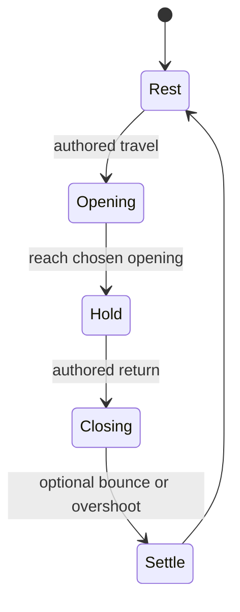

# Motion styles, clip transfer and scene evaluation

Part of the [movables reference](README.md); [evidence and limits](scope-and-evidence.md).
The clip system extends the [minifig pattern](../minifigs/animation-clips.md)
with per-scenario channels and nineteen tagged movement styles. Separate the
joint definition from the gesture: the same measured hinge can ease open,
hesitate, slam or flutter while keeping the same body and pivot.

The [catalog](../../../examples/reference/movables/CATALOG.md) indexes styles
and exact clips. Reuse `movable_clips.Clip`, `cycle`, `damped`, `wave` and `steps`
instead of reconstructing timing from previews. `value_at` evaluates the same
per-segment easing that the Blender builder writes into F-curves.

| Technique | What is authored | What is not established |
| --- | --- | --- |
| `BOUNCE_OUT` | A stop-and-rebound curve | Collision impulses or material restitution |
| `BACK_OUT` | Overshoot, with Blender back factor 1.70158 | Available physical travel beyond the target |
| `damped_swing`, `flutter` | Chosen amplitudes, timing and settling | Forces or a shared wind field |
| Paired/staggered doors | Separate keys for left/right channels | A mechanical coupling between leaves |
| Spin-up/down | Continuous shaft angle with changing keyed speed | Motor torque or inertia |

`BACK_OUT` overshoots its nominal end value by roughly ten percent; leave room
inside the control's actual range and check the evaluated path. The library's
tests sample intermediate values, not just keys. Whole-turn end values preserve
rotor pose, but winding and velocity still matter when repeating or blending.



This is a gesture template, not a contact-driven state machine. Measured travel
and the actual clip keys decide which phases apply.

## Playback and reuse

`animate_movables.build_action()` creates one `movable_controller` Action slot
and keys **all** controls in that scenario, with explicit easing and the `back`
factor. Actions have fake users, frame ranges and style metadata. NLA uses
`REPLACE`, `HOLD` for the first clip and `HOLD_FORWARD` for later clips. No
active Action competes with the tracks.

Transfer requires matching channel names, units, positive meanings, neutral
pose and ranges. The fresh reopen check transfers `S10_car_doors.both_doors`
to S06's cabinet controller; both use `door_l`/`door_r`. It compares controller
samples and rig transforms, not clearance between the new door leaves. Test
the target geometry and note clamping if its limits are narrower.

## Background rendering of multiple scenes

Twenty scenario scenes link the same object collections as `Catalog`, with
their own cameras and frame evaluation. A background renderer must evaluate
the intended scene, rather than inherit the catalog's last pose:

```python
with bpy.context.temp_override(scene=scene, view_layer=scene.view_layers[0]):
    scene.frame_set(frame)
    bpy.context.view_layer.update()
    bpy.ops.render.render(write_still=True, scene=scene.name)
```

The builder/reopen check compares each scenario scene with the catalog at three
frames while the catalog is parked at rest. This exposed stale evaluation that
could otherwise make a correct rig appear frozen in batch previews. It does
not arise from mechanical parenting, and changing the plan would not fix it.
