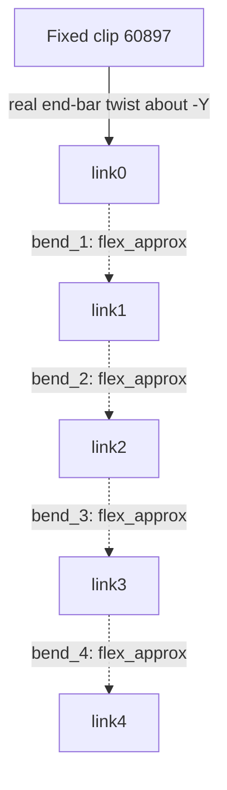

# Flexible vines: split geometry and respect the supports

Part of the [plants/wind reference](README.md); [evidence](scope-and-evidence.md).
P09 and P16 use related vine geometry but have different support conditions.
They must not receive the same free-swing rig merely because both are vines.

## One-end support: twist plus a bending approximation

`16981` contains official end bars/leaves and a scaled cylinder `16981k04` for
the stem. `vine_parts()` in [the builder](../../../scripts/build_plants.py)
divides that existing stem into five lengths, preserving its subfile placement
and distributing the leaf subparts to their links. The split boundaries in the
vine's local -X direction are 39, 90, 141, 192, 243 and 281 LDU.

The [P09 plan](../../../examples/reference/plants/P09_hanging_vine/plan.json)
and [identity map](../../../examples/reference/plants/P09_hanging_vine/source/parts.json)
record the exact membership. Stem occurrences `19`–`23` belong successively
to `link0`–`link4`; every leaf/end piece follows its own link.

The top grip at (20,-332,-30) allows axial twist, range ±0.8 rad. Four artificial
bends below it, each ±0.17, approximate a flexible stem. In this hanging pose
their authored axes are -Z, so positive bend carries the lower stem downwind
(+X). Wind recipes add progressively delayed responses; they do not solve
elastic tension or smooth curvature. See the
[vine sheet](../../../examples/reference/plants/previews/P09_hanging_vine.png).

Scaled source subparts remain valid geometry and bind into the GLB. Connector
analysis reporting unsupported scale is a limitation of that contact evidence,
not proof that conversion or rigid-body animation is invalid. Verify identities,
rest transforms and moved endpoints separately. This example does not misuse
`stretch` to shorten rods or to deform the vine; each animated link stays rigid.
Piecewise bends can graze at the seams (about 0.67 LDU reported vertex depth).

## Two-end support: keep both grips on the same axis

P16 retains whole thorny `73828` and leafy `16981` vines between paired `61252`
clips. The measured grip spans are **180** and **300 LDU**. Occurrences `25`
and `26` each rotate about the line through their two grips, with ±0.6 rad
travel. This preserves both endpoints; no chain of bending joints is added.

The saved axes are -Z, with origins (-30,-102,90) and (30,-150,150). The
[plan](../../../examples/reference/plants/P16_liana/plan.json) owns one body per
vine. Rotation about another pivot would detach an end. If a future case needs
sag or more general bending while both ends stay fixed, it needs an additional
closure/deformation solution; P16 supplies only axial rocking.
