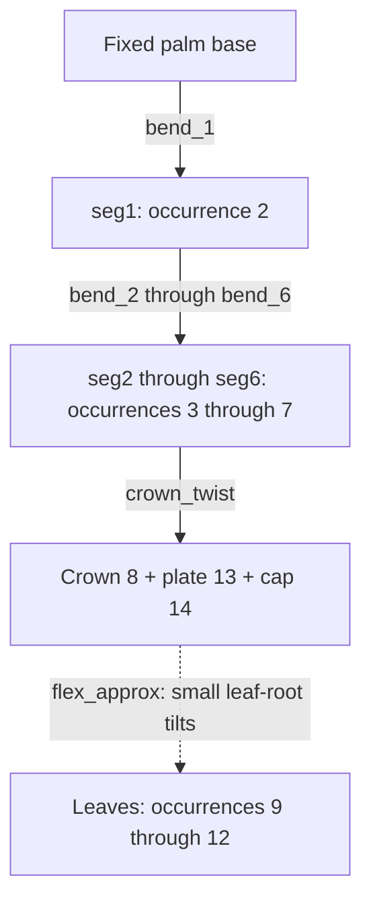

# Plant joints: what rotates, what only approximates bending

Part of the [plants/wind reference](README.md); [evidence](scope-and-evidence.md).
Use [the part taxonomy](../../part-information.md) to find candidate leaves,
stems and mounts, then establish each connection from geometry and source
assemblies. A plant part's name or material-like appearance does not establish
a free bend at its base.

| Connection in this catalog | Example | Implemented motion and qualification |
| --- | --- | --- |
| Ball/socket chain | P01 `2536a` segments; P03/P10 stalks | One selected tilt per ball, composed through parents; other ball freedoms unused |
| Clip around transverse bar | P02/P13 fronds; P11 branch carriers | Rotation about the bar; orientation decides flap versus lateral swing |
| Bar, pin or round hole along stem | P08 reed tops, P15 tiers, P20 crowns | Axial twist, subject to fit/friction assumptions |
| Stud or rigid two-prong mounting | P07 grass, P01 leaves | Small `flex_approx` root rotation stands in for plastic bending |
| Two coaxial fixed-end grips | P16 vines | Rock about the common grip line; both endpoints retained |

“real” in this catalog means an adopted connection freedom, not measured
frictionless motion or a verified torque threshold. Of 112 joint pairs, the
saved mating evidence confirms contact for 73; remaining placements use frames,
geometry or existing-source comparisons. Keep those qualifications.

## Palm: a six-link trunk carries the crown

The [P01 source map](../../../examples/reference/plants/P01_palm_tree/source/parts.json)
comes from splitting shortcut `2518c01` into its official subparts. Each `2536a`
ball at local Y=+3 meets the preceding socket at Y=-32: **35 LDU pitch**. The
older `2536` uses 32 LDU, so mould IDs matter. Original curved placements remain
the rest pose; the plan adds rotations to them.

The [plan](../../../examples/reference/plants/P01_palm_tree/plan.json) uses +Z
for each trunk bend, ranges ±0.2 rad; crown twist is ±0.6. Leaf-root tilts are
±0.17 rad and explicitly approximate bending: the leaf is held on two prongs,
not a free hinge. Parenthood makes each tip inherit the lower links' motion.
The delayed oscillator inputs are independent prescribed angles, not forces
transmitted through a coupled dynamic chain. See the
[palm sheet](../../../examples/reference/plants/previews/P01_palm_tree.png).

## A grip axis can mean flap or twist

Swordleaf fans `10884`/`30239` grip a bar normal to their fan. A horizontal bar
lets them flap in a vertical plane; a vertical bar produces horizontal swing.
A bar coaxial with the part gives **twist**, not pendulum swing: this matters
for curl `1997` and vine end bars. Inspect the actual attachment before choosing
a wind-response axis.

For P02, the saved `10884` fronds are occurrences `13`–`16`. Their axes are -Z,
+Z, +X, -X around the four sides of the trunk, and each range is -0.38..0.45 rad.
The mirrored clip primitive in this part puts the useful grip at local
**(0,4,30)** along Y; the shadow-derived point is 3 LDU off in this snapshot.
The builder checks the primitive-based grip against five fronds in model 10297
(about 0.014 LDU from the handle lines). Treat this as a documented measured
correction for that part, not a blanket offset for all clip metadata.

## Artificial bends need explicit labels

`PlantBuild.hinge(..., flex=reason)` records an approximation in connection
evidence; the case roster labels the control `joint="flex_approx"`. The label
is carried into notes, tooltips, Action metadata and the catalog. The plan body
is still an ordinary revolute body; `flex_approx` is not a new motion-contract
kind or permission to deform every part.

The flex ranges are at most 0.17 rad. A rigid part tilted about its stud centre
can dip an edge into its seat by roughly radius × angle. The saved crossings
show that limitation. For a new target, either retain and disclose this visual
approximation or use a physically appropriate supported mechanism. Do not infer
that all stud-mounted bushes or single-piece trees have movable joints.
