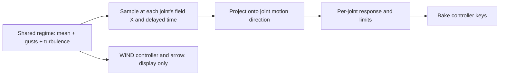

# A shared wind field for an entire scene

Part of the [plants/wind reference](README.md); [evidence](scope-and-evidence.md).
The field in [wind_clips.py](../../../scripts/wind_clips.py) can supply forcing
to any measured joint, not just vegetation. Its useful property is coherence:
objects feel the same gust at different positions/times, then respond according
to their own geometry and response settings.



## Coordinates and time

The field has dimensionless components `U` toward LDraw +X and `V` toward +Z;
-Y is up. `wind(regime, t, x)` takes clip time in **frames**, with `t=0` at
clip frame 1, and position `x` in LDU. The regime argument is `"A"`, `"B"` or
`"C"`, not the title string. With gust speed `c=48 LDU/frame`:

```text
tau = t - (x - X0) / c
U = envelope(tau) * (mean + Gaussian gusts(tau) + turbulence(tau))
V = envelope(tau) * cross_turbulence(tau)
```

`X0=-1280` in this catalog. The five grid columns span -1040..+1040 LDU, so
the rightmost column receives the same gust about **43.33 frames** after the
leftmost. Sampling different rows at the same X gives the same field; there is
no obstacle flow, wake, spatial Z variation or aerodynamic shadowing.

| Regime | Forcing | Clip handling |
| --- | --- | --- |
| A: breeze | Mean 0.42; periodic 96-frame swell/turbulence | Fade in 1..25, repeated response 25..217, fade out 217..240 |
| B: gusty | Mean 0.45; three Gaussian gusts, cross turbulence | Ramp from calm, integrate response, fade toward rest 220..240 |
| C: storm | Mean 0.8; four stronger gusts and cross turbulence | Same finite-clip strategy with stronger forcing |

These are artistic amplitudes, not wind speeds in m/s. The propagation speed
controls visible gust timing; it is not a measured weather parameter. A
`threshold` on a joint is an authored shelter/friction-like response setting,
not a computed wake from the wall beside it.

## Spatial coherence survives only if clips are regenerated

The response samples at `slot_x + recipe["x"]`, where the latter is the joint's
position inside the case. Moving a root after baking does not change its clip.
Use `respond(spec, regime, new_slot_x)` to regenerate timing at a new location.
Rotating the assembly also changes its joint swing directions and possibly vane
headings: remeasure those in the field frame. Editing `WIND_DIR` alone does not
rotate the hard-coded +X/+Z field math.

The `WIND` controller and its three Actions display a separately sampled series
at the field centre. The arrow length is driven by `speed`. Plants themselves
read their own baked controller keys, so changing that display cannot alter
their movement. A live wind control would require a different evaluation/rebake
workflow; the preserved example demonstrates deterministic offline generation.

Portable diagnostic, from the repository root:

```python
import sys
sys.path.insert(0, "scripts")
import wind_clips as wc

# The same gust reaches a point 120 LDU downwind 2.5 frames later.
u, v = wc.wind("B", 90, 120)
u0, v0 = wc.wind("B", 87.5, 0)
assert abs(u-u0) < 1e-12 and abs(v-v0) < 1e-12
```

Use the field with the [response recipes](wind-responses.md); random independent
keys per object would discard the shared timing that this example establishes.
